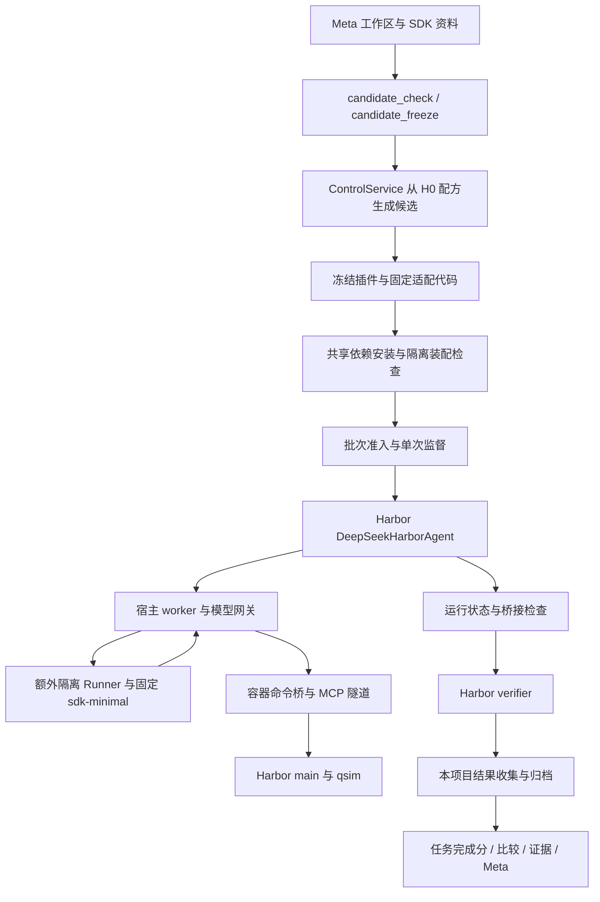
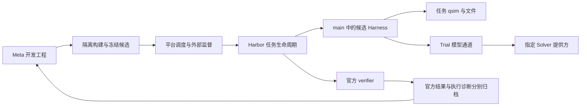

# 执行 Harness 与评测平台职责重构

日期：2026-10-24。状态：完整重构设计，尚未实施。实施步骤与验收见[执行计划](../plans/execution-harness-refactor.md)。

## 1. 目标与设计决定

Meta 应能开发、修改和组合执行 Harness，使指定 Solver 在 Quantum Harbor 上表现更好。平台负责构建运行、外部监督、评测接入和结果保存；候选拥有提示词、上下文、工具、执行流程、模型请求恢复以及其他执行策略。新增一种策略不应要求平台增加错误码白名单、特殊开关或专属业务接口。

本设计修改的是执行职责边界，不改变固定 Solver、官方任务与评分权威、用户资源上限、历史原件和独立导出的要求。以 DeepSeek Harness 插件组合作为默认开发形式，允许候选选择准确的框架版本、profile、启动配置和入口；平台不再把 `sdk-minimal` 的内部服务树当作唯一合法 Harness。

明确采用以下决定：

1. **候选提交完整的执行组合。** 插件、配置、入口、依赖锁、框架/profile 和构建说明共同形成候选，H0 只是可复制修改的起点。
2. **默认在 Harbor 的任务 main 环境内运行候选进程。** 文件、终端、子进程和工具共享真实任务工作区。删除新链路中的双容器执行绕行；隔离由任务环境及外部监督承担。
3. **模型通道只执行外部约束。** 真实凭据、指定模型和明确固定的调用设置由外部模型代理执行；工具参数检查、响应截断、重试、错误反馈及压缩交给候选。
4. **复用 Harbor 的生命周期和官方 verifier。** 不增加“必须正常结束一个 DSH turn”“必须调用一次工具”等评分前提。Agent 的异常退出与官方评分可以同时存在。
5. **版本化差异，而非禁止差异。** 候选依赖/profile/恢复策略变化是研究对象；任务、Solver、外部资源及监督实现变化是实验条件。两者分别记录和比较。
6. **新旧运行链分开。** 历史 v1/v2 冻结组合继续用原实现；新契约下重新准备 H0。当前恢复组合可作为默认插件迁入候选，不能继续作为所有候选不可替换的基础设施。

本方案取代旧文档中将固定工具集合、固定 profile、固定候选依赖和固定流恢复策略视为长期平台边界的设计。旧条款仍解释旧活动；实施完成前，不能把本设计的能力写成已经可用。

## 2. 审计范围与证据口径

审计覆盖 Meta 工具入口、候选冻结与构建、调度准入、单次监督、Harbor Agent、隔离 Runner、模型/工具传输、评分收集、反馈、比较和导出。初始源码基线为本仓库 `77f00f2`；审计期间恢复组合增量提交为 `e5e1971`，已纳入职责分析，其实现不作为本重构已完成的证据。

另只读检查了运行主机安装的 Harbor **0.18.0**，以及 Quantum-Harbor 检出 `1f03d78e959cf02469568250f61f9af88a53146f`。以下 Harbor 行为以实际安装源码为依据，不假定所有版本相同。实施时必须锁定依赖与文件完整性，并重跑对应契约测试。

### 2.1 当前链路

| 阶段 | 当前实现与实际行为 | 对研究的影响 |
|---|---|---|
| 开发入口 | [Meta API](../../src/control/meta_api.py) 的 `candidate_check/freeze` 接收插件路径和配置；[工具契约](../../packages/meta-harness/contracts.json)不接收完整启动工程 | Meta 不能以同一候选入口改变执行框架配置和依赖闭包 |
| 候选生成 | [ControlService.build_candidate](../../src/control/service.py)每次读取 `recipes/h0-sol.json`；校验候选与 H0 的 `infrastructure_identity` | 执行配方隐含由平台选择，候选只能追加插件 |
| 冻结 | [freeze.py](../../src/execution/bundle/freeze.py)、[组合 schema](../../schemas/execution/composition.schema.json)固定框架包、Agent 入口和适配资产；工具名、包依赖及文件大小有额外限制 | 框架/profile/依赖被混入固定基础设施；合法策略可能在测试前即被拒绝 |
| 构建与检查 | [execution_cache.py](../../src/control/execution_cache.py)安装平台锁；[check.mjs](../../src/execution/bundle/check.mjs)使用无任务工具的假 provider，并要求恰好一次模型调用 | 无法可靠检查真实工具协作；多调用策略可能仅因形态不同被拒绝 |
| 准入与调度 | [resource_planning.py](../../src/control/resource_planning.py)、[store.py](../../src/control/store.py)维护活动限额、批次和幂等；[task_time.py](../../src/execution/host/task_time.py)读取 benchmark 阶段时限 | 这是外部监督应保留的部分；不得让启动开销悄悄扣减 Solver 时限 |
| 单次启动 | [single_run.py](../../src/execution/host/single_run.py)生成 Harbor 配置，禁用自动整 Trial 重跑，绑定任务镜像、期限和固定 Agent | 单次监督合理；将 Agent 内部实现一并固定并非必要 |
| 环境与接入 | [agent.py](../../src/execution/adapters/quantum_harbor/agent.py)操作 main/qsim 网络、发现 MCP、启动命令桥、宿主 Node worker | 接入层同时承担过多执行语义，产生多个异常传播层 |
| Solver 执行 | [isolation.mjs](../../src/execution/host/isolation.mjs)、[isolated.mjs](../../src/execution/runner/isolated.mjs)、[boot.mjs](../../src/execution/runner/boot.mjs)额外创建无网络 Runner，禁用原生文件与终端工具，强制启动固定 profile | 本地工作区与任务工作区分离；Meta 必须绕行固定 bash 才能补能力 |
| 模型访问 | [model_gateway.mjs](../../src/execution/host/model_gateway.mjs)、[stream_guard.mjs](../../src/execution/host/stream_guard.mjs)处理凭据/固定模型，也决定输出内容保护、终止与恢复资格 | 外部模型约束与候选执行策略耦合；异常生成被放大为不可恢复任务失败 |
| 调用授权 | [model_access.mjs](../../src/execution/host/model_access.mjs)每次请求前访问控制服务；[model_access.py](../../src/control/model_access.py)读取活动/租约，另检查存储状态 | 控制服务不可用会阻塞求解请求，直到恢复或耗尽任务期限；运行数据通道与管理数据库耦合 |
| 工具执行 | [worker.mjs](../../src/execution/adapters/quantum_harbor/worker.mjs)逐请求核对固定工具集合；[profile.mjs](../../src/execution/adapters/quantum_harbor/profile.mjs)要求全部任务工具存在；[container_tool.mjs](../../src/execution/adapters/quantum_harbor/container_tool.mjs)固定 bash、输出裁剪和 MCP 不重连 | 按步骤选择工具、替换终端、工具延迟加载及连接管理受到平台限制 |
| 评分入口 | Agent 对 worker 非零退出抛普通 `RuntimeError`；[bridge.py](../../src/execution/adapters/quantum_harbor/bridge.py)对部分桥接/审计故障抛异常 | 这些异常可以跳过 Harbor 的评分路径 |
| 结果读取 | [results.collect](../../src/execution/adapters/quantum_harbor/results.py)先要求无 Harbor errored trial、无 exception、runtime completed 且 toolCalls≥1 | 即使官方文件存在，也可能被平台内部状态挡在读取之前 |
| 反馈与统计 | [result_collection.py](../../src/control/result_collection.py)针对已知缺陷补读；[outcomes.py](../../src/evidence/outcomes.py)派生完成分；[library.py](../../src/evidence/library.py)提供证据 | 已有官方优先和完整证据增量应保留；不能继续按每种收集缺陷增加特例 |
| 导出 | [project.py](../../src/exporting/project.py)导出同一组合和所需固定适配 | 精确导出原则保留；候选不应依赖整套 Campaign 或平台执行策略 |

### 2.2 Harbor 原生评分行为

已检查的 `harbor/trial/single_step.py` 中，`SingleStepTrial._run_agent()` 捕获 `AgentTimeoutError` 和 `NonZeroAgentExitCodeError`、记录异常后返回；`_run()` 随后收集产物并运行 verifier。普通未捕获异常会进入 `Trial.run()` 的异常分支，只恢复输出和清理，不再执行该正常评分路径。

因此，“Agent 异常就不能评分”并非这版 Harbor 的统一规定。本项目将候选非零退出包装成普通 `RuntimeError`，以及收集器拒绝所有 `exception_info`，都与这项原生能力不匹配。多步任务有自己的异常与评分规则，不得把单步结论直接套用到全部任务。

核对依据：Harbor 安装包中的 `trial/single_step.py` SHA-256 为 `15deae31efe1287e3db4a4f57d7732eeffd28a8c4fd385e86193e81a3c944218`。这用于定位所审计实现；新适配必须以锁定版本自动测试验证，不能长期依赖私有方法补丁。

### 2.3 已解决、历史兼容与待改变内容

- 新活动已经使用 benchmark 阶段时限，不能把历史单命令 300 秒或固定收尾预留误称为所有当前活动的行为。
- 新活动已移除 token 账本和总 token 限额；重构不恢复它们。
- 新 Meta 组合已提供完整证据文件；旧字段白名单仅在旧路径保留，重构不重新过滤新字段。
- 传输恢复、结果补读及桥接阶段诊断已有修复；它们降低部分故障，但没有改变执行权仍在平台的结构。
- 新恢复组合提供有用的默认实现，但其固定策略、宿主内容判定及默认装配归属仍需迁移。

## 3. 限制保留与移除清单

“移至候选”表示 Meta 可以在新候选中替换、调整或删除，并记录版本；“移除”表示不得继续作为平台拒绝测试的条件。外部监督要求必须标明来源：用户实验约定、benchmark 规则或实际运行环境容量。不能用实现方便替代这些依据。

| 编号 | 当前限制或规则 | 决定 | 新边界与理由 |
|---|---|---|---|
| R01 | Solver/provider/路由与约定调用设置固定 | 保留并收窄 | 固定用户实际约定字段；候选的上下文、tools、tool choice、输出格式和调度不因此固定。平台默认 `maxTokens` 不得伪装成用户约定，迁移时显式记录其来源 |
| R02 | 真实凭据不进入候选，禁止模型路由逃逸 | 保留 | 提供按 Trial 绑定、可撤销的模型通道；不授予其他账号、模型或宿主访问 |
| R03 | 任务、qsim、verifier、隐藏输入和官方结果不可改写 | 保留 | 候选可修改自己的文件、程序和提交；不可修改评分服务和受限数据，也不能伪造官方来源 |
| R04 | 总时长、并发、实验次数和 benchmark 时限 | 保留 | 来源可见、统一外部执行；内部重试不得延长时限。无默认 token 总预算 |
| R05 | CPU、内存、进程数、磁盘容量 | 保留外部资源约束，移除隐藏常量 | 用明确的运行资源配置代替固定 Runner 1 GiB/2 CPU/128 PID/256 MiB 临时区；所有同组实验使用一致且已记录的容量 |
| R06 | 候选只能增加插件，不能提交启动配置 | 移除 | 冻结完整候选工程，入口、profile、插件和有效配置均属于候选 |
| R07 | 框架只能是固定 `dsh-sdk-minimal` 与内部服务树 | 移除 | DeepSeek 为默认模板；准确框架版本及 profile 可由候选声明。兼容性按运行契约验证 |
| R08 | 所有候选的框架、依赖、profile、恢复实现必须与 H0 相同 | 移除 | 这些进入候选身份；外部模型、任务、资源和监督版本才属于比较条件 |
| R09 | 包依赖必须预装在平台锁中，统一禁止安装脚本 | 移除 | 隔离构建允许锁定的依赖和构建脚本，无提供方凭据、任务私有材料和宿主写权限；不逐包特批 |
| R10 | 插件源文件必须小于 2 MB、排斥所有符号链接 | 收窄 | 以构建/存储总容量管理资源；允许可打包的内部链接，拒绝逃出工程的路径。包缓存不直接作为源码快照 |
| R11 | 插件能力必须落在五项枚举中 | 移除作为权限门槛 | 能力说明用于阅读，不替代真正的文件、网络、模型和进程隔离 |
| R12 | `bash`、`mcp__` 等工具不可替换，名字必须静态列全 | 移除 | 候选显式拥有工具注册与替换；名称冲突由框架配置解决。底层权限不由工具名授予 |
| R13 | 每个模型请求都必须携带全部固定工具 | 移除 | 允许动态子集、延迟发现、聚合工具、无工具调用和内部辅助会话；记录实际请求即可 |
| R14 | 禁用原生文件/终端；执行命令必须绕经平台 bash | 移除 | 候选进程在任务 main 中运行，原生文件、终端、PTY、子进程及同 Solver 子会话可用 |
| R15 | 单一 SDK session、单个 prompt/turn 完成作为合法运行形态 | 移除 | 平台观察进程生命周期；候选管理会话、轮次、并行推理与停止策略，模型仍固定 |
| R16 | 工具必须每次新 shell、固定输出展示和默认截断 | 移至候选 | 持久 shell、异步 jobs、文件卸载、摘要及错误渲染可自行设计；平台保留原始输出或明确不完整原因 |
| R17 | MCP 强制 `reconnect.enabled=false`，固定客户端封装 | 移至候选 | 连接复用、重连和参数文件接口属于 Harness；任务端点和 qsim 权限保持 benchmark 约束 |
| R18 | 128 KiB 工具参数、256 KiB 响应、空白和 JSON 保护 | 移至候选 | 默认保护可继续作为插件；外部代理采用流式转发、背压和实际内存/磁盘限制，不按内容判定任务死亡 |
| R19 | 固定错误码允许重试，网关永久 `terminalFailure` 锁定 | 移除内容语义锁定 | 请求错误只结束该请求；候选决定下一步。外部停止仅来自撤销、期限、权限或实际资源终止 |
| R20 | 恢复次数、等待、链归并、工具错误反馈固定 | 移至候选 | 默认恢复组合可复用、替换或不装配；平台不维护“允许策略清单” |
| R21 | 压缩、重试与普通模型请求分别获得特批路径 | 移除 | 所有合法请求共用模型通道、身份和取消契约，不识别候选的算法用途来授予能力 |
| R22 | 固定 16 个桥接请求、整行 32 MB 后杀进程 | 移除隐含执行策略 | 外部 I/O 用流式通道、背压和明确容量；确需连接容量时可见地拒绝/排队，不因工具数量不同直接杀 Harness |
| R23 | Runner 与 main 全面断网，靠自建多层隧道转发 | 重构 | 复用任务网络规则，加 Trial 专属模型通道；构建网络与执行网络分离。删除仅为双容器结构存在的绕行，保持宿主/评分器隔离 |
| R24 | 静态检查要求恰好一次模型调用、必须加载全部工具 | 移除 | 平台检查可启动、契约和取消；策略测试由候选提供。无凭据假服务支持多调用与故障场景，不证明科学有效 |
| R25 | 源码出现任务 ID 字符串即拒绝冻结 | 移除硬拒绝 | 保留泛化目标和禁止藏入答案/隐藏数据；字符串扫描降为提示，不能把合法任务解析误判为违规，更不能把扫描通过当泛化证明 |
| R26 | 插件依赖按列表先后决定合法性 | 收窄 | 声明依赖并解析确定的装配图；实际有语义的顺序进入候选身份，普通服务依赖用框架机制 |
| R27 | 平台附加提示词和环境描述不可修改 | 移至候选 | 任务原文原样提供并归档；环境信息通过运行上下文提供，如何呈现给 Solver 由候选决定 |
| R28 | worker/turn 非正常完成一律抛普通错误，跳过评分 | 移除 | 真实候选非零退出使用 Harbor 对应 Agent 退出语义；真正环境故障单列，不伪装为成功 |
| R29 | 桥接或审计历史错误可一票否决 verifier | 移除一般门槛 | 停止候选进程和后台写入后按 Harbor 生命周期评分；只有环境/官方输入不可用等实际原因阻止评分 |
| R30 | collect 要求无 exception、completed turn、至少一次工具调用 | 移除 | 独立读取并核验官方结果；这些状态作为诊断并存，不作为读分前提 |
| R31 | 整个归档校验失败就不能展示已有官方结果 | 收窄 | 分别核验官方产物来源、候选身份与诊断附件；不完整附件不能抹掉已核验的分数，官方文件受损则不得声称可信得分 |
| R32 | 自动重跑整个 Trial 作为请求恢复 | 继续不启用隐式重跑 | 候选内部恢复可自主；新环境重跑是新的可见尝试，消耗实验名额且保留原结果 |
| R33 | 不可变快照、依赖锁、真实加载回执、幂等提交 | 保留 | 保证测试的就是所提交版本；不要求不同候选的内容相同 |
| R34 | 原始证据、失败历史、官方 null 与 0 分离 | 保留 | 完整结果可读、摘要可分页；不删除失败或将平台故障伪装成科学零分 |
| R35 | 导出必须复现已测代码与有效配置 | 保留 | 同一候选产物、锁和最小接入组件；无 Campaign/Meta/工作台依赖 |
| R36 | Rootless 单 UID 环境只验证过五项任务 | 保留实际兼容性边界，改变维护方式 | 不声称立即支持未验证任务；以任务环境所需 UID/服务/收集能力描述兼容性，逐步替代写死任务名的特批名单 |
| R37 | 每个模型请求同步依赖控制服务/数据库准入 | 重构为外部运行租约 | 调度时授予可撤销运行身份，模型通道本地核验；数据库忙不自动阻断每次模型调用，任务截止与撤销仍在独立监督端执行 |

## 4. 目标架构

### 4.1 平台拥有的内容

平台只拥有任务创建与销毁、运行身份和撤销、外部资源限制、凭据与固定模型约束、Harbor 生命周期接入、官方证据来源核验及持久记录。监督不得依赖候选自报“已停止”或自报得分；限制应在候选进程之外执行。

平台不能依据插件名称、工具清单、模型调用次数、JSON 是否符合某个工具 schema、是否发生过重试或 Agent 文本是否像成功来决定科学成绩。平台源码更新不应成为 Meta 新增执行策略的前置条件。

### 4.2 候选拥有的内容

候选拥有框架/profile、启动入口、提示词与任务呈现、会话结构、上下文压缩、模型工具 schema 和动态选择、参数校验与错误反馈、重试/恢复/退避、工具与结果处理、文件/终端/jobs、同 Solver 的子会话及并发、内部终止条件。

Meta 可以替换默认恢复插件，可以使用不同的输出保护阈值，可以让某一步只看到部分工具，也可以增加内部模型调用。所有调用仍通过同一指定 Solver 通道，所有进程仍受同一任务资源和截止约束。这些变化作为候选差异显示，无需逐项申请能力。

### 4.3 任务环境中的运行方式

默认由受信 Harbor Agent 在 `setup` 阶段把已构建候选部署到 main 的独立目录；`run` 阶段启动候选进程。依赖使用候选专用目录或虚拟环境，不覆盖 qsim、verifier 和任务的系统依赖。复用 `environment.exec`、文件上传下载和 Harbor 原生进程/环境生命周期，平台不重新实现一套终端工具。

main 原镜像、任务文件和 qsim/verifier 身份保持记录；候选的部署内容和依赖是单独的研究变量。初始 Node/Python 可执行文件、架构和 ABI 由构建产物声明并核验，不能假定每个任务镜像预装了 Node。安装和启动准备占用相应准备阶段，Solver 计时从 Harbor Agent 运行阶段起算。

候选的子进程和后台作业归属本 Trial。结束、取消或到期时，由外部监督撤销模型通道并停止该 Trial 的执行进程；separate verifier 模式按照 Harbor 的 main 停止与 sidecar 证据收集顺序执行。不得让后台求解继续写入评分输入，也不得误杀其他 Trial 或 qsim/verifier。

额外 sidecar 运行模式不作为新链路的默认必需层。若某种任务环境确实不能承载候选运行时，应以通用进程/工作区契约实现可验证的部署模式并记录差异，不能恢复为固定 bash 工具加算法特批接口。

### 4.4 模型通道

以 Trial 专属、可撤销的地址与短期凭据提供原提供方协议访问。真实凭据保存在外部；代理核验绑定模型、用户明确固定的调用字段、Trial 存活与截止。对当前使用的提供方支持原生请求与流事件，默认 DSH 适配器由候选持有；候选不必依赖平台特有的工具调用中间表示。

代理不替候选合并响应、不自动重试生成、不解析工具参数来终止 Trial、不强制 tools 集合、不裁掉未知但合法的请求/响应字段。不支持的传输或协议明确报告，不静默换模型、换调用设置或模拟成功结束。HTTP/SSE/WebSocket 的支持按实际提供方契约验证；连接内部维护必须与会改变模型请求次数的重放区分。

代理对自身内存、连接和存储采用流式读写、背压和可见资源上限。资源不足是具体请求/通道故障或实际外部资源终止，不能冒充模型内容错误。请求 ID、时间、状态和传输事实由外部记录；恢复链、策略选择和“哪次工具已执行”是候选报告，不用于授予外部权限。

运行数据通道与控制数据库分开。启动时授予包含 Trial 身份、固定模型约定和原截止的可验证租约，由通道本地核验；撤销通过独立监督通道传达并关闭在途请求，状态异步持久化。控制服务暂时不可用时，独立监督和模型通道继续执行已授予的原期限，不因数据库心跳中断另加一次提前停止。租约不能延长任务时限；监督本身失效或无法执行撤销时须明确标为平台故障，由外部进程/容器控制收回运行，不能无限失联求解。撤销传播上限、重启对账与监督存活关系必须用故障注入验证。用户停止在监督端确认后立即撤销；未送达的停止请求不得向用户宣称已完成。

实际存储容量不足仍由监督处理。诊断输出优先流式落盘、分段与背压，数据库事务或展示层故障不能被等同于磁盘耗尽；官方产物和运行终态必须有独立保存与后续对账路径。

### 4.5 隔离构建与依赖

构建输入为稳定源码快照、精确依赖锁、工具链和构建命令。构建器没有真实模型凭据、私有任务输入或宿主控制 socket；可按统一构建网络政策取得依赖并执行安装脚本。源码构建、原生模块、Python 包和候选资产不再要求平台先预装。

构建完成保存产物摘要与可重建来源，按源码/锁/构建工具链/架构/ABI 缓存。依赖解析和构建日志在失败时也返回 Meta。明确区分“构建完成”“能启动”“契约检查通过”和“正式任务得分”；检查不能暗中执行真实模型请求。

仅拒绝路径越界、缺失锁或资源不可满足等具体问题。不能在宿主进程内 import 候选获取声明，也不能靠禁用所有安装脚本来替代构建隔离。

## 5. 通用运行契约

以下是待实现的版本化契约，不是现有 API。只定义工程装配、任务启动、模型通道和结果来源，不枚举恢复策略。

### 5.1 候选清单

新增 `harness-composition-v3`，在既有内容对象存储上扩展，不建立第二套候选系统。最少包含：

| 字段 | 含义 |
|---|---|
| `sources` / `plugins` | 源码及插件内容引用，插件依赖与配置；普通共享模块不必伪装成插件 |
| `framework` / `profile` | 精确框架引用、实际启动配置及摘要；不固定为一个包名 |
| `build` | 工具链、依赖锁、构建命令、目标平台和构建产物引用 |
| `entrypoint` | 任务 main 内的可执行文件与 argv；不在宿主解释任意 shell 字符串 |
| `runtimeConfig` | 候选自己的配置，包括默认恢复和输出治理；平台不按策略内容审批 |
| `runContract` | 所要求的稳定进程/上下文协议版本 |
| `description` / `parent` | 简短改动说明与来源；不以复杂研究表格作为构建前提 |

确定性候选身份覆盖全部行为相关内容。机器路径、时间戳、报告、缓存位置不进入身份。源码快照变化必须生成新候选；框架和依赖变化不能再被 `infrastructure_identity` 拒绝。

### 5.2 启动上下文与进程协议

受信适配器提供只读上下文文件，包含 Trial ID、候选摘要、任务原文文件、工作区路径、MCP 端点、模型通道位置、有效 Solver 约定、阶段时限与外部资源限制、输出目录。短期凭据单独注入，不进入候选资产或公开日志。

候选用约定入口启动，可自由调用本地文件/进程工具、访问任务允许端点和模型通道。stdout/stderr 和可选事件流可持续落盘。平台只需要知道进程是否启动、退出码/信号、时间与输出位置；不强制 DSH `turn/end=completed`、恰好一个 session 或特定 JSON 轨迹格式。

取消由外部撤销模型通道、发送进程终止信号并在宽限期后强制清理实现。候选可处理信号保存状态，但不能以不响应取消获得更多求解时间。断点恢复可由候选在同一 Trial 的剩余期限内实现；重新创建任务环境则是新 Trial。

### 5.3 最少业务入口

保留现有 `candidate_check`、`candidate_freeze`、`batch_submit`、结果/证据查询和导出入口。新版本的 check/freeze 接受候选工程清单引用；旧插件列表兼容转为旧模式，不把两套入口强迫 Meta 同时使用。

构建、冻结与提交可以异步返回 operation ID，重试必须幂等。可重用同一源码快照的构建和检查结果，冻结时不无条件再跑一次相同检查。插件 API、原生框架服务和候选内部策略不各自增加平台业务工具。

候选 SDK 文档按该候选的实际依赖/profile 生成或引用，版本匹配；从模板启动不意味着终身只能阅读 H0 的固定 SDK 资料。错误返回具体未满足的运行契约或资源要求，不能只给“能力不允许”。

## 6. 官方评分与执行诊断分离

### 6.1 生命周期与错误映射

候选正常返回、主动结束、非零退出、被 benchmark 超时终止、被用户取消和环境不可用是不同事实。受信 Agent 如实填充 Harbor context；实际候选进程非零退出映射到锁定 Harbor 版本的 `NonZeroAgentExitCodeError`，不再包装为普通 `RuntimeError`。时间到期使用原生超时语义，不把它转换成普通执行错误。不得把宿主部署失败或评分输入被破坏伪装成候选非零退出，以此强行进入评分。

可用产物按 Harbor 原生流程收集和评分，不要求候选先“宣布成功”。用户取消、环境创建失败、verifier 服务故障等是否能产生评分，以该版本 Harbor 的实际生命周期为准。不得为了拿到分数偷偷多给求解时间、恢复已被用户撤销的执行，或修改任务官方评分程序。

默认不修改 Harbor 源码或直接调用其私有评分方法。先通过公开 Agent/环境契约适配，并用单步与多步契约测试确认语义；版本能力不足时按依赖升级流程锁定兼容版本，所有变更进入实验条件。真正缺失的生命周期能力应作为通用适配能力处理，不按错误名称增加例外。

### 6.2 四个独立状态面

| 状态面 | 可信来源 | 示例 |
|---|---|---|
| 执行状态 | 外部进程监督与 Harbor 阶段回执 | completed、nonzero_exit、timed_out、cancelled、environment_error |
| 官方结果 | verifier 产物及 Harbor 结果 | available + 原始 rewards/report；not_run；verifier_error；invalid_source |
| 证据状态 | 分产物的来源、哈希及归档记录 | complete、partial、unavailable；指出具体缺失内容 |
| 比较状态 | 候选身份和实验条件 | conditions_match、conditions_differ、identity_unverified |

失败根因可以多项并存，保留阶段、时间、主体和原始异常；不得用最早一次已恢复错误覆盖终止原因。候选内部的恢复事件是诊断，不能改变官方结果来源。

收集器先发现并保存官方产物，再核对 Trial/任务归属、提供方与候选运行身份、官方文件内部一致性和受信来源。读取官方得分不要求 Harbor `n_errored_trials=0`、`exception_info=null`、DSH turn 完成、工具调用数大于零，或所有诊断附件均可解析。

官方来源校验失败时保留原始文件，结果标记为未核验，不能当作可信成功；日志尾部缺失、指标解析失败或清理报错本身不能抹去已核验的官方得分。收集失败可在不重跑模型/任务的情况下幂等重读；修订作为新投影记录，保留原始结果和旧投影，不建立按历史 bug 名称分支的补读系统。

### 6.3 计分与归因

本次不擅自改变现行 `task-completion-v4`：已开始并结束的尝试按既有规则纳入完成率，官方缺分仍为 null，派生完成分与官方科学结果分别展示。平台故障可能导致完成分 0，但必须明确归因为平台/环境，不能据此声称候选科学策略退化。

报告同时提供官方已评分结果、端到端完成率、各层故障和条件差异。主指标定义保持活动绑定；按故障过滤的诊断视图不能冒充主指标，也不能自动给故障重跑免费名额。若未来改变统计规则，必须另发明确版本，不借本次重构悄悄改分母。

## 7. 比较、反馈与独立交付

### 7.1 三类身份

| 身份 | 包含 | 改变后的行为 |
|---|---|---|
| 候选身份 | 源码、插件、profile、依赖锁、启动入口、候选配置和产物 | 新候选，可在同一实验约定内比较 |
| 实验条件身份 | Solver 与明确固定设置、任务/镜像/qsim/verifier、阶段时限、外部计算资源与执行网络规则 | 记录条件差异；不能自动称为仅插件不同的对照 |
| 平台契约身份 | 模型通道、监督、Harbor 接入及官方收集语义 | 影响执行行为时形成新比较条件；必要时重新测基线 |

`infrastructure_identity` 和比较逻辑不再把候选依赖或 profile 摘要误认为必须相同的外部环境。构建产物或候选运行镜像的差异要展开解释，不能只比较整个镜像 ID 就禁止依赖实验。任务基础镜像与 verifier 身份必须单独保留，不能因“候选允许换依赖”而失去任务环境约束。

平台同时保留旧条件读取，不从旧运行缺失字段推断完全可比；不可比较的结果仍可阅读，不能作为同条件因果证据。当前双容器方案迁至 main 会改变计算位置和资源口径，应重新建立新链路基线。

### 7.2 Meta 可见反馈

构建、启动、模型请求、候选进程、任务工具、评分与收集分别返回阶段、错误主体、原始日志位置和可用结果。Meta 不必先提交研究报告才能拿到错误详情。完整产物按权限提供文件，分页仅是阅读方式；新字段默认保留，确有受限材料则说明来源规则与缺失范围。

系统提示词和 SDK 说明应改为“修改候选工程与执行策略”，明确默认插件可以替换，平台只约束外部运行契约。保留简短改动动机、全部尝试记录和结果解释，不要求固定诊断表格、多代理流水线或先证明策略有效才允许测试。

同一故障跨候选反复出现时，可以汇总为平台问题和独立验证材料；这不是遇到新策略先申请平台扩展的流程。正常策略开发不得因平台无法识别策略名称而停止。

### 7.3 导出

导出同一候选源码/构建产物、锁、入口与配置，附最小 Harbor Agent 接入组件和模型连接配置说明。接收方提供自己的模型凭据与 Quantum Harbor 环境，不依赖 Campaign 数据库、Meta 服务或工作台。

独立运行与平台运行使用相同进程契约和官方结果读取逻辑。导出不能重新生成近似代码、偷偷换依赖、强制加回固定恢复或工具包装。运行时凭据、短期令牌、研究材料和历史评分不打入包。搬迁验证既检查装配，也检查替换策略后的真实有效行为。

## 8. 文件职责迁移

| 现有位置 | 目标处理 |
|---|---|
| `src/control/service.py::build_candidate`、`meta_api.py`、Meta 工具契约 | 接收工程清单；H0 生成与普通候选构建共用路径；删除固定 H0 配方重写和策略身份等值门槛 |
| `src/execution/bundle/`、`schemas/execution/` | 扩展 v3 完整组合；分离候选与外部契约身份；保留旧读取器 |
| `src/control/execution_cache.py`、`runner_images.py` | 构建工作迁入无凭据隔离构建器；缓存按候选锁与工具链；宿主不安装候选可执行依赖 |
| `src/execution/host/model_gateway.mjs`、`providers.mjs`、`model_access.mjs` 与 `src/control/model_access.py` | 新链路使用最小模型通道与可撤销租约；提供方认证和固定字段约束保留，DSH 归一化适配移至默认候选；每请求控制数据库依赖移除 |
| `src/execution/host/stream_guard.mjs`、`src/execution/recovery/` | 将默认输出治理与恢复整理为可替换执行插件及其配置；旧冻结实现继续保留 |
| `src/execution/runner/{boot,isolated,dsh_session,gateway_plugin}.mjs` | 新链路不以固定 SDK 协议控制候选；所需 DSH 启动/日志适配进入默认候选工程。旧路径保持兼容 |
| `src/execution/adapters/quantum_harbor/agent.py` | 精简为部署、启动候选进程、传播外部取消、填充 context 和正确映射进程退出 |
| `worker.mjs`、`profile.mjs`、`container_tool.mjs` | 删除新链路的固定工具集合、强制提示和 SDK turn 完成门槛；可复用工具作为默认候选插件 |
| `bridge.py`、`mcp_tunnel.py`、`host/capabilities.mjs` | main 内工具直接访问任务能力；删除新链路无必要的固定 bash/RPC 绕行及评分否决。旧适配不原地改写 |
| `host/task_network.py`、`isolation.mjs` | 网络按 Harbor/活动政策执行，增加统一模型通道；不再以双容器代理作为执行策略边界 |
| `host/single_run.py`、`task_time.py`、`processes.py` | 保留外部生命周期与任务阶段时限，绑定新运行契约，分别记录构建/启动/执行/评分 |
| `adapters/quantum_harbor/results.py`、`control/result_collection.py` | 独立官方结果收集，分产物核验，可幂等重读；删除 completed/toolCalls/无异常前提 |
| `evidence/outcomes.py`、`control/store.py`、`reporting/` | 保留绑定计分规则，新增四状态展示，比较候选差异与外部条件差异 |
| `evidence/library.py`、`materials.py`、`knowledge.py` | 保留完整证据；开发资料跟随候选框架/profile；旧资料不覆盖 |
| `src/exporting/`、`templates/standalone/`、`src/execution/assets.json` | 精确导出候选及最小适配，删除新包对整套固定执行栈的依赖 |
| `packages/meta-workbench-client/`、`packages/meta-workbench-studio/` | 展示完整候选组成与有效条件；官方分数、执行错误和证据状态同时可见 |

具体文件拆分由实现决定，但必须满足上述责任迁移；不能只把原固定代码换目录、改名为插件，却仍禁止 Meta 替换。

## 9. 兼容与迁移规则

1. 当前文档阶段不改变运行行为，不部署、不重启活动、不启动真实模型测试。
2. v1/v2 组合、已有 H0 和在途恢复增量按原摘要保存；新候选采用 v3，旧活动不能热切到新执行链。
3. 默认恢复、工具、压缩和上下文能力从旧实现整理为独立候选组件。新 H0 配置可采用原默认值，但 Meta 的后续候选能替换；默认值不再写进平台策略白名单。
4. 新链路先用合成 provider 和实际隔离环境通过端到端检查，再按[实施计划](../plans/execution-harness-refactor.md)验证真实任务。未通过的部分明确保留旧模式可用性，不提前删除兼容代码。
5. 数据库和 API 增量允许旧对象读取；官方结果修订通过新投影关联原始文件，不改写历史评分、归档和已发布比较结论。
6. 新执行链启动失败时明确报错，不静默回退旧 H0 执行并把分数记到新候选。回退是重新选择明确版本，不是混用实现。

## 10. 完成标准

最重要的验收不是文件变少或接口更多，而是：**Meta 能在平台源码不变、外部模型/任务条件不变的情况下，修改恢复、工具、上下文、依赖和运行流程，冻结候选，取得真实 Harbor 评分与完整失败信息，并导出同一个 Harness 独立运行。**

必须额外证明：动态工具选择和多调用策略不会被装配检查误拒；候选非零退出和官方得分可共存；平台诊断缺失不会覆盖可信官方结果；外部取消、固定模型、任务资源及评分器隔离仍真实有效；新旧身份不会混淆。具体可执行矩阵和阶段产物见[执行计划](../plans/execution-harness-refactor.md)。
