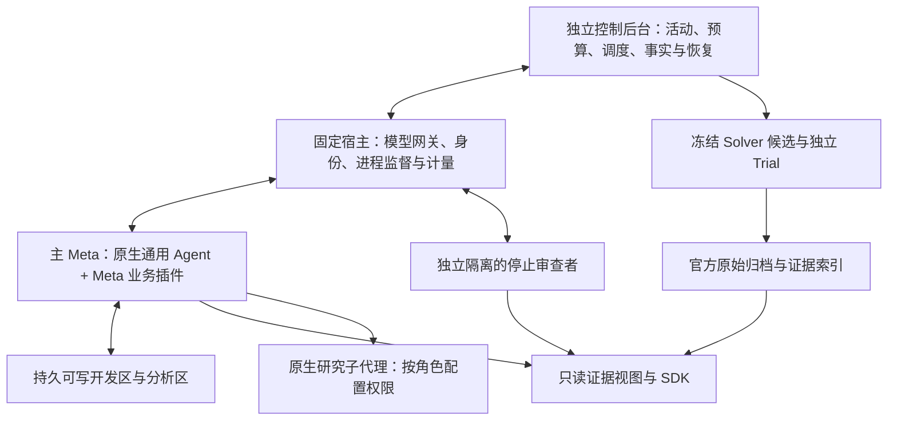

# Meta 通用 Agent 与完整证据访问设计

日期：2026-10-21 · 状态：核心实现已落地；第 13 节七工具修改方案待实施，完整故障矩阵继续验收 · 框架核对基线：DeepSeek Harness 0.2.1-rc.2

Meta 应当是具备通用工作能力的 DeepSeek Harness Agent，通过业务插件承担执行 Harness 的研究与改进。模型可以自行查看材料、编写脚本、运行检查、委派分析和继续调查；平台提供可访问的完整证据、持久工作区及可靠的活动监督。

**完整保存不等于全量注入上下文。** 启动和通知只提供必要状态、材料索引与运行环境内的路径；模型按需搜索和读取。摘要、分页和上下文压缩可以减少一次看到的内容，不能使原始信息失去可访问的来源。

## 1 范围、文档分工与设计决定

本文细化[需求 v0.12](../requirements/meta-harness.md)及[总体实现方案第 6 节](meta-harness-implementation.md#6-meta-harness-插件与统一服务接口)，修订原先将受限开发工具、筛选后的材料和最小运行入口作为 Meta 长期形态的设计。本文保留完整目标与验收标准；已实现接口、运行限制与验证命令以运行说明为准。

真实模型测试后确定的七工具修改方案见[第 13 节](#13-七个业务工具的修改方案)：业务工具默认提供完整路径、简短描述和必要状态；报告正文使用统一契约。该节细化早期方案中允许业务预览的部分，不代表已经部署。

2026-10-22 的[进化可读性设计](evolution-readability.md)在上述完整文件基础上补充研究解释、判断到片段的关联，以及显式纳入目标活动范围的历史来源。该增量已实施；未纳入的跨活动查询继续拒绝，现有角色边界不改变。新解释契约须保留旧活动的精确工具绑定和恢复路径，不直接替换本文所述历史协议。

| 文档 | 负责的规则 |
|---|---|
| 本文 | 通用 Agent 能力、文件访问、输出留存、会话恢复、权限及迁移设计 |
| [Meta 插件组合设计](meta-harness-composition.md) | 六个原生插件的职责、接口、依赖与作用域，原生预设、停止审查和组合研究边界 |
| [插件版本管理与按需导出](plugin-versioning-and-export.md) | 内容对象、组合引用、共享安装、Solver 导出与历史兼容 |
| [资源规划计划](../plans/meta-resource-planning.md) | 用户上限、Meta 计划、准入与计量 |
| [模型请求恢复计划](../plans/model-request-recovery.md) | 执行请求故障契约、Solver 插件恢复和评分版本 |
| [开发任务书第 19 节](../plans/meta-harness-development.md#19-meta-通用-agent-与完整证据访问) | 实施顺序与完成条件 |
| [运行说明](../operations/meta-harness.md) | 已可用功能、实际命令和未完成项 |

确定以下边界：

1. 复用原生 Agent 循环、工具、会话、压缩和 Subagent；本项目增加必要适配，不开发第二套通用 Agent 框架。
2. 主 Meta 继承所固定通用配置的能力；与活动权限不相容的能力明确限制并记录，不能因为采用无界面入口就默认关闭文件和终端。
3. 评分报告、轨迹、工具完整返回和提交产物有稳定引用及可访问文件；摘要不是证据的唯一入口。
4. 开发文件和会话持久保存。请求断线、进程重启与活动结束分别处理，短暂通信故障不直接关闭活动。
5. 延续精简存储：框架保存准确版本引用，插件保存精确内容；安装可重建，证据和研究状态独立保存，不随候选反复复制。
6. 固定 Solver、原有评分、用户预算和三类停止契约继续有效；本次不引入固定的多 Agent 研究流水线或 Meta 组合效果比较系统。

## 2 已核对的现状与缺口

以下是 2026-10-21 实施前的源码事实，用于说明修改对象；新 v2 的实际行为见运行说明，旧 v1 保留兼容。

| 当前入口 | 现状 | 需要改变的行为 |
|---|---|---|
| `src/execution/runner/assets/sdk-minimal.yml` | 已有原生 Agent、会话、基础压缩、jobs、文件与终端相关服务；文件读写配置受限 | 按通用能力清单装配并实际验证，不能以安装包存在代替工具可用 |
| `src/control/meta_worker.mjs`、`src/execution/runner/isolated.mjs` | Meta 设置 `disableLocalTools: true`，关闭原生文件、工作目录及终端工具 | 主 Meta 在自己的隔离工作区内启用原生能力；Solver 的工具约定分别处理 |
| `src/control/operations.py` | 自定义命令默认 30 秒、工作目录只读；只返回开头约 16 KB；超时不返回已产生的日志；临时输出随后删除 | 可写且持久的开发区，受管长任务，先保存完整输出，再返回预览与路径 |
| `src/evidence/library.py` | 官方结果按字段白名单投影，shadow/CZ 的详细指标未完整进入材料；轨迹只收录部分事件 | 原件可达，索引与摘要只作为视图；不因未知字段或事件类型而丢失诊断 |
| `src/evidence/materials.py` | 已有稳定引用、搜索和分页，但读取的是允许材料的投影，不提供通用文件路径 | 保留导航能力，接到完整材料及容器内文件，允许脚本处理 |
| `packages/meta-harness/composition.mjs` | 有原生 Subagent 服务，主要供程序化停止审查使用 | 开放普通研究委派；停止审查保留独立身份和更严格权限 |
| `src/execution/host/isolation.mjs`、`src/control/meta.py` | 原生会话目录位于临时区；Meta 失败会关闭活动准入并收尾 | 持久会话、断线恢复、通知确认及故障后的可恢复状态 |

现有分页本身不是丢失信息的原因：只要完整源仍可读，分页合理。需要消除的是无完整来源的截断、字段删除、不可达的归档，以及错误地将一轮模型失败当作整个活动结束。

## 3 目标架构与职责



通用文件、搜索、命令、任务和会话能力由 DeepSeek 提供。Meta 插件保留活动查询、资源计划、候选检查与冻结、实验提交、比较、保留、报告提交、停止申请和导出等领域操作。业务规则由现有后台执行；不把文件读写重新包装成另一套必经业务 RPC。

固定宿主负责把活动范围内的目录和受控通道接入 Runner，持有真实凭据、预算门和可信身份。它不替模型规定调查顺序，也不根据简短错误文本替模型选择下一种科学算法。

工作台、报告和 Meta 共用事实索引。界面可以展示简短摘要，模型可以直接分析文件，两者引用同一来源和结果版本；不得各自计算一套官方评分。

### 3.1 六个原生 Meta 插件

Meta 插件包内包含六个可组合的 DeepSeek 原生插件：`meta-control` 提供共享后台服务，`meta-campaign` 接入活动上下文/通知和计划/结束操作，`meta-experiments` 管理版本/实验/比较与保留，`meta-evidence` 导航完整材料，`meta-reporting` 保存正式分析及组织导出，`meta-stop-review` 提供独立停止审查行为。一个安装包包含多个插件入口；普通工具函数、类型和 schema 不各自做成插件。

六项的接口输入/输出、依赖图、配置、状态归属、清理、三个角色的装配及旧模块迁移统一在[插件组合设计第 3 节](meta-harness-composition.md#3-组合结构与插件职责)维护。业务插件直接依赖 `metaControl` 及相应原生服务，彼此不通过模型工具互调；停止审查额外要求兼容的结束申请能力及合法审查者预设。

原生 Persona、文件、终端、任务、会话及普通委派仍属于通用 Agent。移除六个 Meta 插件后这些基础能力应继续工作；装上 Meta 组合才增加本平台业务能力。各插件的权限仍由固定宿主和后台核验，不以工具是否出现在预设中作为唯一权限边界。

## 4 原生能力基线

### 4.1 标准模式的含义

“标准模式”指固定版本中适合通用 Agent 工作的原生配置，不预设存在名为 `standard` 的 SDK profile。实施时检查本地锁定安装中的官方配置及依赖，优先复用通用预设；通过原生配置或最小 patch 适配无界面运行。需要自行声明组合时，记录与官方通用配置的差异和原因。

主 Meta 的能力清单必须包含下表。每项记录提供插件、精确版本、有效配置、作用域、实际工具回执和验证状态；不能只将 `disableLocalTools` 改为 false 就宣布完成。

Meta 角色以职责片段叠加在通用预设上，保留原生工具说明、工作目录、上下文管理和能力约定。不得用完整 system 覆盖把这些说明一并清除；实际发送给模型的系统消息和工具 schema 都纳入装配检查。

| 能力 | 目标行为与验收边界 |
|---|---|
| 文件和编辑 | 读取文本及支持的图片、创建和修改插件、增量编辑、切换工作目录；大型文件可按范围读取 |
| 搜索 | 搜索目录、文件名及完整文件内容；结果可分页，标明匹配总量或是否仍有后续，不只搜索预览 |
| 终端与脚本 | 使用原生终端在开发区执行命令，保留会话内 cwd 和 shell 状态；支持 Node、Python、JSON/文本处理及项目检查 |
| 长任务 | 使用原生 jobs/进程管理，返回可查询的任务 ID、状态和日志；可等待、取消和清理，不统一套用 30 秒上限 |
| 上下文与资料 | 原生上下文压缩、与版本匹配的技能/资料按需加载、会话查询；压缩后仍能查原始记录和材料 |
| 计划和用户交互 | 复用固定通用配置中的计划/待办等能力；需要用户输入时经持久后台和工作台表达，后台不依赖页面在线 |
| 普通子代理 | 模型可自行决定是否委派独立分析、检查或编码；无强制数量、角色流水线或每轮必用要求 |
| 持久会话 | 会话及其文件跨 Runner 重启保留，按第 9 节恢复；不承诺恢复操作系统进程的内存状态 |

通用配置中的网络、MCP 和其他扩展也必须逐项列入能力清单。已有且适用的能力保留；需要额外外部服务的能力声明依赖和可用范围。首期不向开发终端开放任意外网，资料与依赖通过版本化资料包和受管安装提供；需要网络研究能力时走受控接入，不允许绕过模型网关或读取隐藏评测资产。与无界面工作无关的 UI 外壳不作为 Meta 必须加载的依赖。

### 4.2 开发环境与资源

开发镜像提供锁定的 Node、Python、包管理工具、`rg`、常用 JSON 处理及科学数据分析所需的明确依赖。科学分析至少覆盖 NumPy；其他库通过声明的依赖安装流程加入，记录版本与安装结果。不能把软件缺失伪装成模型分析失败。

依赖安装在隔离构建环境完成，复用共享下载/安装缓存；受管下载不赋予生成代码任意网络或模型服务访问能力。生成插件的导入、安装脚本和测试均在无真实凭据的环境执行。开发环境的依赖不自动成为 Solver 插件依赖，正式冻结和检查必须验证目标执行环境。

CPU、内存、磁盘、输出保存量、进程数和子代理并发属于可见的平台容量条件，记录来源和实际值。时间分配遵循活动资源计划；不把开发工具的默认超时变成隐含的活动目标。达到磁盘或输出容量边界时停止相关生产者并保留已写内容，明确报告不完整范围，不能静默丢弃尾部后返回成功。

## 5 持久工作区、挂载与角色权限

以下为 Runner 内的逻辑布局；宿主目录可调整，活动引用不依赖个人机器的绝对路径。

```text
/work/plugins/                       可写插件草稿
/work/analysis/                      可写分析脚本、笔记与图表
/work/checks/                        可写开发检查输出
/work/agents/<agent-id>/             普通子代理独立工作区
/evidence/index.json                 只读材料目录及访问状态
/evidence/trials/<trial-id>/          只读 Trial 证据
/materials/                         只读活动约定、任务原文与历史报告
/sdk/                               只读、版本匹配的开发资料
/versions/                          只读冻结插件及组合清单
/outputs/                           只读、由受管捕获器发布的命令/工具输出
/session/                           当前 Agent 的原生持久会话目录
```

挂载实际支持原生文件工具和脚本访问，不向模型返回无法在容器内解析的宿主路径。目录由后台按活动身份准备；证据、SDK 和版本只读，草稿与分析区可写。Runner 根目录仍可只读，持久卷不使用会随退出消失的 tmpfs。临时缓存可使用 `/tmp`，其消失不能影响已发布证据、草稿、命令日志或会话恢复。

证据视图优先引用已有对象与归档；可用只读挂载、受控链接或按需物化，禁止因增加路径入口复制全部历史。链接目标必须位于已授权根下，不接受模型传入的任意宿主路径。新 Trial 的文件先校验后原子发布，目录索引更新有修订号；正在写入的日志标为 live，已完成文件才有最终摘要。

| 角色 | 文件和执行权限 | 业务权限 |
|---|---|---|
| 主 Meta | 开发/分析区读写；授权材料只读；受管终端与任务 | 既有 Meta 操作，不能修改用户上限、固定 Solver、评分和原记录 |
| 普通研究子代理 | 原生独立会话，与主 Meta 同一活动研究环境；共享授权文件，cwd 遵循原生语义，需要并行修改时分配独立目录或副本 | 研究预设只提供业务查询；与主 Meta 属于同一研究信任域，工具作用域不是 OS 安全隔离 |
| 停止审查者 | 独立隔离环境，证据只读，可在自己的临时分析区运行只读来源上的计算 | 仅查询与提交所属审查结果；不写主工作区、不提交实验、不结束活动、不递归委派 |
| Solver | 当前任务、已冻结执行插件和本 Trial 环境 | 保持现有执行边界，无 Meta 工作区、历史评分或研究子代理能力 |

普通子代理写同一插件前需分配独立副本或明确单一写者，主 Meta 合并后再冻结。它们与主 Meta 共用活动预算和模型设置；额外模型路由必须来自已有明确配置，不能由委派参数任意指定。

**工具作用域与操作系统权限必须同时成立。** 开放终端后，Runner 内可读的环境变量或配置不能作为跨角色可信签名依据。当前 `PHYEXP_META_BRIDGE_KEY` 方式必须在启用通用执行前调整：角色权限由固定宿主持有的通道绑定，后台不信任工具自报的 `agentId/preset/role`。主 Runner 无法取得审查者身份，也无法伪造独立批准。

停止审查因此需要独立进程/容器及独立通道。优先使用锁定框架支持的隔离 spawn 后端；如需适配现有 Runner，仅实现原生 Subagent 后端适配，不另建子代理协议。普通同权限研究子会话可以复用原生后端，但必须验证文件范围和并发写入。凭据始终留在外部宿主；活动研究环境与审查者、Solver、其他活动之间不共享可变会话及身份通道。普通研究子会话共享活动研究文件和原生会话存储；审查者不能继承主 Meta 的终端或写工具注册。

## 6 完整证据与索引契约

### 6.1 三层材料

| 层次 | 内容与用途 |
|---|---|
| 原始归档 | 官方输出、执行事件及产物原件；保留原字节、来源、摘要和完整性状态，不能由 Meta 修改 |
| 可访问视图 | 按活动和任务契约开放的原件路径，或明确声明转换/脱敏的派生文件；默认尽量直接引用原件 |
| 摘要和检索索引 | 状态、关键指标、预览、搜索结果和导航；可重建，不能取代前两层 |

每个 Trial 至少提供：官方评分报告及 reward、完整可用执行事件、模型可见输出、工具调用与完整返回、实际提交文件、执行与桥接日志、评分器日志、失败及恢复记录、加载回执、有效运行条件和用量记录。任务允许的运行工作区产物也进入目录；不能只给最终分数和选中的工具事件。

已有 `events.json` 保持原格式与摘要。可生成 `trajectory.jsonl` 便于检索，但必须标明它是派生视图、来源摘要及事件覆盖范围，并提供原件；新增事件类型不静默排除。完整轨迹指系统实际取得的记录，不要求取得提供方未暴露的内部思维过程。原始记录本来就缺失的部分明确标记，不合成补齐。

官方零分、官方缺失评分、派生任务完成分和材料发布状态分别保存。评分已入库但证据目录尚未就绪，不能把该 Trial 改成无评分；材料异常应有独立诊断与修复入口。统一结果收集链路继续验证 Trial 归属、归档摘要和幂等入库。

### 6.2 文件描述与查询

文件描述至少包含：稳定 `ref`、类型、所属 Campaign/Trial、容器内 `path`、媒体类型/编码、字节数、最终 SHA-256 或 live 状态、来源引用、视图/策略版本、读取时间或修订号，以及可用性与完整性。派生材料额外记录转换说明；无法读取时返回明确的缺失、受限、损坏或尚在生成原因。

目录和搜索支持分页及继续游标，结果标明是否完整；不能保留当前“只列前 500 个文件但无后续入口”的行为。搜索范围是完整可访问内容，二进制或不支持的编码明确说明。路径作为读取入口，稳定引用和内容摘要作为报告引用依据，不以可变路径单独认定证据身份。

现有 `materials_*`、`evidence_read`、`sdk_*` 继续作为便利入口，旧引用保持可解析。新业务契约以描述和路径提供材料，七工具的具体变更见第 13 节；旧契约的正文预览、字符 offset 和分页保持原语义。原生文件范围读取返回编码和下一读取位置，UTF-8 按字符边界处理。大型 JSON、JSONL、图片和二进制文件允许通过原生文件工具或本地程序处理，避免全塞进 RPC。

### 6.3 评分可见性

开发任务的官方评分报告和正常失败诊断默认完整可查。未知字段不能仅因不在通用白名单中就被删除；各任务的 metrics、gates、checks、拒绝原因和错误详情应当保持原始结构。现有 `feedback()` 可以继续服务历史摘要，不再作为新 Meta 唯一可读结果。

若任务契约明确禁止开发者接触某些隐藏答案或真值，只对这些明确范围执行任务级策略，保存策略版本、理由和受影响路径；提供带说明的诊断视图，不能声称是完整原件。没有明确禁止规则的新增诊断字段保留。凭据和非活动范围的私人数据不因开放路径而暴露。

最终保留测试仍遵循既有用途限制。为研究开放过的反馈必须记录其用途，不能继续称为独立未见证据。Solver 无法挂载 Meta 证据目录；分析结果也不会自动写入执行插件或导出包。插件资产遵循既有任务答案和泛化边界。

## 7 工具完整返回与上下文策略

### 7.1 先保存，再展示

所有可能产生长输出的命令、工具和后台操作必须有完整来源。受管捕获发生在原生工具裁剪、展示渲染或上下文压缩之前：优先使用原生完整输出落盘能力，不足时用最小输出捕获适配补齐。仅把已被截断的返回保存为文件不满足要求。

工具结果已经指向完整持久文件时直接复用该引用；归档、材料索引和模型预览不各存一份相同全文。只有格式转换或明确的任务级诊断视图需要额外内容，并记录派生关系。

业务工具与主动读取分别处理：第 13 节所列业务工具采用“完整文件路径＋简短描述＋必要状态”的默认回执，不追加正文预览。原生 `read`、`grep`、终端等继续返回 Agent 主动请求的读取/搜索/执行结果，不能把读取结果再次替换为同一个路径，造成无法阅读。以下命令预览规则仍适用于原生执行工具。

命令流写入持久输出对象，工具回复只带状态、适量预览、输出引用及路径。普通管道分别记录 stdout/stderr；PTY 原生合流时标明合流，不能声称可以还原两个独立流。保留退出码、起止时间、取消/超时原因、字节数、内容完整性及进程身份。超时和失败同样保留已经取得的输出。

回复概念结构如下；字段名待契约实现时统一，不是当前可调用 API：

```json
{
  "operationId": "operation-example",
  "status": "completed",
  "exitCode": 0,
  "preview": "简短结果",
  "previewTruncated": true,
  "outputs": [
    {"ref": "artifact-example", "path": "/outputs/operation-example/stdout.log", "bytes": 250000, "complete": true}
  ]
}
```

预览长度是可见的展示配置，不影响文件完整性。预览省略时提供下一读取方法；整个结构化响应不能从中间切断为无效 JSON。模型流的保护上限、工具参数校验和协议消息上限继续生效，大数据通过文件传递，不靠无限放大控制消息解除约束。生产者被上限终止时记录 `complete: false` 和实际原因。

### 7.2 长任务与上下文压缩

长任务通过原生任务服务受理，固定宿主记录与活动的归属、进程/容器身份及日志入口。Runner 重启先查询原任务是否仍存活，存活则重新接入；已退出或无法确认时标为中断/未知，不自动重新执行任意 shell 命令。需要可靠跨进程执行的检查使用已有隔离检查能力和相同任务记录，不发展第二套通用 jobs 框架。

启动上下文仅包含目标、固定模型、预算和计划、角色能力、工作区/材料入口及恢复状态。实验完成通知包含事件 ID、Trial/Batch ID、简短结果及证据目录；不注入整条轨迹。等待任务时等待事件，避免无意义轮询调用模型。

复用原生压缩保留近期工作上下文；完整会话日志、输出文件和证据引用仍可按需查询。压缩与资料装载产生的模型请求也计量。分析笔记帮助续接，但只是模型分析，不能覆盖后台事实；不要求每次工具调用后强制填写固定报告。

## 8 业务接口、冻结与通知确认

业务工具使用明确的结构化参数、结果及错误类别，逐步去除“一个字符串中再编码 JSON”的常规调用形式。已有调用兼容入口保留至旧组合退出使用。只保留领域动作；旧 `workspace_read/write/exec` 作为旧活动兼容接口，新 Agent 日常开发使用原生文件与终端。

工具所有权和参数契约以[六插件接口设计](meta-harness-composition.md#3-组合结构与插件职责)为准：例如 `campaign_finish` 由 `meta-campaign` 注册，`meta-stop-review` 通过原生扩展点处理需要审查的分支；`results_compare` 由 `meta-experiments` 提供，`meta-evidence` 只负责材料导航。不得同名重复注册，也不通过遍历全部后台操作自动暴露新工具。

插件冻结只收集声明的插件源码、资产和配置，排除 `/work/analysis`、会话、日志、安装依赖和证据。先生成一致的暂存快照并校验，再原子发布内容对象与组合；冻结期间草稿改变应重试快照或拒绝，不能保存混合版本。开发检查通过不等于目标 Solver 装配通过，后者仍是正式 Trial 的前置条件。

候选冻结、批次提交、计划修改、保留、报告和停止申请沿用唯一操作 ID、请求摘要与幂等键。同键同参数返回原操作，同键不同参数冲突。响应丢失时先查询操作事实；已经执行的业务操作不重复计数、执行或收费。

通知区分已持久化、已投递与已确认消费的位置。领取通知不能立即推进唯一消费游标；通知及其 ID 先进入持久会话，再记录确认。故障后允许重复投递同一事件，通过事件 ID 与操作幂等避免重复副作用。不能承诺所有外部进程恰好执行一次；无法确认的窗口先对账，保留未知状态。

## 9 会话持久化与恢复

### 9.1 保存内容

每个活动关联精确 Meta 组合、能力/恢复策略版本、主会话及子会话身份、原生持久日志、工作区、有效模型配置、通知投递和确认游标、进行中操作、进程身份及预算记录。原生状态与审计分开：模型可访问的会话文件不作为可信的权限、计量或审批依据。

优先通过锁定版本已验证的原生持久会话接口恢复。恢复的是最后一个完整提交点，不执行残缺工具参数、不把部分响应当成完整指令；保留中断段用于诊断。如果只能启动新会话，则显式记录前后关系和原因，提供同一工作区、旧会话查询入口、未处理事件及后台事实，不伪称连续恢复。

### 9.2 恢复过程与状态

1. 固定宿主记录原始故障，停止对应请求，保留已取得输出及已知/未知用量。
2. 控制服务保持 Trial 监督和结果收集，临时阻止重复 Meta 实例；通过租约/所有权隔离旧实例，避免两个恢复者同时写入。
3. 核验准确组合、工作区和持久日志，核对已受理业务操作、运行进程、通知及预算；不能先重放后对账。
4. 在剩余授权范围内恢复原生会话或显式建立续接会话，重新接入已有任务，投递未确认通知。
5. 成功后记录恢复链及正常工作；达到技术恢复上限则进入可见的待处理状态，保存故障及恢复入口。不能标作用户暂停、科学失败或“充分探索后结束”。

目标状态包括运行、等待、恢复中、需处理、收尾和终态，具体编码与现有状态机统一。恢复中和需处理不自动取消已受理 Trial；它们在原计划和截止内继续调度、归档，用户暂停/停止仍优先。无剩余时间或预算时按既有资源规则收尾。

### 9.3 初始恢复策略及与 Solver 的区别

原生 Meta 的技术恢复由控制后台管理，不是可替换的 Meta 插件。针对短暂连接、响应中断及可恢复进程故障，连续未完成回合期间最多追加六次恢复，退避依次为 2、5、10、20、30、60 秒；每次都受原活动截止与准入校验。恢复计数及下一允许时间持久化，重启不能清零；恢复后的会话完成过完整回合后，再次故障从第一档重新计数。更新后台策略并重启后，既有活动后续故障也使用新规则，不改写已记录的恢复决定；已经需要处理的活动仍须显式恢复。

鉴权失败、预算拒绝、用户停止、完整性错误、权限错误及确定性装配故障不按瞬时网络错误自动重试。后台不可用时仅重连和对账，不在无法计量时发起模型请求。未知消费不记零，不用恢复自动增加时长或额度。

此策略只属于新 Meta 运行契约，不修改 Solver 的冻结请求恢复策略（新 H0 v2 为五档，旧配方保持原策略）；评分版本也不随之改变。原生重试与宿主恢复共用一份次数与计量事实，不能层层叠加。之前已经完成的工具副作用不得随模型请求恢复重做：读操作可重试；业务写操作查幂等记录；不具备幂等性的命令若结果未知，由恢复后的 Agent 调查后决定。

停止审查的业务判断不自动重投票。故障恢复只核对同一审查请求的运行状态和已保存结论；需要新的技术尝试仍遵循独立审查策略和预算，不能靠主会话恢复取得多次批准机会。

## 10 版本身份、存储与迁移

### 10.1 分开保存成果、状态与缓存

| 对象 | 保存与身份规则 |
|---|---|
| Meta 组合 | DeepSeek 精确引用、原生配置/patch、Meta 插件版本、角色和有效配置、锁文件引用；新格式复用现有内容对象，不复制整个执行目录 |
| 平台运行契约 | 网关、隔离与恢复策略、开发环境和能力清单身份；按明确版本记录，与插件效果比较条件关联 |
| 研究状态 | 每活动的开发文件、会话、通知、操作、预算与分析；不计入插件内容身份，也不随每个候选复制 |
| 研究证据 | 原归档、必要索引与派生视图；保留出处和摘要，能复用原件时不存第二份完整副本 |
| 可重建资源 | 框架安装、依赖缓存、开发镜像、装配与路径视图；按锁定来源重建，缓存缺失不丢插件和证据 |

组合与运行契约共同确定实际 Meta 运行条件；资料路径、日志追加和分析文件变动不生成新插件版本。镜像 ID 是实际运行回执，重建还需锁定依赖与构建输入；不能将一个无法取得的镜像 ID 当作完整恢复方案。

当前 `meta-composition-v1` 有完整冻结代码和镜像恢复依赖，继续按原规则保留。新格式需要显式版本与兼容解析，不能直接删除旧资产或用新宿主冒充旧版本。新 Meta 采用内容引用不要求迁移 Solver 已实现的 `plugin-composition-v2`，也不要求开发新的远程存储或自动垃圾回收。

### 10.2 新旧活动与证据补齐

新契约通过新活动启用。现有活动不因文档或宿主升级自动换工具、恢复策略、评分或组合；已结束活动不自动重开。用户明确要求续跑时，创建关联的新活动，沿用指定执行插件和配置，记录改变的 Meta/平台条件，按可比性要求建立基线。

已有证据可以从原归档建立新的只读路径与索引，保留旧引用、原评分、报告和摘要。新视图属于追加记录；活动模型可见范围的扩大需要明确的活动策略修订，不能声称旧 Meta 当时看到了新增材料。对已被开发工具丢掉的日志标明历史缺失，不从摘要补造全文。

迁移采用“核验原件 → 构建新视图 → 验证可读和身份 → 原子发布索引”。失败时继续使用旧入口，既不删原件，也不半发布。备份覆盖插件对象、组合、不可重建研究状态、证据和账本；缓存与可重建路径视图单独列出。回退选择原组合和原运行契约，只在无在途操作的安全边界执行，不将新会话格式硬塞给旧运行时。

## 11 实施落点与顺序

下列为工作包，不要求新增同名模块或服务；能复用现有结构时直接修改。

| 顺序 | 主要入口 | 可审查产物 |
|---|---|---|
| A 核对原生能力与契约 | Runner 配置、`packages/meta-harness/`、锁定 SDK | 能力清单、官方配置差异、实际 Agent 作用域回执、版本化契约 |
| B 建立文件与输出入口 | `src/evidence/`、`src/control/operations.py`、资料/报告索引 | 只读证据目录、完整输出捕获、旧引用兼容；超长与失败输出可达 |
| C 启用通用开发环境 | `src/execution/host/isolation.mjs`、Runner、Meta 工具 | 持久工作区、原生文件/搜索/终端/jobs、可用依赖；通道身份与审查隔离先通过检查 |
| D 接入委派与恢复 | 原生 Subagent 后端适配、`meta.py`、`meta_worker.mjs`、网关和通知 | 普通委派、隔离审查、原生会话恢复、幂等对账与可见故障状态 |
| E 统一交付与兼容 | Meta 组合解析、工作台、报告、SDK 资料与运行说明 | 新旧活动兼容、能力和文件入口展示、完整验证与实际限制说明 |

先做一条纵向闭环：发现失败 Trial → 用原生工具读取完整评分和轨迹 → 编写分析脚本 → 修改插件并检查 → 冻结并提交一次实验 → 收集评分并通知续接。随后注入截断、断线、崩溃和权限故障。只通过文件查询或假装配不能宣布整个增量完成。

## 12 验收矩阵

工程验收优先使用临时数据目录、可控时钟、假 provider 和真实原生装配；只修改本文时不执行这些运行测试。新增测试入口由实现阶段落地，不能把本表当作已有命令。

| 场景 | 必须证明的行为 |
|---|---|
| 原生通用配置 | 实际 Agent 有文件、搜索、编辑、终端、任务、资料和委派能力；漏装、禁用和错误作用域会使检查失败 |
| 自主失败调查 | 脚本化 provider 只收到目录和状态，可驱动 Agent 查完整评分、定位轨迹事件、运行 Python 分析并产出引用；不能由测试宿主预先塞入答案 |
| 不同评分结构 | hamlearn/shadow/CZ 合成报告的指标、检查项和未知诊断字段完整可读；官方 0/1/null 与入库、报告一致 |
| 轨迹完整性 | 包含新增事件、工具返回、提交和错误；派生轨迹有原件与覆盖说明；压缩后仍能查旧事件 |
| 超长及失败输出 | 超过旧 16 KB 上限的输出在文件尾部放置校验标记；命令失败、超时、取消也能读取已产生尾部；预览和完整文件状态不同 |
| 大目录与编码 | 超过 500 个文件可完整列举和搜索；UTF-8 跨块不丢字节，JSON 保持有效，二进制返回文件入口 |
| 原生裁剪前捕获 | 触发原生终端/工具自身的展示上限，仍能读取完整源；验证不是将裁剪后内容再次落盘 |
| 工作区与长任务 | 跨调用保留状态和文件；超过旧 30 秒时限可继续；重启可对账或明确中断，不默默重跑命令 |
| 角色隔离 | 主 Meta 不能冒充审查者；审查者终端不能写主目录或调用业务写接口；主/子代理均不能取得凭据、其他活动或隐藏资产 |
| 普通研究委派 | 子代理独立读取证据、产出文件并可取消；实际请求共用预算；并发写入有明确处理，停止审查不被普通结果替代 |
| 请求中途断线 | 部分参数不执行，之前工具不重复；恢复成功后继续同一活动，失败历史和未知用量保留 |
| 操作响应丢失 | 在批次受理后断线，恢复得到原 Batch/Trial，无额外轮次、实验或重复记账 |
| 通知与重启窗口 | 投递前、落会话后、确认前分别崩溃，事件不丢且副作用不重复；多个恢复者只能有一个有效所有者 |
| 恢复耗尽与截止 | 次数跨重启不重置；需处理状态可见；已受理任务继续受监督；暂停、停止、预算与截止不能被恢复绕过 |
| 输出容量不足 | 已有文件和故障原因保留，完整性明确为 false；无截断后假成功或无界内存缓冲 |
| 插件与缓存身份 | 草稿分析/日志不进入冻结插件；相同内容共享；精确框架可重新取得；新 Meta 不重复保存框架和整份执行源码 |
| 历史与导出 | 原件摘要、官方评分和旧报告不变；旧组合仍可解析；Solver 和导出不包含 Meta 会话、分析、研究子代理或历史证据 |

完整执行到评分入库的既有检查继续保留，包括 `tests/contracts/harbor-score-pipeline.py`；新的闭环在其上增加 Meta 读取、原生开发和续接，不以模拟的科学成功证明真实任务通过。受影响的单元、契约、工作台构建、依赖边界和导出检查完成后，才更新运行说明的已实现状态。

真实模型验证使用当次有效授权和资源边界，分别记录工程闭环、官方评分及科学结果。验收不要求人为保证分数提升，但要求 Meta 有条件独立完成调查，并且全部失败、恢复、消耗和证据可查。首次核心实现采用离线与脚本 provider 验证；其后按用户授权重启后台并完成一次真实基线，官方评分通过，候选迭代因用量准入不足未完成。该次暴露的接口问题按第 13 节修改，不能将此前核心验证解释为本增量已经通过。

## 13 七个业务工具的修改方案

### 13.1 范围、现状与共同约定

状态：实现已完成，单元、原生回执/恢复及官方评分管道检查通过；真实复测已完成，模型结果和额外修复记录于本地验收报告。本次修改对象限定为 `evidence_list`、`sdk_read`、`results_compare`、`candidate_retain`、`campaign_status`、`candidate_list`、`report_save`，以及它们必需的渲染、文件发布、通知、契约与恢复适配。不增加业务插件或通用 Agent 框架，不改 Solver、官方评分、保留规则或预算口径。其他业务工具沿用已有接口，本增量不宣称全工具已经完成精简。

真实运行中，上述前六个工具最大回执分别约为 35,355、16,633、14,204、11,594、9,866、7,325 个字符；`report_save` 因正文必填字段与 `problems` 类型约束未完整声明而被拒绝两次，第三次成功。字符数包含模型可见的附加文件提示，不等于 token 数。这些是本次改动依据，不是应当截断到这些长度的阈值。

已引入 `meta-tools-v3` 与 `meta-tool-receipt-v1`。新组合同时冻结输入 schema、回执 schema、报告正文 schema 和渲染规则的版本/摘要。本节保留 v3 阶段的契约说明；当前新活动使用 `meta-tools-v4`，增量见[进化可读性设计](evolution-readability.md#9-已落地的契约与接口)。旧活动继续使用原绑定协议。

成功回执采用同一骨架：

```json
{
  "receiptVersion": "meta-tool-receipt-v1",
  "status": "completed",
  "summary": "找到 39 条证据，完整目录及每条证据的读取路径见文件。",
  "total": 39,
  "file": {
    "ref": "query:example",
    "path": "/materials/objects/<sha256>.json",
    "mediaType": "application/json",
    "bytes": 48000,
    "sha256": "<sha256>",
    "completeness": "complete"
  }
}
```

共同要求：

1. **简短且有用。** `summary` 由程序根据状态和计数生成，不额外调用模型；不复制用户长文本、研究结论或原始异常堆栈。每个工具只增加本节允许的标识、计数或修订字段。成功回执连同渲染附加信息的 UTF-8 序列化大小以 4 KiB 为验收上限；依靠固定字段和文件引用满足，不允许从中间切 JSON 或裁掉正文来凑大小。
2. **先发布再引用。** 所有成功回执指向已原子发布、当前角色可读的完整文件。文件描述的全部来源/策略/编码等信息保存在完整记录和索引中，回执只保留读取和校验所需字段。文件及每个嵌套路径使用容器内地址，不返回宿主绝对路径。
3. **完整范围明确。** 查询文件记录过滤条件、观察时点、结果总数和记录来源。目录记录完整不等于所有原件可用：缺失、损坏和受限条目仍入目录并带原因，回执附 `unavailableCount`，不把它们静默删除。评分及轨迹原件不经格式重写；查询 JSON 是明确的派生索引。
4. **不可变快照与轻量存储。** 复用 `FileViews` 和内容寻址对象；同样内容复用同一对象，不每次复制轨迹、框架或候选源码。业务修订、证据内容及用量/事件水位未变时复用快照，不因查询时间或剩余秒数变化重存整份正文；快照保留自己的观察时点，回执可提供当前观察时点及由截止时间推导的剩余时间。查询快照保留当时的范围和修订；可变入口仅用于导航，报告引用仍绑定稳定证据 ID/摘要。JSON 显式声明媒体类型与 UTF-8 编码，不能靠 `.txt` 后缀误判。
5. **没有正文的旁路。** `domain-tools.mjs` 不再对整个服务返回对象无条件 `JSON.stringify` 给模型。`output-context.mjs` 对新业务回执复用已有文件引用，不把全文或第二份相同路径提示附回上下文。回放、幂等重试、操作对账、启动上下文和完成通知也使用相同的精简投影。
6. **主动读取能力保留。** 原生 `read`、`grep`、终端和会话查询不套用业务回执替换策略，按请求返回内容并保留完整来源。原始输出捕获继续在裁剪前执行；`/outputs` 的记录标明它保存的是回执、原始终端流还是其他产物，不能将业务回执称为原始证据全文。
7. **错误可处理。** 回执内保留错误代码、是否已提交、关键标识和简短处理提示；全部错误详情放到诊断文件。未经提交的参数拒绝、已提交但回复丢失、结果真正未知分别表达。缺少文件时明确不可用，不捏造可读路径或返回假成功。

### 13.2 evidence_list：完整证据目录文件

**现状。** 默认最多返回 50 条完整描述，每条合并后台记录和文件描述；结果随证据数量增长，产生约 3.5 万字符回执。

**输入。** 新契约保留可选 `batchId`、`trialId`，二者同时给出时取交集，并校验都属于当前活动。移除新契约中的 `offset/limit`；旧 v2 仍保持原分页行为。新查询生成该过滤范围的完整目录，模型在文件中自行筛选或分页。

**返回。** 仅返回公共回执、`total`、`unavailableCount` 和目录文件，不内嵌 `items`、来源对象或评分正文。描述只说明证据条数、查询范围及不可用条数。

**完整文件。** 包含查询条件、目录修订、每条证据的稳定 ID、类型、所属 Trial、来源/策略、文件描述和可用性；官方分数保留 0、1、null 的原始区别。每条记录指向现有完整原件，不把原件嵌入目录文件。目录缺失原件时保留条目与原因。

**实现落点。** `src/control/meta_api.py` 的分支改为构建并发布完整索引，复用 `src/evidence/files.py` 的路径和完整性检查；不改变证据采集和评分入库逻辑。

**验收。** 39 条和超过 500 条证据均只返回小回执；目录数量与后台一致，最后一条及原件尾部可读。交集过滤、空结果、跨活动拒绝、不可用原件及二进制路径分别验证。

### 13.3 sdk_read：解析并返回准确版本的文档路径

**现状。** 先调用旧 SDK 正文读取，再追加全文文件描述，正文和路径一起进入模型上下文。

**输入。** 新契约只接收文档 `id`，不再接收字符 `offset/limit`。保留工具名以便发现资料，但说明明确为“定位文档并返回完整路径；用原生文件工具读取正文”。旧 v2 的范围读取保持不变。

**返回。** 公共回执加 `documentId`、`knowledgePackId`、`sdkVersion`；描述使用文档标题和主题，不内嵌正文、API 声明或代码样例。

**完整文件。** 发布当前活动已冻结知识包中的准确文档内容，复用知识包/材料对象，不重新获取最新版。文档内引用应能在同版本 SDK 目录继续定位；对应关系保存在索引文件。

**实现落点。** `meta_api.py` 绕过旧正文预览返回，调用知识包定位与 `FileViews` 发布；同步工具说明与 SDK 导航示例。

**验收。** 长文档首尾及 Unicode 内容完整，回执不含正文中的测试标记；同一文档在两知识包下不能串版本，缺失或版本不匹配明确报错。收到路径后，真实原生读取仍能读到文档内容。

### 13.4 results_compare：比较摘要与完整比较文件

**现状。** 同时返回统一评估对象和详细 `attempts`，其中可能包含诊断、评分与运行信息；约 1.4 万字符回执会随 Trial 数增长。

**输入。** 保留 `candidateIds`、`batchIds`、`tasks`，沿用交集和活动范围校验。比较对象没有有效评分时也返回结果，不能以空集掩盖失败。

**返回。** 公共回执加 `evaluationRule`、`candidateCount`、`trialCount`、`limitationCount`。描述只说明范围、已评分/未评分/失败计数及是否存在比较限制，不列出每个候选或每项指标，不替 Meta 排名或选择。

**完整文件。** 保存当前后台统一计算的 `evaluation`、全部入选尝试、逐候选/任务统计、实际运行条件、比较限制及评分/轨迹引用。所有统计来自现有同一计算路径；保留失败、取消、未知和 0/null 区别。原始官方报告通过路径引用，未知诊断字段仍可从原件读取。

**实现落点。** `meta_api.py` 将既有比较结果作为完整文件发布，仅单独构造短回执；用户 UI 和报告统计接口继续使用既有完整数据。

**验收。** 文件中的统计与 UI/报告及旧完整计算结果一致；覆盖官方 0/1/null、取消、模型失败、外部失败、在途和环境不可比。扩大至上千 Trial 时回执仍受共同大小约束，文件包含全部尝试。

### 13.5 candidate_retain：确认决定，不返回整个活动

**现状。** 服务完成保留后直接返回活动对象，连同配置、资源计划和选择详情进入会话，产生约 1.2 万字符回执。

**输入。** 保持现有 `candidateId`、理由、证据引用、取舍、局限、重新考虑条件、`expectedSelectionRevision` 和 `idempotencyKey`。不减弱已有证据校验或改变 Meta 选择规则。

**返回。** 公共回执加 `candidateId`、`decisionId`、`selectionRevision`；描述只确认本次保留/重申/回退已记录。不得内嵌活动 `config`、资源计划或长决定正文。

**完整文件。** 保存该次不可变选择决定、前后候选、提交理由、证据核验、实际比较限制及修订。引用原候选和证据对象；不复制整个活动历史。不根据单次通过追加“稳定”或“有收益”的认证文字。

**实现落点。** 保留 `store.retain` 的业务事务；在 Meta API 边界投影回执并发布决定文件。成功提交与回执发布之间故障时，依据请求记录/决定 ID 对账；新格式也应用于幂等回放和恢复查询。

**验收。** 同键同参数得到相同决定 ID、修订和文件；不同参数冲突。修订过期或证据非法不改选择。提交成功后回复丢失仍只产生一次决定；文件发布失败明确保留已提交状态，不诱导重新选择。

### 13.6 campaign_status：必要状态与完整活动快照

**现状。** `summary` 已包含组合、恢复历史、问题、评估等较多信息；`full` 返回更大的业务对象。相同投影还进入启动上下文和通知。

**输入。** 新契约使用空对象，不再提供会把全文内嵌的 `view=full` 分支。旧 v2 保留 `view` 语义。新调用总是产生完整状态快照及精简回执。

**返回。** 公共回执加 `campaignId`、`state`、`revision`、`selectionRevision`、`planRevision`、`remainingSeconds`、`activeTrials`、`reservedTrials`、`explorationClosed`、`stopReason`、`unresolvedOperationCount`、`pendingQuestionCount`。`budget` 只包含已确认 token、在途预留、未知预留和阈值；不能将未知用量当成可用余额。描述说明当前阶段及是否有需处理事项，不罗列所有事项。

**完整文件。** 包含目标、冻结模型/组合身份、完整用户限额与 Meta 计划、各对象索引、恢复/问题/待接受条件和操作记录，必要的大对象通过同一次快照生成的只读文件引用。所有嵌套路径都是角色可读地址。快照标记观察时点和各对象修订，不能把不同时间查询伪称为原子全库快照。执行写操作仍由后台再次校验修订和权限。

**实现落点。** 在 `meta_context.py` 分开“必要状态”和“完整快照”，`meta_api.py` 发布快照。启动、恢复提示与 `meta.py` 通知复用必要状态；通知只带事件/操作/Trial/Batch ID、简短状态与文件引用，ACK 和恢复游标语义不变。初始化仍需目标、角色能力与固定模型等一次性说明，但不附完整历史。

**验收。** 增加大量恢复记录、问题、操作和实验不会扩大回执；完整文件仍覆盖全部记录。零剩余额度、未知预留、需要处理状态准确可见。旧快照在后续状态变化后仍可读；过期快照不能绕过写操作的修订检查。通知重投递和 ACK 故障窗口继续通过。

### 13.7 candidate_list：候选目录及可访问版本文件

**现状。** 即使只查一个候选，也返回插件、检查、评估等完整行，含容器不可读的 `bundlePath` 和检查宿主路径。

**输入。** 新契约使用空对象，移除 `offset/limit`；返回当前活动完整候选目录的文件入口。旧 v2 分页不变。

**返回。** 公共回执加 `total`、`retainedCandidateId`、`finalCandidateId`。描述只报告候选数量与是否已选择；不内嵌候选列表。

**完整文件。** 目录包含每个候选的 ID、可读名称、父版本、组合摘要、插件版本引用、检查状态和简明实验计数，详细清单、插件源码和检查日志分别指向 `/versions` 或 `/materials` 内文件。含历史兼容记录时仍列出不可用原因；不得把宿主 `bundlePath` 当成读取入口，不对模型开放另一活动的版本材料。

**实现落点。** 新增 Meta 专用候选投影并复用版本材料视图，不改变用户 API 所需的宿主信息，也不在每次查询时重算并内嵌所有候选的完整 `taskEvaluation`；详细评估由 `results_compare` 查询。

**验收。** 多候选、零候选、基线无插件、缺失旧版本分别验证；目录总数与后台一致，候选末项可达；路径能在真实隔离容器里读取，宿主路径不出现在回执或新候选目录中，跨活动引用被拒绝。

### 13.8 report_save：完整正文契约与可靠保存

**现状。** 工具只声明 `analysis` 是任意对象，后台另行要求六个字段和部分嵌套类型。正文错误可能进入通用写操作的 `outcome_unknown` 记录；报告保存缺少基于该写请求的专门恢复对账，不能只补一段提示词解决。

**输入。** 保留 `factsId`、`expectedReportRevision`、`idempotencyKey`，以及二选一的 `analysis` / `analysisFile`。优先让 Meta 用原生文件工具写分析文件，提交 `/work/analysis/…` 路径及 SHA-256；直接传对象作为可用的简便入口。两个正文入口使用同一份 `meta-report-analysis-v1` 定义：

| 字段 | 新契约要求 |
|---|---|
| `summary` | 必填、非空字符串 |
| `observations` | 必填、字符串数组，允许空数组 |
| `hypotheses` | 必填、字符串数组，允许空数组，不为凑字段编造假设 |
| `limitations` | 必填、字符串数组，允许空数组；是否充分表达局限属于报告内容质量 |
| `decision` | 必填、非空字符串 |
| `evidenceRefs` | 必填、不重复的证据 ID 字符串数组；有已启动 Trial 时至少一条，引用必须在事实快照的授权范围内 |
| `process` | 可选、字符串数组 |
| `problems` | 可选、数组；每项仅含必填 `status`（`resolved` / `unresolved`）和非空 `description`，可选 `evidenceRefs` |
| `pluginContributions` | 可选、数组；每项必填字符串 `plugin/expected/observed/comparison/assessment`，可选不重复的 `evidenceRefs` |

新正文不接受未声明字段，错误明确指出字段位置，不能静默丢掉 `title`、`nextExperiment` 等模型内容。旧报告继续按旧版本读取，不按新 schema 回写或校验拒绝。展示层按版本处理新的问题状态，不要求迁移旧字符串列表。

**契约来源。** 在现有 `contracts.json` 所属契约包中维护唯一正文 schema；模型参数、JS 校验、Python 校验、文档最小例子和分析文件模板都从该定义生成/引用。根级“恰好一个正文来源”、嵌套 required、枚举、数组和禁止额外字段都必须验证。原生工具登记当前只提取 `parameters` 属性：实施时验证真实注册后模型可见 schema 的表达能力，根级互斥若无法原生表达则在描述中明确声明，并由相同运行时校验强制执行，不能声称转换已经保留了全部 schema 语义。

**保存流程。**

1. 验证调用身份和外层参数，先查既有幂等结果。已提交且同键同参数的调用返回原回执，不因草稿后来变化而重新读文件、创建报告或改变结果。
2. 对新提交只读取一次正文文件字节，验证授权路径、符号链接边界、SHA-256、编码与 JSON；据同一字节快照进行完整 schema 校验。对象输入使用同一正文校验。再验证事实摘要、证据引用和报告范围。
3. 汇总一次能确定的格式/引用错误，返回 `validation_failed`、`status=rejected`、`committed=false`、错误总数、简短说明、完整错误文件及契约/模板路径。错误文件列出 JSON Pointer、期望类型/约束、实际类型和处理提示；不复制整段输入正文。引用或修订冲突使用明确错误代码。
4. 明确的校验失败记录为 `rejected`，不列入未决副作用；同键修改参数仍遵守冲突规则，修正后用新键。成功提交在事务内重新核对修订与键唯一性，绑定请求 ID、事实 ID、分析内容摘要、报告 ID 和新修订。
5. 报告和写请求建立可恢复关联。报告提交后回复或文件发布失败，按请求 ID 找回原报告，只补齐文件/回执，不再创建修订；只有无法确定是否提交的崩溃窗口才标记 `outcome_unknown`。报告事实与分析文件发布失败不得伪报“未保存”。

**返回。** 成功时只返回公共回执加 `reportId`、`analysisRevision`、`factsId`，以及完整报告文件路径；描述确认保存范围和修订。不回显分析正文、事实全文或整个报告对象。`report_get_facts` 已有的事实路径保持可用，并提供相同版本的正文 schema/模板路径作为配套导航。

**实现落点。** `contracts.json`、`domain-tools.mjs`、`meta_api.py`、`src/reporting/reports.py`、`src/evidence/materials.py` 及报告展示适配。复用现有报告存储和幂等账本，不另建报告服务。模型不能通过自填契约版本切换校验规则。

**验收。** 用本次失败的两种结构生成不含私人数据的合成样例：缺字段、`problems` 为对象，首次即完整报错且不新增报告或未知操作。对象与文件输入对同一合法/非法正文判定一致；覆盖未声明字段、空数组、嵌套问题/贡献、非法证据、内容摘要错误、路径逃逸、修订冲突、重复提交、提交后断线、恢复原报告 ID 和旧报告展示。检查真实 native 注册后的参数定义，不只检查 schema 源文件。

### 13.9 版本兼容、实施顺序与完成条件

**兼容必须由后台执行。** 当前后台 `MetaAPI` 从工作区加载当前契约，单独冻结 Runner 工具并不足以保护旧活动。新实现按活动冻结的 `toolContractVersion` 与摘要选择校验和回执适配；字段由后台从组合身份确定，不接受模型指定。未声明的新旧历史活动映射回原 `meta-tools-v2` 或更早入口；缺少精确实现时明确不可用，不能静默使用最新版。

同名工具在新 v3 中改变输入/返回形状，只有新活动启用；旧 v2 的分页、正文返回、报告参数和恢复记录继续可用。兼容的是协议版本，不要求为每个活动复制整份后台代码。新查询视图不修改旧证据、报告、评分或 Solver 插件身份；不因此自动重启后台、迁移活动、扩大预算或开启真实模型实验。

| 顺序 | 修改内容 | 可验收结果 |
|---|---|---|
| 1 | 冻结契约版本、完整文件与小回执公共适配、明确拒绝/未知状态 | 新旧活动按正确协议路由；文件先发布，实际模型回执不含正文 |
| 2 | `evidence_list`、`sdk_read`、`candidate_list` | 目录/文档完整可达，模型用原生工具自行读取 |
| 3 | `results_compare`、`campaign_status`、`candidate_retain`，同步通知与恢复回执 | 统计一致、状态简洁、选择不重复，通知不会带回完整对象 |
| 4 | `report_save` 正文 schema、持久请求关联与展示兼容 | 两种输入一致、错误一次说明、断线不重复保存，旧报告可读 |
| 5 | 原生集成与有限闭环验证 | 真实 Agent 从路径发现证据、分析、保存报告，恢复后仍用小回执 |

受影响检查优先扩展现有 `tests/unit/meta-native-tools.test.mjs`、`tests/unit/meta_native_test.py`、`tests/unit/materials_test.py`、`tests/unit/readability_test.py` 与 `tests/contracts/meta-native.test.mjs`、`tests/contracts/meta_runtime.py`；完整执行/评分链路继续使用既有 Harbor 契约。新测试先通过脚本 provider 验证，不能让测试宿主预先把完整材料塞给模型来绕过路径读取。涉及报告客户端时构建并检查新旧展示；不因仅修改文档运行这些测试。

总体通过条件：七工具的成功回执均满足 4 KiB 上限且无完整正文；完整文件及尾部标记可达；扩大证据/候选/Trial 数量时回执不随正文线性增长；所有回放/恢复/通知入口保持同样规则；报告格式、证据、修订与幂等结果准确；旧协议与历史不变。额外模型调用不是精简回执的实现手段。

真实验收另按当次有效授权登记有限配置和预算，观察每工具回执大小、模型实际读取路径、上下文/用量和恢复开销；不预设节约百分比、不以增加预算替代接口验收，也不把官方单次满分当作插件改进收益。实施完成前，运行说明不得将本节标为已上线。

### 13.10 实现与验证说明

输入、回执、正文分别由 `packages/meta-harness/contracts.json`、`receipt.schema.json`、`report-analysis.schema.json` 定义；原 v2 输入保留在 `contracts-v2.json`。冻结组合的 `toolContract` 记录版本和这些文件及渲染规则的摘要，后台核对组合身份后选择适配，未知精确版本拒绝执行。

原生工具 DSL 可以表示嵌套必填、类型、枚举和禁止额外字段，但不支持 `minLength`、`pattern`、`uniqueItems` 及当前登记方式的根级互斥。转换器将前述约束写进参数说明；JS 与 Python 继续按完整 schema 校验，报告错误交后台生成完整诊断。实际登记后的参数及模型接收的回执均有容器测试，不能仅凭 schema 文件判断成功。

状态及通知文件声明顺序读取的观察范围；重复查询按内容签名复用快照。报告和 Trial 大对象使用独立文件引用。事实文件为路径投影视图，`fileView.sourceFactsId` 指向后台原始事实摘要，文件自身 SHA-256 用于校验投影字节。评分、轨迹原件不经过这种投影。

检查入口新增 `tests/unit/meta_receipts_test.py`；现有原生工具、恢复与 Harbor 契约覆盖新协议。覆盖 507 条证据、1,002 次尝试、完整文件尾部、不可用条目、报告正文两入口、错误汇总、幂等重放、提交后发布失败恢复和旧 v2 兼容。真实运行的成绩、用量及发现的问题记录在本地开发记录，不作为插件收益证明。

实际复测补充了两个边界：诊断中的 JSON Pointer 不是文件地址，必须保留精确字段位置；通用拒绝不能附带无关的报告模板。收尾快照增加 `closeout`，列出缺失的逐批报告与总报告；短摘要明确下一份批次及所需操作，失败 Trial 同样需要每轮报告，总报告不能替代它。已有探索关闭时不再提示申请结束。

允许暂停收尾活动，后台准入关闭不得把暂停状态改回运行/收尾；恢复保持 `explorationClosed`、原截止时间和预算，仍回到收尾。单元测试覆盖后台监督轮询，原生 `meta_runtime.py --native --final-first` 先保存总报告、结束回合，再验证通知准确指出缺失轮报告并完成收尾。真实验证还覆盖同一原生会话恢复后补齐缺失报告；它不能证明模型输出异常或连接故障已经解决。

报告文件读取通过目录文件描述符逐级打开，拒绝符号链接、目录和管道，避免路径校验后被替换以及读取管道阻塞；同一次读取的字节用于摘要和正文校验。新旧工作台均在收尾状态显示“暂停收尾”，界面验证覆盖暂停后恢复仍处于收尾，未增加实验或重设截止时间。


## 14 普通研究子代理回归原生能力

2026-10-22 修改方案；实施与验证状态见运行说明及本地开发记录。保持 `meta-composition-v2` 的内容冻结机制，为新组合记录独立的 `native-research-v1` 委派契约；旧冻结组合按原代码和镜像恢复，不热替换后端。

### 14.1 职责与装配

普通研究使用锁定版本的 `subagent-spawn-in-process`、`tool-subagent` 和 `tool-subagent-control`。身份、父子目录、消息、取消、持久描述符和冷恢复由原生框架管理，不再把研究请求送到一次性的 `meta-isolated` 后端，也不新建子任务调度器。Meta 插件继续提供领域操作。停止审查保留独立 Runner、宿主绑定身份和一次性结构化审查结果；隔离适配器只服务审查。

主 Meta 与普通研究子会话属于同一活动研究信任域，独立上下文共享持久工作区和原生会话存储。研究预设不暴露业务写工具，后台仍检查登记角色；此约束不能宣称能抵御共享终端中的恶意同域代码。跨活动、Solver、审查者以及真实凭据边界继续由外部宿主执行。模型网关接受本研究 Runner 已登记的原生主/子会话，逐会话计量，共用固定模型和原活动资源；不能登记审查身份或任意切换模型。

### 14.2 四项行为

1. **研究任务无隐含五分钟总时限。** 移除普通研究对一次性宿主 `runChild` 的依赖，受原活动截止、预算和主动中断约束。停止审查的 300 秒限制单独公开；模型连接、终端等原生故障保护不与研究总时限混同。
2. **cwd 和文件路径真实有效。** 显式 cwd 由原生框架采用，省略时继承原生默认目录；主/子可读取同一授权草稿、证据和分析文件。cwd 不表示权限隔离。模型自行决定是否创建独立目录、副本及怎样合并，不新增强制快照/文件交接流程。
3. **同一研究会话可追问。** 原生 `send_message` 支持运行中补充、空闲后继续；`interrupt_agent` 中断当前工作，后续由主 Meta 决定是否继续。研究子会话可向直接父会话报告简短结论和文件路径，不强制摘要格式或分析流水线。
4. **重启后续接原会话。** 原生父子目录、子会话描述符、消息及文件持久保留；主会话恢复后可查原记录，并通过原生消息接口冷恢复同一子 ID。先核对中断工作和未知副作用，不自动重放所有历史指令。保证持久会话和文件续接，不保证 OS 进程内存恢复，也不承诺原生尚未落日志的消息恰好一次投递。暂停、截止和预算不能因恢复被重置。

### 14.3 验证与兼容

使用脚本 provider 和真实隔离 Runner，验证：研究确实使用原生后端、没有五分钟宿主总时限；指定/继承 cwd、共享文件及独立修改目录；运行中消息、同会话追问、主动中断；主/子工作中替换 Runner 后原 ID、历史及文件可续接；逐子会话计量和注册；未知身份与研究者业务写请求拒绝；独立审查仍不能被冒充。验证观察到的模型请求和真实工具效果，不能只检查包名或 schema。

新能力通过新冻结组合和镜像生效；旧组合、评分、试验、原生会话及旧研究结果文件不迁移、不覆盖。运行说明记录所测平台、命令与限制，脚本验证不代表模型科学表现。
