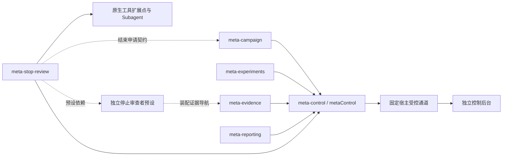

# Meta Harness 插件组合设计

日期：2026-10-23 · 状态：六插件与通用 Agent 核心实现已落地；两个可选参考插件仅完成设计，旧组合保留兼容，完整验收继续 · 接口基线：DeepSeek Harness 0.2.1-rc.2

Meta Harness 通过 DeepSeek Harness 通用 Agent 与领域插件组合，为开发模型提供读取证据、开发执行插件、组织实验、比较版本和交付报告的能力。原生文件、终端、任务和会话能力按固定版本继承，详细目标见[通用 Agent 与完整证据设计](meta-agent-and-evidence.md)。模型自主选择研究方向；停止审查插件在模型申请“继续改进已不值得投入”时，调用独立上下文的审查者核对依据。活动预算、权限和最终状态仍由独立后台执行。

对外可将这套组合称为“Meta 插件包”。内部使用框架已有的服务、工具、事件、预设和 Subagent 机制，不另建插件管理器或 Agent 循环。Meta 优化的产物是执行 Harness 的候选组合；Meta 自身的组合与候选分别记录，执行项目不依赖 Meta 才能运行。

长期愿景是让 Meta Harness 本身也成为可研究的对象：通过修改、更换、添加和移除 Meta 插件，比较不同组合设计执行 Harness 的能力，再通过重复实验和消融判断插件的实际贡献。保留有证据支持、成本合理的能力，移除冗余或无收益的部分，让组合随证据演进。本期实现可替换、可冻结、可观察和可隔离的基础；不实现 Meta 组合的效果比较功能，也不开展真实比较实验。单个活动的复跑遵循当次用户授权。

## 1 文档位置与设计范围

本专题细化[总体实现方案第 6 节](meta-harness-implementation.md#6-meta-harness-插件与统一服务接口)。文档分工如下，避免重复维护规则：

| 文档 | 维护内容 |
|---|---|
| [需求文档](../requirements/meta-harness.md) | 产品行为、探索自主性、三类停止条件、权限和预算要求 |
| [总体实现方案](meta-harness-implementation.md) | 执行、控制、工作台与 Meta 的边界及共同数据契约 |
| [插件版本管理与按需导出方案](plugin-versioning-and-export.md) | Solver 候选的目标保存单位、共享安装和按需导出；当前 Meta 恢复协议不随之迁移 |
| 本专题 | Meta 插件组合、停止审查、组合版本及未来比较所需的基础 |
| [通用 Agent 与完整证据设计](meta-agent-and-evidence.md) | 原生能力、持久工作区、完整文件访问、输出留存、角色隔离与会话恢复；修订首期受限工具的长期设计 |
| [执行插件开发资料设计](meta-plugin-knowledge.md) | 教给 Meta 的执行插件开发资料，不负责定义 Meta 自身的运行组合 |
| [开发任务书第 16 节](../plans/meta-harness-development.md#16-meta-插件组合与停止审查增量) | 首期重构及可比较性基础的实施和验证要求 |
| [运行说明](../operations/meta-harness.md) | 已可使用的能力、安装恢复方法和实际限制 |

本次设计覆盖 Meta 自身的插件化、停止审查及后续对照实验基础，不引入固定的“分析—提案—编码—测试”多 Agent 流水线，不要求每轮开发指定数量的插件，也不允许 Meta 在活动中自行改写已绑定的组合、停止契约、预算或评分规则。研究新 Meta 组合时，在独立的新活动中装配和评估它。

### 1.1 两层优化愿景

| 实验层次 | 被改变的对象 | 一次实验的单位 | 主要评价对象 |
|---|---|---|---|
| 执行 Harness 实验 | Solver 使用的执行插件组合 | 一个候选的一次任务 Trial，按批次组织 | 任务完成表现、稳定性和执行成本 |
| Meta Harness 实验 | Meta 使用的工具、上下文、策略及审查插件组合 | 一次完整进化活动，即一个 Campaign；同一组合安排多次独立活动 | 在相同研究条件和资源上限下，最终保留的执行 Harness 的质量，以及设计过程的可靠性和成本 |

Meta 插件数量、生成的候选数量、报告篇数或自我评价不能代替效果证据。某个插件是否必要，是相对于任务范围、预算和其他插件而言的条件性结论，不要求保留一套对所有情况都相同的最大或最小组合。

### 1.2 首期实现落点

`packages/meta-harness/composition.json` 是声明式组合入口，`composition.mjs` 转换为原生 Host 插件和两个 Agent Preset；服务、上下文、查询、操作和停止审查分别位于同目录的独立模块。原 `index.mjs` 的完整提示词与工具集合保存在 `legacy.mjs`，仅供旧活动兼容。

`src/control/meta_composition.py` 冻结插件包、执行运行时源文件、Meta 监督代码、渲染后的上下文、组合配置、依赖锁和不可变镜像 ID。恢复核验内容摘要和宿主依赖锁，缺失或不匹配则拒绝启动。`stop_review.py` 保存与核验独立审查；`meta_gateway.mjs` 将不同原生会话的请求故障隔离，同时共用原模型、活动截止与预算。

普通回合结束后的继续通知仍由现有控制后台和 SDK 会话驱动；没有新的 Agent 循环或对照调度器。新活动自动绑定 `stop-review-v1`，旧活动不升级。工作台和新生成报告展示组合、加载/触发回执、审查结论及其用量。模拟契约验证独立上下文、只读工具、批准/拒绝/非法输出/超时和插件替换/禁用；它们不证明真实审查判断的质量。

## 2 遵循 DeepSeek 的插件原则

插件划分以可组合、可替换的能力为依据。需要替换实现时，使用“服务定义—服务实现—消费者”结构：服务定义约定请求和结果，服务实现完成操作，消费者通过接口使用它。消费者可以是工具，也可以是行为插件。简单能力允许同时承担多个角色，不为形式预先拆出多个发布包。[官方能力设计教程](https://github.com/deepseek-ai/deepseek-harness/blob/master/docs/user/develop/practice/index.md)

每个插件明确声明依赖、配置、注册作用域和卸载行为。通过 `inject` 等待服务就绪，不靠配置文件书写顺序保证依赖；注册工具、提示词片段和事件处理器时归属正确的 Context，外部资源有对应清理。使用足以解决问题的局部扩展点，观察工具结果与转换结果分开，不为增加一段说明接管整个提示词装配。[Cordis 教程](https://github.com/deepseek-ai/deepseek-harness/blob/master/docs/cordis-tutorial/index.md)、[官方插件实践](https://github.com/deepseek-ai/deepseek-harness/blob/master/packages/preset/agent-preset/skills/cordis-plugin-development/references/practices.md)

以下概念分别使用：

| 概念 | 在本设计中的含义 |
|---|---|
| 插件 | 注册服务、工具、提示词或行为的代码与配置单元 |
| Agent Preset | 用普通插件声明某类 Agent 应装配的子插件，例如 Meta 与停止审查者 |
| Subagent | 运行时创建的子会话实例；其角色和能力来自选定的预设 |
| Meta 插件包 | 分发所需代码与组合声明；可通过 bundle/profile 接入现有启动链路 |
| 执行 Candidate | 被优化的 Solver 组合；新候选保存插件版本引用与配置清单，旧 Runtime Bundle 保留兼容，与 Meta 组合分开 |

原生预设管理器负责组合的加载与作用域，Subagent 服务负责子会话的受理、运行和取消。它们不替代本项目后台的持久账本及操作系统隔离；同进程子会话的上下文独立，不等于安全沙箱。[Agent Preset](https://github.com/deepseek-ai/deepseek-harness/blob/master/packages/preset/agent-preset/README.md)、[预设注册与限制](https://github.com/deepseek-ai/deepseek-harness/blob/master/packages/preset/agent-preset-registry/README.md)

## 3 组合结构与插件职责

本节定义六个原生插件的目标契约，是其职责、接口和依赖的维护入口。新 v2 已按此划分实现，具体入口、能力限制与检查见运行说明；第 1.2、11 节描述的 `control/context/queries/actions/stop-review` 仍是首期兼容结构。完整证据、工作区和恢复的共同规则见[通用 Agent 设计](meta-agent-and-evidence.md)。

### 3.1 分发、插件与预设

六项能力分别作为 DeepSeek Harness 原生插件存在，先放在一个 `packages/meta-harness/` 安装包内，通过原生 Agent Preset 装配。一个安装包可以包含多个插件入口，一个插件也可以引用多个普通源码模块；类型定义、参数校验、客户端辅助函数和共享 schema 不单独做成插件。

固定角色说明使用原生 Persona；动态活动信息由 `meta-campaign` 贡献上下文片段，不新增独立的角色插件。文件、搜索、编辑、终端、jobs、会话、压缩、技能和普通研究委派继续来自通用原生配置。移除 Meta 业务组合后，通用 Agent 的这些能力仍应可用。

插件使用 Cordis 的服务依赖、Context 作用域、工具注册和生命周期机制。新组合声明精确插件入口、内容引用、配置和角色，复用现有组合校验，不增加第二套插件管理器。依赖通过原生 `inject` 等机制就绪，不靠配置文件的书写顺序。

| 原生插件 | 类型 | 对外提供 | 直接依赖与注册范围 |
|---|---|---|---|
| `meta-control` | 服务插件 | 内部服务 `metaControl`；不注册模型工具 | 固定宿主提供的受控通道；每个隔离运行域一份，各 Agent 调用仍绑定自身身份 |
| `meta-campaign` | 上下文、事件和活动工具插件 | 活动导航、状态/计划工具、结束申请入口、完成通知 | `metaControl`、原生 systemPrompt/tools 及会话通知扩展点；按 Agent 预设注册 |
| `meta-experiments` | 工具插件 | 插件检查、冻结、实验提交/查询、候选比较与保留 | `metaControl`、原生 tools；主 Meta 预设 |
| `meta-evidence` | 工具插件 | 材料、证据和目标 SDK 的索引、定位及完整文件描述 | `metaControl`、原生 tools；主 Meta、研究子代理及审查者分别注册 |
| `meta-reporting` | 工具插件 | 权威事实读取、分析修订保存、报告读取与候选导出 | `metaControl`、原生 tools；主 Meta 预设 |
| `meta-stop-review` | 行为插件 | 结束申请的独立审查行为；不新增通用研究工具 | `metaControl`、原生 tools/Subagent 扩展点；还需结束申请能力及合法审查者预设 |

表中原生服务的准确名称及会话通知接入方法，以锁定 SDK 的实际接口验证为准；`metaControl` 是本项目定义的服务。以下工具名称采用 snake_case，已实现的有限参数契约由 `packages/meta-harness/contracts.json` 维护；不得将目标能力表替代实际作用域回执。

### 3.2 共同接口与依赖关系

所有业务插件只通过 `metaControl` 读取或操作后台，不调用另一个插件的模型工具，也不导入其私有实现。共享输入/输出 schema 是普通代码模块，由各插件显式引用。一个工具只由一个插件拥有，同名重复注册或契约版本冲突应拒绝装配。



实线表示调用/服务依赖，虚线表示装配时必须满足的能力或预设关系。`meta-experiments`、`meta-evidence`、`meta-reporting` 之间没有硬依赖：报告插件从后台读取事实，不要求证据导航工具正在注册；停止审查从后台取得证据快照，不解析其他工具的展示文本。审查者中的 `meta-evidence` 使用独立实例和受限通道，不继承主 Meta 的实例。

模型工具直接声明对象参数和结构化结果，不要求调用者把 JSON 再编码进一个 `input` 字符串。共同结果包括执行状态、对象或操作 ID、事实修订号，以及必要的材料引用；大数据返回路径和描述，遵循通用方案的完整文件契约。异步受理返回 `accepted` 和 `operationId`，不以请求超时推断后台未执行。

各插件的业务写入使用 `idempotencyKey`，修改既有对象时带预期修订号；后台保存请求摘要，同键不同内容返回冲突。错误至少区分参数错误、权限拒绝、修订冲突、依赖不可用、完整性错误、资源拒绝和暂时不可用，不能全部缩成普通字符串。角色、预算余额、官方结果和审批状态不接受模型自报。

### 3.3 meta-control：共享后台服务

**职责。** 作为 Runner 内的原生服务插件提供类型化业务客户端，传递取消信号、请求身份及结构化错误。固定宿主位于 Runner 外，负责真实凭据、可信角色绑定、计量与通道权限；`meta-control` 本身不持有能够冒充其他角色的共享密钥，不实现数据库、调度器或新的 Agent 循环。

目标服务接口如下，泛型和名称用于约定，不表示当前签名已完成迁移：

```ts
interface MetaControl {
  call<K extends Operation>(operation: K, input: Input[K], exec: ExecutionContext): Promise<Result<Output[K]>>;
  runtime<K extends RuntimeAction>(action: K, input: RuntimeInput[K], exec: ExecutionContext): Promise<Result<RuntimeOutput[K]>>;
  notifications(after: number, signal: AbortSignal): AsyncIterable<CampaignNotice>;
  observe(pluginId: string, event: PluginEvent, exec: ExecutionContext): Promise<void>;
}
```

`Operation` 与 `RuntimeAction` 是版本化的有限映射，不允许任意后台 URL、宿主命令或文件路径。`exec` 包含原生调用 ID、取消信号和会话关联信息，最终权限由宿主通道确认。`runtime` 仅承载注册回执、通知确认、审查关联等已声明动作；不因调用名为 runtime 就获得更高权限。通知订阅不自动确认消费，持久确认遵循通用方案第 8、9 节。

**配置与状态。** 配置只引用宿主注入的通道和协议版本，不能由模型选择角色、凭据或任意服务地址；只保存连接与取消句柄等可重建内存状态。账本、幂等记录、恢复次数和通知游标仍由后台持久化。卸载关闭连接和本地等待，不取消已经受理的 Trial，也不清除后台事实。

### 3.4 meta-campaign：活动上下文、通知与操作

**职责。** 提供本次研究的目标、固定模型、预算和计划、能力与目录导航；通过原生上下文片段和通知扩展点接入会话，不覆盖通用 Persona/工具说明。运行顺序由模型决定，插件不安排固定研究步骤。

| 接口/触发 | 主要输入 | 返回或效果 |
|---|---|---|
| 启动/恢复上下文 | 宿主绑定的活动及会话、事实修订 | 目标、有效限制、工作区/材料路径、恢复状态；不注入完整日志 |
| 完成/状态通知 | 后台事件 ID、已确认位置 | Trial/Batch ID、简短状态和证据目录；持久投递及去重 |
| `campaign_status` | `view: summary/full` | 权威活动状态、计划、限制、操作与等待原因；full 不代替评分原件 |
| `campaign_plan_update` | `changes`、`reason`、`expectedPlanRevision`、`idempotencyKey` | 有效计划、新修订和实际生效范围；不得提高用户上限 |
| `campaign_finish` | `condition`、`candidateId?`、`reason`、`evidenceRefs`、尝试与未解事项、`idempotencyKey` | 结束申请状态、审查引用或拒绝依据；后台决定是否进入收尾 |

`campaign_finish` 归本插件所有。稳定停止由后台核验约定标准；“充分探索后结束”经过 `meta-stop-review`；用户停止和资源到期由后台直接处理，不伪装为模型工具调用。

**配置与依赖。** 依赖 `metaControl`、原生 systemPrompt/tools 和经验证的会话通知扩展点。角色按预设配置为主 Meta 或只读观察模式，后者不注册计划/结束写工具；该配置不能扩大后台身份权限。上下文预览量、通知合并方式可版本化，目标和预算来自活动事实，不能由插件配置覆盖。

只读观察模式只提供与本次委派或审查快照有关的导航和状态，不订阅主 Meta 的自动推进通知。投递与确认按活动、会话及消费者区分，子会话查询不能推进主会话游标，也不能将主 Meta 的研究职责提示覆盖到审查者角色上。

**状态与清理。** 保存的投递、确认和恢复状态在后台/原生会话中；插件只持有订阅及上下文注册。卸载撤销片段和监听，取消尚未投递的本地唤醒，不将未确认事件标为已消费。恢复不新增另一套计时或调度循环。

### 3.5 meta-experiments：插件版本与实验

**职责。** 将模型已经开发的插件变为可核验候选，组织固定 Solver 的实验并记录选择。读取、编辑和一般开发命令使用原生工具；本插件只提供需要平台事实、隔离装配或业务受理的操作。

| 接口 | 主要输入 | 返回或后台副作用 |
|---|---|---|
| `candidate_check` | 插件目录引用、配置、目标环境、`idempotencyKey` | 隔离装配检查 ID、诊断与完整日志路径；不计正式 Trial |
| `candidate_freeze` | `plugins:[{path,config}]`、父候选、目的/名称、`idempotencyKey` | 插件版本引用、组合摘要、不可变候选 ID；仍须校验准确冻结内容 |
| `candidate_list` / `candidate_diff` | 候选过滤条件 / 两个候选 ID | 分页版本描述 / 插件和配置差异，附来源及可读文件 |
| `batch_submit` | 候选 ID、任务、重复次数、执行条件、`idempotencyKey` | 受理的 Batch/Trial ID、条件快照和准入事实；不阻塞等待评分 |
| `batch_status` | 批次 ID、可选分页位置 | 逐 Trial 状态、有效条件、官方结果与证据入口 |
| `trial_conditions_accept` | Trial ID、接受的时长、理由、`idempotencyKey` | 对已提示缩短条件的显式确认及新条件记录 |
| `results_compare` | 候选/任务/批次范围 | 后台统一统计、样本数、所有尝试及比较限制；不由插件另算成功率 |
| `candidate_retain` | 候选 ID、理由、证据、权衡和撤回条件、预期选择修订、`idempotencyKey` | 不可变选择记录和当前保留指向；保留不表示科学认证 |

`path` 是登记开发根内的插件目录，不能解析成任意宿主路径；冻结不收集分析、日志、会话或安装缓存。旧 `candidate_freeze` 已有检查能力，新 `candidate_check` 用于提前诊断，先前检查结果不能免除冻结内容的核验。`results_compare` 明确归本插件，证据插件只负责导航和来源，不重复实现比较。

**配置与依赖。** 直接依赖 `metaControl` 和原生 tools；目标 Solver、评分和上限由活动绑定，不是可任意覆盖的插件配置。不硬依赖活动、证据或报告插件的工具实现；完整研究预设在装配时另行检查所需能力齐备。

**状态与清理。** 候选、检查、批次、Trial、比较快照和选择决定在后台保存。卸载清理工具和本地等待，不撤销已受理批次；结果继续由后台收集。取消请求、结果未知和响应丢失均先查操作事实，不能自动重交实验。

### 3.6 meta-evidence：完整材料导航

**职责。** 定位当前角色有权读取的材料，返回稳定引用及可访问文件。原生工具和脚本负责阅读与计算；本插件不负责预先挑选模型“应当关注”的指标或事件。

| 接口 | 主要输入 | 返回 |
|---|---|---|
| `materials_list` / `materials_search` | 类型、任务、候选、批次、查询词与分页 | 材料描述、匹配位置、完整性和继续游标；搜索完整允许文本 |
| `materials_read` | 稳定 `ref`、明确单位的读取范围 | 范围内容及完整文件描述/路径；保留旧字符 offset 协议 |
| `evidence_list` / `evidence_read` | Trial/批次过滤或证据 ID、范围 | 官方报告、轨迹、提交和日志的原件或声明过的视图 |
| `sdk_search` / `sdk_read` / `sdk_inspect` | 查询词、文档 ID 或 API 声明名 | 与目标执行版本匹配的资料和 schema，不执行业务方法 |

共同材料描述包含 `ref/path/source/version/bytes/sha256/availability/completeness`，live 内容不伪造最终摘要；具体规则沿用通用方案第 6 节。旧 `evidence_*` 与 `materials_*` 可以是同一索引的兼容入口，不再维护两份证据库。普通文件读取不必经过这些工具。

**配置与依赖。** 直接依赖 `metaControl` 和原生 tools；可配置分页与预览大小，授权根、反馈策略和 SDK 身份由活动/角色确定。预览配置不能改变文件可见范围或丢弃完整来源。主 Meta、研究子代理、审查者各自注册同一插件实现，实例不共享可变游标或权限。

**状态与清理。** 原件和索引由后台保存，插件仅缓存可重建描述。卸载清理工具及缓存，不删除材料、撤销已发布引用或改变评分。缺失、损坏和明确受限分别返回，不能以空内容冒充完整读取。

### 3.7 meta-reporting：正式分析与交付

**职责。** 把模型自主写出的分析关联到后台事实，保存修订并提供报告/导出入口。模型可以先在分析工作区写草稿；正式提交不改写原评分和旧分析。报告格式约定不扩展成固定的研究步骤。

七工具增量的精确输入、路径回执、报告正文 schema 和新旧协议路由见[通用 Agent 设计第 13 节](meta-agent-and-evidence.md#13-七个业务工具的修改方案)。该增量已用于新活动；以下表格描述业务职责。旧 v2 活动保持原参数和返回格式，由后台按冻结组合分派。

| 接口 | 主要输入 | 返回或后台副作用 |
|---|---|---|
| `report_get_facts` | 批次 ID 或活动最终范围 | 不可变事实快照 ID、修订、事实文件与证据入口 |
| `report_save` | 事实快照引用、分析对象或分析文件引用、证据引用、预期报告修订、`idempotencyKey` | 新分析修订与可读报告路径；已有分析字段兼容，不能同时提交两个不同正文来源 |
| `report_get` | 报告 ID、可选修订 | 指定版本的事实/分析、状态及路径；旧版本仍可读取 |
| `export_create` / `export_status` | 冻结候选 ID、`idempotencyKey` / 导出操作 ID | 导出任务及包路径、清单和校验状态；不触发真实模型运行 |

分析文件引用限定在活动的分析区或已登记对象中，提交时校验内容摘要；后台验证证据归属与可见范围，绑定事实快照。新事实到达不覆盖已有分析，可另建修订并明确当时所见范围。模型观点与权威事实在结果中分开。

**配置与依赖。** 直接依赖 `metaControl` 和原生 tools；报告模板/分析契约可版本化，不能更改官方评分或任意指定宿主导出目录。后台读取事实，不硬依赖 `meta-evidence` 或 `meta-experiments` 的工具注册。

**状态与清理。** 报告、修订、导出操作及其产物由现有 reporting/exporting 实现保存，不再建插件私有报告库。卸载停止本地等待，已受理导出仍由后台监督；它的成功只证明打包完成，不宣称真实独立运行或科学效果通过。

### 3.8 meta-stop-review：独立停止审查

**职责。** 在原生工具执行扩展点识别 `campaign_finish` 的“充分探索后结束”分支，建立独立审查，不向模型增加另一套通用委派工具。稳定达标、用户停止和资源停止分别遵循既有规则。

| 交互 | 输入 | 返回与边界 |
|---|---|---|
| 结束申请扩展点 | 已校验的结束申请、原生调用上下文 | 继续稳定分支、启动/续查审查，或返回继续研究的结构化原因 |
| 内部 `review_request` | 申请及后台核对的相关证据快照 | 审查 ID、适用范围、已有/待处理状态，重复申请复用事实 |
| 原生审查激活与内部关联 | 审查 ID、审查者预设、后台提供的只读材料入口 | 独立子会话与运行身份；按相同活动预算计量 |
| 审查结果提交/故障记录 | 独立通道绑定的审查 ID、子会话、结构化结论或技术故障 | 后台保存的审查状态及理由；主会话自报 `approve` 无效 |

结论沿用 `approve / continue / insufficient_evidence`，并包含理由、证据引用、缺失依据及后续方向。结果是模型审查意见，后台另外核验身份、证据快照、适用性和当前状态；最终结束仍由后台受理。第 5 节维护详细停止协议，本节不另建审批规则。

**配置与依赖。** 直接依赖 `metaControl`、原生 tools/Subagent；装配时要求 `meta-campaign` 或兼容实现提供同版本结束申请能力，并验证审查者预设包含原生只读工作能力和 `meta-evidence` 或兼容证据导航。配置包括审查预设、契约版本及受原活动截止约束的技术超时；模型路由由活动绑定。

**状态与清理。** 审查请求、子会话关联、快照和结论由后台持久化，插件只持有受管激活及取消句柄。卸载或取消释放自身审查激活，保留中断事实，不产生批准；恢复查询原记录，不能重投票。审查者通道必须独立，不能沿用主 Runner 可读的共享签名材料。

### 3.9 角色装配与能力校验

| 运行域/预设 | 六个插件的装配方式 | 原生能力与权限 |
|---|---|---|
| 主 Meta | 域内 `meta-control`；完整 `meta-campaign`、`meta-experiments`、`meta-evidence`、`meta-reporting`、`meta-stop-review` | 通用开发、任务与普通研究委派；业务写入受后台约束 |
| 普通研究子代理 | 作用域正确的 `meta-control` 客户端；只读 `meta-campaign`、`meta-evidence` | 独立工作区和研究工具；不注册批次、选择、报告提交或结束工具 |
| 独立停止审查者 | 独立运行域内 `meta-control`；只读 `meta-campaign`、`meta-evidence` | 原生读取/搜索及自己的临时计算目录；不装业务写插件或递归委派 |

服务实现可以在权限等价的同一隔离域共享，但每次调用仍按真实 Agent 关联与计量；权限不同的角色必须有独立通道及能执行该权限边界的进程/容器隔离。默认研究子代理没有主 Meta 的业务写权限，因此不能仅以同进程 Context 和隐藏工具实现这个边界；隔离审查域也不能共享主域的服务实例。普通子代理的委派与结果回传使用原生能力，研究结果先交主 Meta，再由主 Meta 提交业务动作。

默认完整研究组合需要活动、实验、证据和报告能力；可用同契约实现替换，移除且无替代时拒绝以“完整 Meta”模式启动，并报告缺少的能力。研究特殊组合时显式声明缩小范围，不能把缺失能力隐藏为正常完整运行。禁用停止审查只使第二类提前结束不可用，不移除后台门槛；用户操作和资源停止继续有效。

组合清单保留各插件的 `id`、入口、精确内容引用、角色作用域、配置及契约/依赖声明。原生运行管理就绪与卸载，本项目只补充领域能力校验。每个实际 Agent 的工具、片段和行为回执应符合其预设；不能只看宿主启动时的空工具列表，也不能把写工具全局注册后仅靠提示词禁止子代理调用。

### 3.10 从首期模块迁移与独立验证

| 当前入口 | 新职责归属 |
|---|---|
| `control.mjs` | `meta-control` 的类型化客户端；角色可信绑定移到固定宿主通道，自动角色选择交给预设/装配 |
| `context.mjs` 与冻结角色文本 | 固定角色用原生 Persona，动态活动导航/通知归 `meta-campaign`；旧入口保留 |
| `queries.mjs` | 按业务归属迁入 campaign/experiments/evidence/reporting，不再用“是否只读”决定插件归属 |
| `actions.mjs` | 按业务显式注册活动、实验、报告/导出工具，不再通过枚举全部非查询操作自动暴露工具 |
| `stop-review.mjs` | `meta-stop-review`，继续使用原生行为扩展和受管 Subagent，适配独立审查通道 |
| `legacy.mjs`、旧组合清单 | 仅用于已冻结旧组合的读取/恢复；新组合不重写旧内容或复用旧摘要冒充升级 |

文件名可在实施中调整，不要求另建六个发布包。插件版本引用包含其入口及实际依赖的共享源码/配置；共享文件按内容复用，改变共享实现时更新所有受影响插件的内容身份。加载顺序、安装包版本与插件运行契约分别记录，不能仅凭安装包同名就恢复为最新实现。

每个插件单独验证工具/服务契约、依赖缺失、错误传播、作用域及卸载；替换提供者后消费者仍应通过相同契约。集成验证覆盖完整研究路径、只读角色、同名工具冲突、插件禁用、通知恢复和审查不可绕过。全部 Meta 插件移除后，通用 Agent 文件/终端能力仍可工作的检查也必须通过。此处只规定验证要求，不表示这些测试已经实现。

宿主复用 `dsh-agent-preset-registry`、`dsh-agent-preset`、`dsh-subagent` 与适用的运行后端。当前首期审查使用显式审查者预设和 in-process spawn，只程序化调用审查；该状态不作为新主 Meta 的能力上限。新方案开放原生通用研究委派，并将停止审查迁到独立隔离通道，避免主 Meta 的终端访问破坏角色边界。所需原生后端或最小适配必须实际验证，不能以依赖包已安装视为已启用。[Subagent 接口](https://github.com/deepseek-ai/deepseek-harness/blob/master/docs/subsystems/subagent.md)

首版审查者使用活动当前 Meta 模型及调用设置，并记录实际配置；它是额外的 Meta 调用，不参与 Trial 求解。新上下文用于减少对主会话结论的依赖，不保证消除同一模型的判断偏差。以后需要其他审查模型时，再作为明确的活动配置扩展。

分析失败、提出假设、比较候选和撰写报告由 Meta 使用这些能力完成，不预先为每个思考步骤增加插件。只有某种方法需要独立配置、替换或复用时，再抽出策略插件。

插件应能在声明的接口下替换实现、修改配置或从新组合中移除。每个可研究插件说明依赖、触发条件、可观察效果、关闭后的行为，以及可用的基线实现。维护服务定义的兼容边界，避免工具直接导入另一个策略插件的内部实现；也不允许多个插件无记录地覆盖同一行为而无法确定实际生效者。实验所需的消融说明是组合元数据，不要求另建一套插件生命周期框架。

### 3.11 两个可选参考实验插件（设计阶段）

在六个既有领域插件外，按[参考实验插件设计](meta-reference-experiments.md)增加 `meta-model-reference` 与 `meta-harness-reference`，分别用于原生配置的参考模型运行当前执行 Harness，以及固定 Solver 运行 Codex/DeepSeek 标准模式等参考 Harness。实现与验收见[专项计划](../plans/meta-reference-experiments.md)。它们不加入完整 Meta 的必需能力，不改变六插件现状或自动升级旧组合。

两插件各自声明入口、工具契约、配置、说明、角色和依赖，仅通过 `metaControl` 连接后台；无相互依赖，也不依赖其他领域插件的私有实现。扩展原生装配的受信可选包解析和内容冻结，不另建插件管理器。未选择的包不加载；已选择却缺失时明确失败；冲突工具和契约拒绝装配。无/任一/两个参考插件四组合都须验证正常主线能力。

后台依据实际组合和用户运行期启停修订授予参考提交权限；移除不只影响工具展示。原生作用域负责释放工具和监听，已受理工作由固定监督器继续持有，历史由通用读取层呈现。参考运行有独立身份和统计分组，共用活动总账、调度、通知和收尾；参考来源进入研究解释，不能直接成为 Solver 候选或替代主线稳定证据。

## 4 服务和作用域契约

### 4.1 服务与工具的边界

活动服务定义描述输入、返回结果、错误类别和调用身份。适配器将请求转到现有后台；工具只负责参数表达、返回渲染和必要的模型说明。停止审查使用同一服务读取证据，不通过调用另一个工具的展示文本取得业务数据。服务定义与实现可先放在同一安装包中，以独立模块保持依赖清楚。

服务返回的官方评分、派生任务完成分、失败类别、候选身份和证据引用沿用平台契约。插件不得另算一套成功率。工作台、报告、Meta 与审查者统一使用活动绑定的 task-completion-v1/v2/v3/v4；新活动采用[任务完成规则 v4](task-completion-v4.md)，已启动并结束的尝试无可信官方通过即计失败，外部原因和待归因不免除失败。尚未启动、明确人工撤销且无先行失败、尚在运行或状态未核实单列。官方原始分数不变；历史保留原绑定版本。六插件拆分不改变计分归属，产品口径以需求第 3.3 节为准。

Meta 与审查者的身份由固定宿主和网关绑定，不能由模型通过工具参数自报角色。审查者只读权限还要由后台校验；隐藏工具或切换预设不能作为唯一权限边界。开发执行插件时的 SDK 查询仍绑定目标执行环境，不暴露整个 Meta 宿主的注册表、密钥或管理能力。

主 Meta 获得原生终端后，不能依赖其 Runner 环境中可读取的共享密钥证明审查身份。新通道按外部绑定的角色校验，审查者有独立运行和文件边界；可在自己的临时目录计算证据，但不能写主开发区或调用业务写操作。普通研究子代理不具有停止批准权限。完整挂载和权限要求见[专项设计第 5 节](meta-agent-and-evidence.md#5-持久工作区挂载与角色权限)。

### 4.2 提示词与配置

Meta 和审查者各自使用预设中的 Persona。工具说明、停止约定及其他能力按所需作用域贡献提示词片段。迁移现有 `complete: true` 时同时清理不适用的默认角色文本，验证每个片段实际进入正确会话，不只验证配置已加载。[Persona 行为](https://github.com/deepseek-ai/deepseek-harness/blob/master/packages/preset/persona/README.md)

活动目标、用户输入和证据保持字面量语义，不将其中的模板标记再次求值。保留当前模板版本、实际渲染内容和摘要的记录能力，增加组合身份及审查者角色版本。通用说明可使用原生配置，动态目标可通过明确禁止插值的片段注入。

可调策略放入版本化配置，例如审查者预设、单次审查的时间或用量限额、技术故障的有限重试与空转保护。它们受 Campaign 的剩余额度和截止约束，不能增加隐含的额外预算。初版不写死“至少三个方案”或“连续几轮不提升就停止”。

### 4.3 状态与生命周期

活动状态、实验结果和正式审查记录由后台持久化；模型可见的审查请求、结论和后续输入同时进入可恢复的会话记录。插件内存只保存可重建的状态，不成为批准结束的唯一依据。

预设定义可能被多个 Agent 共享，不能把每个活动的进行中审查放在一个未区分会话的闭包变量中。每 Agent 注册归其上下文所有，同时受插件卸载清理；跨重启需要恢复的信息使用后台存储或框架支持的持久机制，不随意增加未声明的会话事件类型。

审查超时、用户要求终止、插件卸载和进程退出都需要取消对应激活并等待清理。活动暂停时停止新审查，已启动审查按原暂停策略完成或终止，不能因增加子代理改变既有暂停语义。使用原生 Subagent 的受管生命周期；激活发布后按其接口显式释放，不能假定启动时传入的取消信号会自动取消已经运行的子会话。子调用经同一固定模型网关预留和结算，未知用量保留待核实状态。

## 5 三类停止条件与审查协议

### 5.1 停止条件的不同职责

| 条件 | 受理依据 | 谁负责判定或执行 |
|---|---|---|
| 第一条：达到约定稳定目标 | 同一个冻结候选在约定任务、执行条件和重复要求下满足活动预先约定的标准；不得拼接不同版本的最好结果 | 后台核验候选、证据与可机器检查的条件；未明确到可核验的标准不能宣称已认证达标。需要补充约定时明确记录，不由模型临时降低门槛 |
| 第二条：充分探索后继续改进的预期收益不足 | 有实质区别的尝试、负结果与剩余方向分析，解释为何在当前目标及剩余额度下不值得继续；须经独立审查 | Meta 提出停止申请，审查插件调用审查者，后台核验有效审查记录后受理 |
| 第三条：资源达到限制 | 用户实际上限、轮数/Trial 准入、时间、用量及用户明确设置的最低收尾预留；Meta 自定计划预留阻塞不单独构成停止依据 | 后台直接执行，不等待模型或审查批准；仅准入额度用满时保留已受理工作按既定策略完成；计划阻塞按资源规划契约通知 Meta 调整 |

第一、第三条是较严格的停止依据。第一条的稳定标准未约定时，不凭一次成功或自然语言信心代替它；第二条仍可独立申请。用户停止、外部故障和恢复待核实单列，不能伪装成目标达成或“已无改进空间”。

审查同意第二条只表示支持本次活动的停止判断，不证明所有可能改进已经穷尽，也不证明当前候选已达到第一条的稳定标准。活动可以保留 H0 并合理提前结束，不要求耗尽资源或为了凑数量制造插件。

### 5.2 第二条应审查哪些依据

Meta 的申请需要引用已有记录，说明：

1. 尝试过哪些有实质区别的方向，分别改变了什么行为；重复改写同一提示词不能仅按次数证明探索充分。
2. 对应候选与实验结果支持什么结论，是否真的观察到插件触发，是否存在未提交、模型异常或外部故障等不同原因。
3. 哪些问题尚未解决，哪些方向尚未尝试，以及继续验证的预期收益与成本。无需证明穷尽所有方法，但不能只写“没有想法”。
4. 当前保留版本、剩余资源与在途实验。可能影响结论的结果尚未返回时，解释为什么可以提前判断。

一次候选退化、一个插件没有收益、一次报告完成或单纯缺少可用评分，都不足以单独支持停止。外部故障导致没有有效比较，通常说明证据不足或运行受阻，不能作为 Harness 无法改进的证据。审查者可建议继续的方向或补充证据，但不把建议变成固定研究流程。

### 5.3 一次停止审查的流程

1. **提出申请。** Meta 通过结束工具声明适用条件、理由及证据引用。第二条进入审查；普通模型回复或回合结束不会触发活动收尾。
2. **固定审查输入。** 后台生成申请 ID，绑定活动、候选、相关证据修订、停止策略版本和预算快照。审查者读取权威材料；主 Meta 的总结标记为待核验的分析。
3. **创建独立会话。** 停止审查插件用原生 Subagent 服务显式选择审查者预设，提供申请和材料入口。使用新的上下文，不复制完整主会话，不继承实验写工具。
4. **取得结构化结论。** 审查结果包含结论、理由、证据引用、未解决问题和建议补充内容。结论为 `approve`、`continue` 或 `insufficient_evidence`；异常、超时、空结果及无法解析的返回属于审查失败，不按批准处理。
5. **记录并核验。** 固定宿主核验受管子会话归属及结果，后台保存审查记录。结束请求只能引用记录 ID，不能由主模型自行填写 `approved: true`。后台检查同一活动、申请、候选、证据与策略身份，并重新检查实际资源和在途状态。
6. **收尾或继续。** 有效批准后按第二条进入收尾；其他结论返回主 Meta 继续研究或补证据。若过程中已触发资源限制或用户停止，由后台按实际原因处理，不等待审查完成。

行为插件优先在结束工具的异步执行前扩展点接入；其他工具按原链路继续。不能把等待子代理的异步工作放进同步 `guard`，也不能拦截所有回合结束来审查活动是否应停止。具体事件签名以锁定安装版本核对，相关接入须通过原生会话契约验证。[工具扩展方式](https://github.com/deepseek-ai/deepseek-harness/blob/master/docs/cookbook/extension-cookbook.md)

审查记录不是由模型自由填写的报告字段。固定宿主必须能区分主会话的工具参数与受管审查会话的实际结果；后台拒绝跨活动、伪造或不适用的批准引用。审查期间相关候选、证据或停止约定改变时，旧批准不得静默复用；单纯审查自身产生的用量和记录追加不必使批准失效，但提交结束时须重新检查余额。

### 5.4 失败、重复与资源竞争

同一申请只允许一个有效的在途审查，重复调用返回同一状态，不反复创建付费子会话。审查未通过后，需要新增证据或实质修改申请才能重新审查，不能重复请求直到偶然获得批准；后台保留所有申请与结果，不删除拒绝记录。

审查失败不能绕过第二条门槛。可按配置进行有限技术重试，消耗照常记账；不能无限重试或为了等待审查延长活动。服务或模型持续不可用时记录运行受阻；若已经触发资源停止则进入对应收尾，不能将故障改写成审查通过。

审查计入 Meta 总用量、墙钟与原有活动上限，不计为 Solver Trial 或实验轮。它与主 Meta、并发实验共享预留账本，不能分别使用同一余额。严格截止时取消未完成审查，保存部分证据和实际消耗。

## 6 持续探索与活动续接

主 Meta 自主决定继续分析、修改、开新分支、追加验证或等待结果。停止审查只约束第二条结束申请，不改变研究步骤。审查拒绝后的反馈应说明尚缺什么依据，而不是只返回笼统的“禁止停止”。

后台和固定宿主继续拥有活动通知与恢复职责。活动仍在运行、尚有可用资源且存在可推进工作时，普通回合结束不等于活动完成；没有在途工作可等待时，应通过持久的续接请求再次唤醒 Meta。正在等待实验时合并通知并等待相应事件，避免无意义地反复调用模型。

如在 Agent 内实现唤醒，复用框架的 follow-up／事件机制；注入上下文不等于唤醒空闲 Agent。请求按活动、会话和消费位置去重，恢复先核对账本和已处理通知，不能重交实验。首版不为此新增另一套通用循环或调度服务。

连续空转或通知异常按有限保护策略记录为运行故障或待处理状态，不能悄悄将活动标为成功结束。是否主动停止仍通过三类条件表达，不把“持续探索”实现成必须耗尽所有预算。

新 Meta 运行契约补充持久会话与工作区、通知投递/确认分离，以及次数持久化的有限技术恢复。主会话短暂断线不关闭活动，也不替代停止审查；恢复先核对已受理操作和审查事实，不能重放批准投票或重复提交实验。具体状态和初始策略以[专项设计第 9 节](meta-agent-and-evidence.md#9-会话持久化与恢复)为准，旧活动保留原契约。

## 7 组合版本与迁移边界

每个新活动或明确的 Meta 配置修订记录：框架和依赖锁身份、Meta 插件源码摘要、预设 ID 与实际配置摘要、系统提示词身份、停止策略版本及审查者配置。它们是开发来源，独立于 Solver Candidate 的内容身份；只改变 Meta 的研究能力不应伪造成一个新的执行版本。

插件内容、组合配置和框架版本引用的区分遵循[版本与导出方案](plugin-versioning-and-export.md)。Solver 候选已完成该重构；新活动默认使用 `meta-composition-v2` 的内容引用；本专题第 1.2 节描述的 `meta-composition-v1` 快照、宿主锁和镜像恢复协议仍用于旧活动。新 Meta 组合的内容引用与兼容迁移按[专项设计第 10 节](meta-agent-and-evidence.md#10-版本身份存储与迁移)实施，不能据新设计直接删除旧资产或改变进行中活动。

在此基础上增加独立的冻结 Meta 组合记录，包含父组合、变更目的、插件及配置差异、实际装配顺序与作用域、相关资产和内容摘要。受影响的模板、技能或资料配置也纳入身份；用户目标、研究材料和模型路由由活动另行冻结并关联。启动时记录实际加载回执，包括生效的插件、角色、工具和行为配置，声明与实际不符时标记装配失败，不继续形成正常对照结果。

同一个组合可被多个 Campaign 引用。作为 Meta 对照样本的活动从开始到结束使用同一组合和模型配置；中途换组合或模型属于协议偏离，应保留记录并单独解释，不能把换前换后的成果统归给某一组合。研究新版本时创建新组合及独立活动，恢复同一活动不自动更新到最新版。

原生预设保留运行中 Agent 的组合版本，但其内存修订不能代替跨进程的不可变快照。恢复时从已记录的组合资产装配；无法恢复同一配置时明确记录配置变化或阻塞原因，不把当前同名预设冒充历史版本。[预设版本与恢复限制](https://github.com/deepseek-ai/deepseek-harness/blob/master/packages/preset/agent-preset-registry/README.md)

迁移分为以下边界，具体工作及验收由开发任务书维护：

- 在 `packages/meta-harness/` 内先分离服务、查询工具和操作工具，保持单包安装及现有权限，不要求立即独立发布每个模块。
- 用原生预设组合 Meta 与审查者，验证作用域、提示词和实际工具可见性，再接入停止审查协议及后台校验。缺失所需服务时明确报能力不可用，不退回无审查结束。
- 给新活动绑定新的停止契约。已有活动的旧结束理由和原始记录不自动补成“已审查”；进行中旧活动不因软件更新静默切换契约，需要明确的配置迁移记录。
- 工作台和报告展示主停止原因、审查状态、主要依据、剩余资源及未完成项，共用后台记录。停止审查通过与任务成功率、候选保留、交付验收分别展示。
- 保持 Solver profile、执行 Bundle 和独立导出的依赖闭合；Meta 的审查预设及控制客户端不进入执行项目。原始评分、选择记录和历史报告不回写。

## 8 为后续比较保留的设计基础

本次只设计 Meta Harness 的可比较性，不实现比较平台、不安排重复活动或消融实验。组合重构需要保存足够明确的接口、配置与行为记录，让以后研究插件贡献时可以复用这些基础，不必再改写 Meta 的结构。

### 8.1 可替换的插件与合法的消融边界

修改、更换、添加和移除插件都通过明确的组合配置表达，并形成新版本。每项可研究能力说明提供和消费的服务、事件及配置，避免直接依赖其他策略插件的内部代码。关闭能力时清理其工具、提示词、事件处理器和临时状态，不留下影响下一次运行的隐藏行为。

组合校验应识别依赖缺失、服务冲突和不兼容配置，并说明某个插件能否独立移除。不能独立移除时，记录可替换的基础实现、适用的无操作实现或需要共同改变的依赖组。保留接口不等于行为完全相同，可见工具、提示词和开销的连带变化也需要进入组合差异。

每个插件及组合至少保留以下说明，不要求新增独立发布包：

| 信息 | 为未来研究提供什么 |
|---|---|
| 职责、行为及触发条件 | 明确插件预期改变什么，什么时候可能起作用 |
| 服务、事件、配置与依赖 | 能检查装配是否合法、替换是否兼容 |
| 启用、禁用和缺少输入时的行为 | 能确认能力真的被加入或移除，没有隐含替代或残留 |
| 基线实现或不可独立拆分的原因 | 能区分单插件消融与一组能力的共同变化 |
| 可观察结果与已知限制 | 能区分实际作用、未触发、失败和未知，不把用途当成效果证据 |

预算执行、身份权限、原始评分和证据完整性仍由外部基础设施保证。停止审查可以替换符合既定契约的实现；不能通过卸载插件绕过正常活动的第二条停止门槛。将来若研究停止契约本身，应另行明确研究边界，不把插件失效误当成合法基线。

### 8.2 冻结组合与活动来源

第 7 节的 Meta 组合是可重复装配的资产，不能只有名称、可变路径或一个预设 ID。修改插件源码、配置、角色文本或相关依赖时生成新的内容身份，保留父版本、差异及改动目的。源码、配置与依赖锁可归档并恢复，不依赖当前工作区仍然存在。

每次 Campaign 关联精确 Meta 组合，并保存实际加载回执、Meta 与 Solver 模型设置、起始执行候选、任务与环境身份、目标、可见材料、停止规则和资源上限。这些字段为未来筛选可比较活动提供依据；信息缺失标为未知，不从当前设置反推历史。

最终保留的执行候选、活动结果和消耗能够沿 Campaign 回溯到 Meta 组合。Meta 版本与执行 Candidate 分开编号和展示，不能把一次执行 Trial 当成一次独立的 Meta 设计实验。当前只保留这些关联，不新增对照计划、重复调度或 Meta 版本自动排名。

### 8.3 行为观察与状态隔离

记录应回答插件是否加载、是否触发、做了什么、是否降级或失败，以及对应活动和证据在哪里。观察优先复用原生事件及平台持久记录，不另写一套会话日志；行为摘要与原始证据可互相定位。能够可靠归属的成本可关联插件，无法归属时标未知，不将共享调用重复计入多个插件后再相加。

不同活动的工作区、会话和插件状态必须隔离。全局缓存、历史资料或长期记忆如果影响行为，需要明确来源、初始内容和可见范围，不能让后运行的组合无记录地继承前组的新成果。恢复同一活动可以按记录续接，开始新的活动不能误用前一活动的临时状态。

### 8.4 将来评价时应保留的原则

未来比较将以完整进化活动为主要样本，在共同起点和资源条件下考察最终执行成果、研究可靠性及成本；生成更多插件、候选或报告本身不等于设计能力更强。独立重复、成果评估和统计方法留待比较能力的专门设计，本次不实现。

活动失败、没有新改进、外部故障和未知用量均应保留，便于以后区分效果与运行问题。结果和材料还需保留用途及反馈来源，使以后能够判断哪些证据已经参与 Meta 组合选择。消融结论应说明适用条件、插件交互与不确定性，不能将一次没有观察到下降解释为插件永久无用。

## 9 本次范围与后续边界

| 设计调整 | 本次需要明确的基础 | 暂不实施的比较能力 |
|---|---|---|
| 插件可替换 | 接口、依赖、配置、关闭行为、合法基线及组合校验 | 自动生成消融矩阵、穷举组合 |
| 组合可冻结 | 不可变资产、父版本、差异、实际加载回执和恢复身份 | Meta 版本自动筛选、排名或晋升 |
| 来源可追溯 | Campaign 关联组合、共同条件、最终候选和原始结果 | 对照研究管理、重复活动批量调度 |
| 作用可观察 | 插件触发与结果记录、可靠的成本归属和未知标记 | 跨活动统计、显著性判断或自动贡献分析 |
| 状态可隔离 | 独立活动状态、可见材料及缓存来源、正确的生命周期清理 | 专用比较页面、消融报告或真实研究实验 |

上述比较基础纳入首期组合及后续能力增量的验证，要求插件可装配、替换、禁用、恢复并留下真实记录；无需以完成一轮 Meta 比较来验收。2026-10-21 的修改只更新文档，通用能力和完整证据按专项方案另行实施。具体比较计划、研究总预算、评估方法和界面在后续需要时另行设计，不要求先建会递归修改自身的更高层 Meta。

## 10 框架依据与验证入口

设计采用项目锁定版本的接口；上游文档用于解释机制，不视为本项目已启用能力的证明。实施时优先核对实际安装包的 README、类型声明与目标 profile，并将发现的差异写入对应设计或运行限制。

| 依据 | 核对内容 |
|---|---|
| [官方架构](https://github.com/deepseek-ai/deepseek-harness/blob/master/docs/architecture.md) | 原生插件、宿主服务、会话和运行循环的关系 |
| [能力设计教程](https://github.com/deepseek-ai/deepseek-harness/blob/master/docs/user/develop/practice/index.md) | 服务定义、实现与消费者，以及何时需要拆包 |
| [Cordis 教程](https://github.com/deepseek-ai/deepseek-harness/blob/master/docs/cordis-tutorial/index.md) | 依赖、事件、配置、作用域和资源清理 |
| [Agent Preset](https://github.com/deepseek-ai/deepseek-harness/blob/master/packages/preset/agent-preset/README.md) | 通过插件声明角色组合 |
| [Subagent 子系统](https://github.com/deepseek-ai/deepseek-harness/blob/master/docs/subsystems/subagent.md) | 原生受管子会话、结果收集与取消 |
| [插件实践](https://github.com/deepseek-ai/deepseek-harness/blob/master/packages/preset/agent-preset/skills/cordis-plugin-development/references/practices.md) | 使用局部扩展点、状态归属和模型可见记录 |

首期验收需证明组合实际生效、版本可冻结、行为可观察、状态相互隔离、审查无法绕过、拒绝后能够续接、所有调用共用预算、取消及恢复不重复启动，并保护旧活动与执行导出。验证清单见[开发任务书第 16 节](../plans/meta-harness-development.md#16-meta-插件组合与停止审查增量)，不要求开展真实 Meta 比较或实现比较管理功能。仅更新文档不代表这些检查已经通过。

## 11 首期配置与接口约定

本节描述旧 `meta-composition-v1` 的兼容契约；其中 Runner 内签名和 in-process 审查不得直接沿用为通用终端开放后的权限边界。新协议及迁移遵循通用 Agent 专项设计，以下规则仍用于读取和恢复旧组合。

- 组合行声明 `id/scope/module/enabled/config/requires/provides`。模块必须来自本地受信插件包；控制 API 不接受任意宿主路径或上传可执行源码。更换实现时保持消费者所依赖的能力名称。禁用后不会注册相应工具/事件；依赖仍启用时移除提供者会拒绝装配。
- 工具插件消费 `metaControl.call(operation,input,exec)`；行为插件消费 `metaControl.runtime(action,input,signal)`。实际调用者由原生 Agent 提供，固定宿主校验带随机数的签名消息；模型工具参数不能声明自己的身份。模块按预设作用域卸载注册，审查激活由行为插件在完成、失败和取消时 `dispose()`。
- `context.mjs` 的替换实现消费 `{text,pluginId,compositionId}`，`text` 是相应角色的冻结字面量。其他预设插件也可读取该配置但不得更改活动原目标。`stop-review.mjs` 的技术超时为 `timeoutSeconds`，默认 300 秒，仍受活动截止限制；没有自动技术重试。
- 研究新组合时可在新活动创建配置中传 `metaCompositionConfig`；省略时使用默认组合。`parentId` 是来源说明，首期不自动生成跨组合差异或效果比较。关闭停止审查插件只会使第二条提前停止不可用，不撤销后台门槛；资源上限与用户停止仍生效。
- 稳定规则需在创建时明确提供 `stabilityRule: {minTrialsPerTask, minimumOfficialScore}`，前者至少 2。后台要求最终选定的同一候选在所有所选任务上的全部已启动尝试均结束且达到该官方分数，次数满足约定。未提供时不能以第一条提前结束，第二、第三条仍可用。
- 审查结果必须来自已登记的原生只读子会话。一个相关证据快照只取得一次审查意见，改写理由不触发重复付费投票；后续候选、实验、证据或限制变化后才可提交新申请。普通用量、心跳和审查记录不改变快照。审批不等于统计稳定或因果提升认证。
- 审查请求的逐次模型用量关联原生会话 ID；该子集已经包含在 Meta 总量。上下文等没有独立触发探针的插件显示未单独观测，不根据加载成功推断有效。
