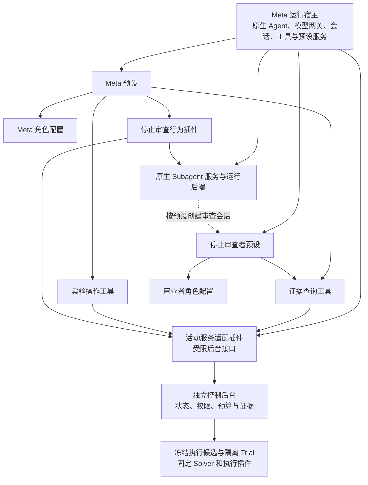

# Meta Harness 插件组合设计

日期：2026-10-19 · 状态：首期实现，持续验收 · 接口基线：DeepSeek Harness 0.2.1-rc.2

Meta Harness 通过 DeepSeek Harness 原生插件和 Agent Preset 组合，为开发模型提供读取证据、开发执行插件、组织实验、比较版本和交付报告的能力。模型自主选择研究方向；停止审查插件在模型申请“继续改进已不值得投入”时，调用独立上下文的审查者核对依据。活动预算、权限和最终状态仍由独立后台执行。

对外可将这套组合称为“Meta 插件包”。内部使用框架已有的服务、工具、事件、预设和 Subagent 机制，不另建插件管理器或 Agent 循环。Meta 优化的产物是执行 Harness 的候选组合；Meta 自身的组合与候选分别记录，执行项目不依赖 Meta 才能运行。

长期愿景是让 Meta Harness 本身也成为可研究的对象：通过修改、更换、添加和移除 Meta 插件，比较不同组合设计执行 Harness 的能力，再通过重复实验和消融判断插件的实际贡献。保留有证据支持、成本合理的能力，移除冗余或无收益的部分，让组合随证据演进。本期实现可替换、可冻结、可观察和可隔离的基础；不实现 Meta 组合的效果比较功能，也不开展真实比较实验。单个活动的复跑遵循当次用户授权。

## 1 文档位置与设计范围

本专题细化[总体实现方案第 6 节](meta-harness-implementation.md#6-meta-harness-插件与统一服务接口)。文档分工如下，避免重复维护规则：

| 文档 | 维护内容 |
|---|---|
| [需求文档](../requirements/meta-harness.md) | 产品行为、探索自主性、三类停止条件、权限和预算要求 |
| [总体实现方案](meta-harness-implementation.md) | 执行、控制、工作台与 Meta 的边界及共同数据契约 |
| 本专题 | Meta 插件组合、停止审查、组合版本及未来比较所需的基础 |
| [执行插件开发资料设计](meta-plugin-knowledge.md) | 教给 Meta 的执行插件开发资料，不负责定义 Meta 自身的运行组合 |
| [开发任务书第 16 节](../plans/meta-harness-development.md#16-meta-插件组合与停止审查增量) | 首期重构及可比较性基础的实施和验证要求 |
| [运行说明](../operations/meta-harness.md) | 已可使用的能力、安装恢复方法和实际限制 |

本次设计覆盖 Meta 自身的插件化、停止审查及后续对照实验基础，不引入固定的“分析—提案—编码—测试”多 Agent 流水线，不要求每轮开发指定数量的插件，也不允许 Meta 在活动中自行改写已绑定的组合、停止契约、预算或评分规则。研究新 Meta 组合时，在独立的新活动中装配和评估它。

### 1.1 两层优化愿景

| 实验层次 | 被改变的对象 | 一次实验的单位 | 主要评价对象 |
|---|---|---|---|
| 执行 Harness 实验 | Solver 使用的执行插件组合 | 一个候选的一次任务 Trial，按批次组织 | 任务完成表现、稳定性和执行成本 |
| Meta Harness 实验 | Meta 使用的工具、上下文、策略及审查插件组合 | 一次完整进化活动，即一个 Campaign；同一组合安排多次独立活动 | 在相同研究条件和资源上限下，最终保留的执行 Harness 的质量，以及设计过程的可靠性和成本 |

Meta 插件数量、生成的候选数量、报告篇数或自我评价不能代替效果证据。某个插件是否必要，是相对于任务范围、预算和其他插件而言的条件性结论，不要求保留一套对所有情况都相同的最大或最小组合。

### 1.2 首期实现落点

`packages/meta-harness/composition.json` 是声明式组合入口，`composition.mjs` 转换为原生 Host 插件和两个 Agent Preset；服务、上下文、查询、操作和停止审查分别位于同目录的独立模块。原 `index.mjs` 的完整提示词与工具集合保存在 `legacy.mjs`，仅供旧活动兼容。

`src/control/meta_composition.py` 冻结插件包、执行运行时源文件、Meta 监督代码、渲染后的上下文、组合配置、依赖锁和不可变镜像 ID。恢复核验内容摘要和宿主依赖锁，缺失或不匹配则拒绝启动。`stop_review.py` 保存与核验独立审查；`meta_gateway.mjs` 将不同原生会话的请求故障隔离，同时共用原模型、活动截止与预算。

普通回合结束后的继续通知仍由现有控制后台和 SDK 会话驱动；没有新的 Agent 循环或对照调度器。新活动自动绑定 `stop-review-v1`，旧活动不升级。工作台和新生成报告展示组合、加载/触发回执、审查结论及其用量。模拟契约验证独立上下文、只读工具、批准/拒绝/非法输出/超时和插件替换/禁用；它们不证明真实审查判断的质量。

## 2 遵循 DeepSeek 的插件原则

插件划分以可组合、可替换的能力为依据。需要替换实现时，使用“服务定义—服务实现—消费者”结构：服务定义约定请求和结果，服务实现完成操作，消费者通过接口使用它。消费者可以是工具，也可以是行为插件。简单能力允许同时承担多个角色，不为形式预先拆出多个发布包。[官方能力设计教程](https://github.com/deepseek-ai/deepseek-harness/blob/master/docs/user/develop/practice/index.md)

每个插件明确声明依赖、配置、注册作用域和卸载行为。通过 `inject` 等待服务就绪，不靠配置文件书写顺序保证依赖；注册工具、提示词片段和事件处理器时归属正确的 Context，外部资源有对应清理。使用足以解决问题的局部扩展点，观察工具结果与转换结果分开，不为增加一段说明接管整个提示词装配。[Cordis 教程](https://github.com/deepseek-ai/deepseek-harness/blob/master/docs/cordis-tutorial/index.md)、[官方插件实践](https://github.com/deepseek-ai/deepseek-harness/blob/master/packages/preset/agent-preset/skills/cordis-plugin-development/references/practices.md)

以下概念分别使用：

| 概念 | 在本设计中的含义 |
|---|---|
| 插件 | 注册服务、工具、提示词或行为的代码与配置单元 |
| Agent Preset | 用普通插件声明某类 Agent 应装配的子插件，例如 Meta 与停止审查者 |
| Subagent | 运行时创建的子会话实例；其角色和能力来自选定的预设 |
| Meta 插件包 | 分发所需代码与组合声明；可通过 bundle/profile 接入现有启动链路 |
| 执行 Candidate / Runtime Bundle | 冻结的 Solver 执行项目，属于被优化对象，不是 Meta 组合包 |

原生预设管理器负责组合的加载与作用域，Subagent 服务负责子会话的受理、运行和取消。它们不替代本项目后台的持久账本及操作系统隔离；同进程子会话的上下文独立，不等于安全沙箱。[Agent Preset](https://github.com/deepseek-ai/deepseek-harness/blob/master/packages/preset/agent-preset/README.md)、[预设注册与限制](https://github.com/deepseek-ai/deepseek-harness/blob/master/packages/preset/agent-preset-registry/README.md)

## 3 组合结构与插件职责

宿主装配共享运行服务，Meta 与审查者分别选择自己的预设。角色提示优先使用原生 Persona 插件；查询和操作工具按可复用性与权限需求划分。下列名称为设计名称，不表示新增包或接口已存在。

图中查询工具表示同一插件实现分别在两个预设中注册，不把 Meta 的写工具全局暴露后仅靠提示词要求审查者不要使用。

这里的运行宿主指隔离 Runner 内的 DeepSeek Host，活动服务适配插件也在该边界内运行。Runner 外的固定宿主持有凭据、模型网关和计量通道；适配插件经受控通道访问后台，不取得这些宿主权限。本文后续的“固定宿主核验”属于外部边界，不由模型生成的插件代码承担。

| 部分 | 类型与依赖 | 主要职责与边界 |
|---|---|---|
| 活动服务适配插件 | 宿主侧 Cordis 服务实现；消费固定网关与后台协议 | 提供活动状态、允许材料、开发工作区、候选、实验、报告与结束申请接口。调用带会话身份、取消信号和幂等标识；后台保持唯一业务事实来源，不复制调度器或账本 |
| 证据查询工具插件 | 预设内工具消费者；依赖工具注册服务及活动服务 | 注册材料、SDK、版本、实验和证据查询。Meta 与审查者复用；按活动身份和反馈规则过滤，只返回允许的内容与稳定引用 |
| 实验操作工具插件 | Meta 预设内工具消费者；依赖工具注册服务及活动服务 | 写插件、运行隔离开发检查、冻结候选、提交实验、保存分析、选择版本、申请结束、导出已有候选。各操作沿用后台权限和计量，不提供用户管理能力 |
| 停止审查插件 | Meta 预设内行为扩展；依赖工具执行扩展点、活动服务及 Subagent 服务 | 识别第二条结束申请，创建审查者，校验结果并关联审查记录；拒绝或证据不足时将理由返回主 Meta。自身不直接决定实验方向或修改后台预算 |
| Meta 角色配置 | 原生 Persona 与提示词片段 | 提供目标、固定 Solver、研究自主性、工具使用和停止约定；详细资料按需查询 |
| 审查者角色配置 | 独立预设中的原生 Persona 与查询工具 | 从独立上下文审查停止依据，只读证据，不开发插件、不提交实验、不结束活动，也不递归发起审查 |

宿主复用 `dsh-agent-preset-registry`、`dsh-agent-preset`、`dsh-subagent` 与适用的运行后端。首版审查采用显式选择审查者预设的 in-process spawn，由停止审查插件程序化调用服务并收集结果；不因需要审查就默认向主模型开放通用委派工具。当前最小运行 profile 需要实际补充并验证这些能力，不能把依赖包已安装视为已启用。[Subagent 接口](https://github.com/deepseek-ai/deepseek-harness/blob/master/docs/subsystems/subagent.md)

首版审查者使用活动当前 Meta 模型及调用设置，并记录实际配置；它是额外的 Meta 调用，不参与 Trial 求解。新上下文用于减少对主会话结论的依赖，不保证消除同一模型的判断偏差。以后需要其他审查模型时，再作为明确的活动配置扩展。

分析失败、提出假设、比较候选和撰写报告由 Meta 使用这些能力完成，不预先为每个思考步骤增加插件。只有某种方法需要独立配置、替换或复用时，再抽出策略插件。

插件应能在声明的接口下替换实现、修改配置或从新组合中移除。每个可研究插件说明依赖、触发条件、可观察效果、关闭后的行为，以及可用的基线实现。维护服务定义的兼容边界，避免工具直接导入另一个策略插件的内部实现；也不允许多个插件无记录地覆盖同一行为而无法确定实际生效者。实验所需的消融说明是组合元数据，不要求另建一套插件生命周期框架。

## 4 服务和作用域契约

### 4.1 服务与工具的边界

活动服务定义描述输入、返回结果、错误类别和调用身份。适配器将请求转到现有后台；工具只负责参数表达、返回渲染和必要的模型说明。停止审查使用同一服务读取证据，不通过调用另一个工具的展示文本取得业务数据。服务定义与实现可先放在同一安装包中，以独立模块保持依赖清楚。

服务返回的官方评分、派生任务完成分、失败类别、候选身份和证据引用沿用平台契约。插件不得另算一套成功率。工作台、报告、Meta 与审查者统一使用活动绑定的 `task-completion-v1/v2`：官方原始分数保留，符合规则的模型输出异常、未提交及约定限额耗尽计入零分；v2 将最终未恢复的模型过载和连接故障计 0，其余外部故障、取消、待定和待归因单列；旧活动按 v1 读取。具体归因与聚合规则以[需求第 3.3 节和第 6 节](../requirements/meta-harness.md#33-读取证据)为准。

Meta 与审查者的身份由固定宿主和网关绑定，不能由模型通过工具参数自报角色。审查者只读权限还要由后台校验；隐藏工具或切换预设不能作为唯一权限边界。开发执行插件时的 SDK 查询仍绑定目标执行环境，不暴露整个 Meta 宿主的注册表、密钥或管理能力。

### 4.2 提示词与配置

Meta 和审查者各自使用预设中的 Persona。工具说明、停止约定及其他能力按所需作用域贡献提示词片段。迁移现有 `complete: true` 时同时清理不适用的默认角色文本，验证每个片段实际进入正确会话，不只验证配置已加载。[Persona 行为](https://github.com/deepseek-ai/deepseek-harness/blob/master/packages/preset/persona/README.md)

活动目标、用户输入和证据保持字面量语义，不将其中的模板标记再次求值。保留当前模板版本、实际渲染内容和摘要的记录能力，增加组合身份及审查者角色版本。通用说明可使用原生配置，动态目标可通过明确禁止插值的片段注入。

可调策略放入版本化配置，例如审查者预设、单次审查的时间或用量限额、技术故障的有限重试与空转保护。它们受 Campaign 的剩余额度和截止约束，不能增加隐含的额外预算。初版不写死“至少三个方案”或“连续几轮不提升就停止”。

### 4.3 状态与生命周期

活动状态、实验结果和正式审查记录由后台持久化；模型可见的审查请求、结论和后续输入同时进入可恢复的会话记录。插件内存只保存可重建的状态，不成为批准结束的唯一依据。

预设定义可能被多个 Agent 共享，不能把每个活动的进行中审查放在一个未区分会话的闭包变量中。每 Agent 注册归其上下文所有，同时受插件卸载清理；跨重启需要恢复的信息使用后台存储或框架支持的持久机制，不随意增加未声明的会话事件类型。

审查超时、用户要求终止、插件卸载和进程退出都需要取消对应激活并等待清理。活动暂停时停止新审查，已启动审查按原暂停策略完成或终止，不能因增加子代理改变既有暂停语义。使用原生 Subagent 的受管生命周期；激活发布后按其接口显式释放，不能假定启动时传入的取消信号会自动取消已经运行的子会话。子调用经同一固定模型网关预留和结算，未知用量保留待核实状态。

## 5 三类停止条件与审查协议

### 5.1 停止条件的不同职责

| 条件 | 受理依据 | 谁负责判定或执行 |
|---|---|---|
| 第一条：达到约定稳定目标 | 同一个冻结候选在约定任务、执行条件和重复要求下满足活动预先约定的标准；不得拼接不同版本的最好结果 | 后台核验候选、证据与可机器检查的条件；未明确到可核验的标准不能宣称已认证达标。需要补充约定时明确记录，不由模型临时降低门槛 |
| 第二条：充分探索后继续改进的预期收益不足 | 有实质区别的尝试、负结果与剩余方向分析，解释为何在当前目标及剩余额度下不值得继续；须经独立审查 | Meta 提出停止申请，审查插件调用审查者，后台核验有效审查记录后受理 |
| 第三条：资源达到限制 | 轮数、Trial 准入、时间、用量和收尾预留的实际状态 | 后台直接执行，不等待模型或审查批准；仅准入额度用满时保留已受理工作按既定策略完成 |

第一、第三条是较严格的停止依据。第一条的稳定标准未约定时，不凭一次成功或自然语言信心代替它；第二条仍可独立申请。用户停止、外部故障和恢复待核实单列，不能伪装成目标达成或“已无改进空间”。

审查同意第二条只表示支持本次活动的停止判断，不证明所有可能改进已经穷尽，也不证明当前候选已达到第一条的稳定标准。活动可以保留 H0 并合理提前结束，不要求耗尽资源或为了凑数量制造插件。

### 5.2 第二条应审查哪些依据

Meta 的申请需要引用已有记录，说明：

1. 尝试过哪些有实质区别的方向，分别改变了什么行为；重复改写同一提示词不能仅按次数证明探索充分。
2. 对应候选与实验结果支持什么结论，是否真的观察到插件触发，是否存在未提交、模型异常或外部故障等不同原因。
3. 哪些问题尚未解决，哪些方向尚未尝试，以及继续验证的预期收益与成本。无需证明穷尽所有方法，但不能只写“没有想法”。
4. 当前保留版本、剩余资源与在途实验。可能影响结论的结果尚未返回时，解释为什么可以提前判断。

一次候选退化、一个插件没有收益、一次报告完成或单纯缺少可用评分，都不足以单独支持停止。外部故障导致没有有效比较，通常说明证据不足或运行受阻，不能作为 Harness 无法改进的证据。审查者可建议继续的方向或补充证据，但不把建议变成固定研究流程。

### 5.3 一次停止审查的流程

1. **提出申请。** Meta 通过结束工具声明适用条件、理由及证据引用。第二条进入审查；普通模型回复或回合结束不会触发活动收尾。
2. **固定审查输入。** 后台生成申请 ID，绑定活动、候选、相关证据修订、停止策略版本和预算快照。审查者读取权威材料；主 Meta 的总结标记为待核验的分析。
3. **创建独立会话。** 停止审查插件用原生 Subagent 服务显式选择审查者预设，提供申请和材料入口。使用新的上下文，不复制完整主会话，不继承实验写工具。
4. **取得结构化结论。** 审查结果包含结论、理由、证据引用、未解决问题和建议补充内容。结论为 `approve`、`continue` 或 `insufficient_evidence`；异常、超时、空结果及无法解析的返回属于审查失败，不按批准处理。
5. **记录并核验。** 固定宿主核验受管子会话归属及结果，后台保存审查记录。结束请求只能引用记录 ID，不能由主模型自行填写 `approved: true`。后台检查同一活动、申请、候选、证据与策略身份，并重新检查实际资源和在途状态。
6. **收尾或继续。** 有效批准后按第二条进入收尾；其他结论返回主 Meta 继续研究或补证据。若过程中已触发资源限制或用户停止，由后台按实际原因处理，不等待审查完成。

行为插件优先在结束工具的异步执行前扩展点接入；其他工具按原链路继续。不能把等待子代理的异步工作放进同步 `guard`，也不能拦截所有回合结束来审查活动是否应停止。具体事件签名以锁定安装版本核对，相关接入须通过原生会话契约验证。[工具扩展方式](https://github.com/deepseek-ai/deepseek-harness/blob/master/docs/cookbook/extension-cookbook.md)

审查记录不是由模型自由填写的报告字段。固定宿主必须能区分主会话的工具参数与受管审查会话的实际结果；后台拒绝跨活动、伪造或不适用的批准引用。审查期间相关候选、证据或停止约定改变时，旧批准不得静默复用；单纯审查自身产生的用量和记录追加不必使批准失效，但提交结束时须重新检查余额。

### 5.4 失败、重复与资源竞争

同一申请只允许一个有效的在途审查，重复调用返回同一状态，不反复创建付费子会话。审查未通过后，需要新增证据或实质修改申请才能重新审查，不能重复请求直到偶然获得批准；后台保留所有申请与结果，不删除拒绝记录。

审查失败不能绕过第二条门槛。可按配置进行有限技术重试，消耗照常记账；不能无限重试或为了等待审查延长活动。服务或模型持续不可用时记录运行受阻；若已经触发资源停止则进入对应收尾，不能将故障改写成审查通过。

审查计入 Meta 总用量、墙钟与原有活动上限，不计为 Solver Trial 或实验轮。它与主 Meta、并发实验共享预留账本，不能分别使用同一余额。严格截止时取消未完成审查，保存部分证据和实际消耗。

## 6 持续探索与活动续接

主 Meta 自主决定继续分析、修改、开新分支、追加验证或等待结果。停止审查只约束第二条结束申请，不改变研究步骤。审查拒绝后的反馈应说明尚缺什么依据，而不是只返回笼统的“禁止停止”。

后台和固定宿主继续拥有活动通知与恢复职责。活动仍在运行、尚有可用资源且存在可推进工作时，普通回合结束不等于活动完成；没有在途工作可等待时，应通过持久的续接请求再次唤醒 Meta。正在等待实验时合并通知并等待相应事件，避免无意义地反复调用模型。

如在 Agent 内实现唤醒，复用框架的 follow-up／事件机制；注入上下文不等于唤醒空闲 Agent。请求按活动、会话和消费位置去重，恢复先核对账本和已处理通知，不能重交实验。首版不为此新增另一套通用循环或调度服务。

连续空转或通知异常按有限保护策略记录为运行故障或待处理状态，不能悄悄将活动标为成功结束。是否主动停止仍通过三类条件表达，不把“持续探索”实现成必须耗尽所有预算。

## 7 组合版本与迁移边界

每个新活动或明确的 Meta 配置修订记录：框架和依赖锁身份、Meta 插件源码摘要、预设 ID 与实际配置摘要、系统提示词身份、停止策略版本及审查者配置。它们是开发来源，独立于 Solver Candidate 的内容身份；只改变 Meta 的研究能力不应伪造成一个新的执行版本。

在此基础上增加独立的冻结 Meta 组合记录，包含父组合、变更目的、插件及配置差异、实际装配顺序与作用域、相关资产和内容摘要。受影响的模板、技能或资料配置也纳入身份；用户目标、研究材料和模型路由由活动另行冻结并关联。启动时记录实际加载回执，包括生效的插件、角色、工具和行为配置，声明与实际不符时标记装配失败，不继续形成正常对照结果。

同一个组合可被多个 Campaign 引用。作为 Meta 对照样本的活动从开始到结束使用同一组合和模型配置；中途换组合或模型属于协议偏离，应保留记录并单独解释，不能把换前换后的成果统归给某一组合。研究新版本时创建新组合及独立活动，恢复同一活动不自动更新到最新版。

原生预设保留运行中 Agent 的组合版本，但其内存修订不能代替跨进程的不可变快照。恢复时从已记录的组合资产装配；无法恢复同一配置时明确记录配置变化或阻塞原因，不把当前同名预设冒充历史版本。[预设版本与恢复限制](https://github.com/deepseek-ai/deepseek-harness/blob/master/packages/preset/agent-preset-registry/README.md)

迁移分为以下边界，具体工作及验收由开发任务书维护：

- 在 `packages/meta-harness/` 内先分离服务、查询工具和操作工具，保持单包安装及现有权限，不要求立即独立发布每个模块。
- 用原生预设组合 Meta 与审查者，验证作用域、提示词和实际工具可见性，再接入停止审查协议及后台校验。缺失所需服务时明确报能力不可用，不退回无审查结束。
- 给新活动绑定新的停止契约。已有活动的旧结束理由和原始记录不自动补成“已审查”；进行中旧活动不因软件更新静默切换契约，需要明确的配置迁移记录。
- 工作台和报告展示主停止原因、审查状态、主要依据、剩余资源及未完成项，共用后台记录。停止审查通过与任务成功率、候选保留、交付验收分别展示。
- 保持 Solver profile、执行 Bundle 和独立导出的依赖闭合；Meta 的审查预设及控制客户端不进入执行项目。原始评分、选择记录和历史报告不回写。

## 8 为后续比较保留的设计基础

本次只设计 Meta Harness 的可比较性，不实现比较平台、不安排重复活动或消融实验。组合重构需要保存足够明确的接口、配置与行为记录，让以后研究插件贡献时可以复用这些基础，不必再改写 Meta 的结构。

### 8.1 可替换的插件与合法的消融边界

修改、更换、添加和移除插件都通过明确的组合配置表达，并形成新版本。每项可研究能力说明提供和消费的服务、事件及配置，避免直接依赖其他策略插件的内部代码。关闭能力时清理其工具、提示词、事件处理器和临时状态，不留下影响下一次运行的隐藏行为。

组合校验应识别依赖缺失、服务冲突和不兼容配置，并说明某个插件能否独立移除。不能独立移除时，记录可替换的基础实现、适用的无操作实现或需要共同改变的依赖组。保留接口不等于行为完全相同，可见工具、提示词和开销的连带变化也需要进入组合差异。

每个插件及组合至少保留以下说明，不要求新增独立发布包：

| 信息 | 为未来研究提供什么 |
|---|---|
| 职责、行为及触发条件 | 明确插件预期改变什么，什么时候可能起作用 |
| 服务、事件、配置与依赖 | 能检查装配是否合法、替换是否兼容 |
| 启用、禁用和缺少输入时的行为 | 能确认能力真的被加入或移除，没有隐含替代或残留 |
| 基线实现或不可独立拆分的原因 | 能区分单插件消融与一组能力的共同变化 |
| 可观察结果与已知限制 | 能区分实际作用、未触发、失败和未知，不把用途当成效果证据 |

预算执行、身份权限、原始评分和证据完整性仍由外部基础设施保证。停止审查可以替换符合既定契约的实现；不能通过卸载插件绕过正常活动的第二条停止门槛。将来若研究停止契约本身，应另行明确研究边界，不把插件失效误当成合法基线。

### 8.2 冻结组合与活动来源

第 7 节的 Meta 组合是可重复装配的资产，不能只有名称、可变路径或一个预设 ID。修改插件源码、配置、角色文本或相关依赖时生成新的内容身份，保留父版本、差异及改动目的。源码、配置与依赖锁可归档并恢复，不依赖当前工作区仍然存在。

每次 Campaign 关联精确 Meta 组合，并保存实际加载回执、Meta 与 Solver 模型设置、起始执行候选、任务与环境身份、目标、可见材料、停止规则和资源上限。这些字段为未来筛选可比较活动提供依据；信息缺失标为未知，不从当前设置反推历史。

最终保留的执行候选、活动结果和消耗能够沿 Campaign 回溯到 Meta 组合。Meta 版本与执行 Candidate 分开编号和展示，不能把一次执行 Trial 当成一次独立的 Meta 设计实验。当前只保留这些关联，不新增对照计划、重复调度或 Meta 版本自动排名。

### 8.3 行为观察与状态隔离

记录应回答插件是否加载、是否触发、做了什么、是否降级或失败，以及对应活动和证据在哪里。观察优先复用原生事件及平台持久记录，不另写一套会话日志；行为摘要与原始证据可互相定位。能够可靠归属的成本可关联插件，无法归属时标未知，不将共享调用重复计入多个插件后再相加。

不同活动的工作区、会话和插件状态必须隔离。全局缓存、历史资料或长期记忆如果影响行为，需要明确来源、初始内容和可见范围，不能让后运行的组合无记录地继承前组的新成果。恢复同一活动可以按记录续接，开始新的活动不能误用前一活动的临时状态。

### 8.4 将来评价时应保留的原则

未来比较将以完整进化活动为主要样本，在共同起点和资源条件下考察最终执行成果、研究可靠性及成本；生成更多插件、候选或报告本身不等于设计能力更强。独立重复、成果评估和统计方法留待比较能力的专门设计，本次不实现。

活动失败、没有新改进、外部故障和未知用量均应保留，便于以后区分效果与运行问题。结果和材料还需保留用途及反馈来源，使以后能够判断哪些证据已经参与 Meta 组合选择。消融结论应说明适用条件、插件交互与不确定性，不能将一次没有观察到下降解释为插件永久无用。

## 9 本次范围与后续边界

| 设计调整 | 本次需要明确的基础 | 暂不实施的比较能力 |
|---|---|---|
| 插件可替换 | 接口、依赖、配置、关闭行为、合法基线及组合校验 | 自动生成消融矩阵、穷举组合 |
| 组合可冻结 | 不可变资产、父版本、差异、实际加载回执和恢复身份 | Meta 版本自动筛选、排名或晋升 |
| 来源可追溯 | Campaign 关联组合、共同条件、最终候选和原始结果 | 对照研究管理、重复活动批量调度 |
| 作用可观察 | 插件触发与结果记录、可靠的成本归属和未知标记 | 跨活动统计、显著性判断或自动贡献分析 |
| 状态可隔离 | 独立活动状态、可见材料及缓存来源、正确的生命周期清理 | 专用比较页面、消融报告或真实研究实验 |

本次修改只完善设计文档。未来实施首期组合重构时，将上述基础纳入同一批接口和验证工作，要求插件可装配、替换、禁用、恢复并留下真实记录；无需以完成一轮 Meta 比较来验收。具体比较计划、研究总预算、评估方法和界面在后续需要时另行设计，不要求先建会递归修改自身的更高层 Meta。

## 10 框架依据与验证入口

设计采用项目锁定版本的接口；上游文档用于解释机制，不视为本项目已启用能力的证明。实施时优先核对实际安装包的 README、类型声明与目标 profile，并将发现的差异写入对应设计或运行限制。

| 依据 | 核对内容 |
|---|---|
| [官方架构](https://github.com/deepseek-ai/deepseek-harness/blob/master/docs/architecture.md) | 原生插件、宿主服务、会话和运行循环的关系 |
| [能力设计教程](https://github.com/deepseek-ai/deepseek-harness/blob/master/docs/user/develop/practice/index.md) | 服务定义、实现与消费者，以及何时需要拆包 |
| [Cordis 教程](https://github.com/deepseek-ai/deepseek-harness/blob/master/docs/cordis-tutorial/index.md) | 依赖、事件、配置、作用域和资源清理 |
| [Agent Preset](https://github.com/deepseek-ai/deepseek-harness/blob/master/packages/preset/agent-preset/README.md) | 通过插件声明角色组合 |
| [Subagent 子系统](https://github.com/deepseek-ai/deepseek-harness/blob/master/docs/subsystems/subagent.md) | 原生受管子会话、结果收集与取消 |
| [插件实践](https://github.com/deepseek-ai/deepseek-harness/blob/master/packages/preset/agent-preset/skills/cordis-plugin-development/references/practices.md) | 使用局部扩展点、状态归属和模型可见记录 |

首期验收需证明组合实际生效、版本可冻结、行为可观察、状态相互隔离、审查无法绕过、拒绝后能够续接、所有调用共用预算、取消及恢复不重复启动，并保护旧活动与执行导出。验证清单见[开发任务书第 16 节](../plans/meta-harness-development.md#16-meta-插件组合与停止审查增量)，不要求开展真实 Meta 比较或实现比较管理功能。仅更新文档不代表这些检查已经通过。

## 11 首期配置与接口约定

- 组合行声明 `id/scope/module/enabled/config/requires/provides`。模块必须来自本地受信插件包；控制 API 不接受任意宿主路径或上传可执行源码。更换实现时保持消费者所依赖的能力名称。禁用后不会注册相应工具/事件；依赖仍启用时移除提供者会拒绝装配。
- 工具插件消费 `metaControl.call(operation,input,exec)`；行为插件消费 `metaControl.runtime(action,input,signal)`。实际调用者由原生 Agent 提供，固定宿主校验带随机数的签名消息；模型工具参数不能声明自己的身份。模块按预设作用域卸载注册，审查激活由行为插件在完成、失败和取消时 `dispose()`。
- `context.mjs` 的替换实现消费 `{text,pluginId,compositionId}`，`text` 是相应角色的冻结字面量。其他预设插件也可读取该配置但不得更改活动原目标。`stop-review.mjs` 的技术超时为 `timeoutSeconds`，默认 300 秒，仍受活动截止限制；没有自动技术重试。
- 研究新组合时可在新活动创建配置中传 `metaCompositionConfig`；省略时使用默认组合。`parentId` 是来源说明，首期不自动生成跨组合差异或效果比较。关闭停止审查插件只会使第二条提前停止不可用，不撤销后台门槛；资源上限与用户停止仍生效。
- 稳定规则需在创建时明确提供 `stabilityRule: {minTrialsPerTask, minimumOfficialScore}`，前者至少 2。后台要求最终选定的同一候选在所有所选任务上的全部已启动尝试均结束且达到该官方分数，次数满足约定。未提供时不能以第一条提前结束，第二、第三条仍可用。
- 审查结果必须来自已登记的原生只读子会话。一个相关证据快照只取得一次审查意见，改写理由不触发重复付费投票；后续候选、实验、证据或限制变化后才可提交新申请。普通用量、心跳和审查记录不改变快照。审批不等于统计稳定或因果提升认证。
- 审查请求的逐次模型用量关联原生会话 ID；该子集已经包含在 Meta 总量。上下文等没有独立触发探针的插件显示未单独观测，不根据加载成功推断有效。
