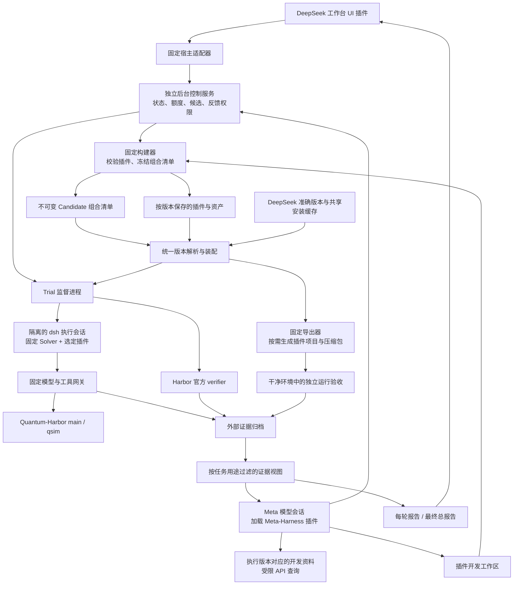

# Meta-Harness 实现方案

日期：2026-10-21 · 状态：架构基线，包含已实施与待完成部分 · 需求基线：[meta-harness.md v0.12](../requirements/meta-harness.md)

开发执行规则、自动完成条件和人工验收点见面向 Codex / GPT-6 Astra 的 [AI 开发任务书](../plans/meta-harness-development.md)。M0–M5 由 AI 自检后连续推进；人工验收聚焦最小真实闭环的使用体验，以及最终交付是否满足需要，不要求用户逐项验收底层技术。通用已知限制见[运行说明](../operations/meta-harness.md)。具体实施进度与验证证据保存在本机被忽略的 `reports/development/meta-harness/`，不随源码分发；不能仅依据本方案认定完成。新克隆应核对代码和可执行检查，不依赖私人记录才能安装。

新活动的用户上限、Meta 运行计划和平台执行条件通过 `meta-resource-planning-v1` 分离，接口与验收见[资源规划与限额执行修改计划](../plans/meta-resource-planning.md)。`resourcePlan` 单独版本化，批次保存条件快照；旧活动沿用原有预算与调度规则。宿主以结构化准入协议等待临时预留，网关在实际模型调用前独立保存准入审计。已启动进程的动态扩容不在此次增量内。

执行版本的保存与导出已按[插件版本管理与按需导出方案](plugin-versioning-and-export.md)实现：新 Solver 候选使用组合清单、共享对象及安装缓存；历史 Runtime Bundle 保留兼容。Meta 通用 Agent、完整证据路径与会话恢复已通过新 `meta-composition-v2` 实现核心链路，完整目标见[专项方案](meta-agent-and-evidence.md)，实际限制与验收进度见运行说明。旧活动不自动切换。

## 1. 核心架构决定

采用 **DeepSeek 通用 Agent + Meta 业务插件 + DeepSeek 工作台 UI 插件 + 独立后台控制服务 + 隔离的执行运行时**。主 Meta 继承原生开发能力，业务插件提供实验、版本、报告及停止审查操作；工作台通过 DeepSeek 原生客户端扩展服务于用户；后台负责固定规则、持久化、调度、预算和交付。模型自主选择研究方法。原生预设与首期停止审查已经接入，职责见[组合设计](meta-harness-composition.md)；通用能力、持久文件和恢复按新专项方案实施。

两个插件可作为同一套件安装，分别启停。工作台的固定宿主适配器连接后台服务，浏览器端呈现界面；后台由独立服务进程持有，UI 的卸载只释放界面和连接，不销毁活动、账本或 Trial 监督进程。后台主动停止和故障恢复遵循既定运行策略。

测试与导出共用**不可变的候选组合清单及其引用的插件版本**。DeepSeek Harness 只记录准确版本、获取来源及必要校验信息；插件源码与资产按版本保存一次，Candidate 记录引用、有效配置和锁定依赖。Trial 与导出复用同一套版本解析、校验及原生装配规则，按需生成运行目录或交付项目。完整 Runtime Bundle 作为历史格式兼容，不再作为新候选长期保存的单位。

第一版按单机、单用户设计，同一时间运行一个 Campaign，Campaign 内允许受控并发 Trial。保留多个历史活动和多个候选分支。当前 Quantum-Harbor 是首个环境适配器，模型循环继续使用 DeepSeek，不另写一套 Agent 循环。

Meta Harness 自身也作为可实验的插件组合演进。首期重构为此提供可替换能力、冻结组合、作用记录、活动关联和状态隔离；未来可以据此比较不同组合设计出的执行成果及研究成本。当前只设计这些基础，不实现比较管理或运行对照实验，也不改变第一版的并发范围；具体边界见[专题第 8、9 节](meta-harness-composition.md#8-为后续比较保留的设计基础)。

新建 Campaign 的 `prepare_h0` 操作先为所有所选任务准备镜像，再装配 H0。控制层 `task_images.py` 串行维护可复用构建缓存，整套镜像锁一次性写入 Campaign；执行层只校验和消费 main/qsim/verifier 的不可变 ID。运行中禁止构建、拉取或重新解析可变标签，清理保留共享镜像并删除每个 Trial 的容器与数据卷。`campaign-pinned-v1` 仅标记新活动；旧活动不迁移。v2 镜像锁同时覆盖任务树及根目录构建输入，v1 锁仍按原摘要范围校验。

| 部分 | 建议实现 | 理由 |
|---|---|---|
| 控制服务与调度 | Python、FastAPI、单个独立控制进程；独立 Trial 监督进程 | 延续当前 Harbor/Python 链路；UI/Meta 退出不撤销运行控制 |
| 模型运行与插件 | Node.js ESM，固定 dsh 0.2.1-rc.2；提供类型声明 | 复用当前会话、Cordis 和工具集成；按职责迁移目录，保留既有 JS 语言实现 |
| UI | DeepSeek 客户端插件；React + TypeScript，按锁定版本的客户端 bundle 约定构建 | 复用主面板、布局与主题，使用宿主提供的兼容共享模块；不预设独立 Vite 应用 |
| 开发资料与查询 | 版本化只读资料包 + 目标执行环境的受限 API 查询 | 教会 Meta 正确使用接口，避免依赖开发宿主特有能力 |
| 状态与文件 | SQLite 事务记录 + 按内容摘要保存的文件目录 | 计数、预留与状态变更需要原子性；大轨迹不放数据库 |
| 接口 | 后台 HTTP JSON + SSE；工作台经固定宿主适配器桥接；Meta/执行请求走受控通道 | 共用业务契约并区分用户与模型身份，支持断线后续读事件 |
| 报告 | 结构化事实 + 模型分析修订 + 静态 HTML/Markdown | UI 和离线报告使用同一事实来源，卸载 Meta 后仍可阅读 |

FastAPI 提供 OpenAPI/JSON Schema，可用来生成后台客户端类型。UI 使用 `dsh.client` 与 `./client` 声明，遵守 dsh 的 bundle、依赖和共享模块约定；具体构建配置由 M0 原生接入验证确定。新依赖选择兼容版本并锁定。[FastAPI 文档](https://fastapi.tiangolo.com/features/)、[DeepSeek 客户端插件文档](https://github.com/deepseek-ai/deepseek-harness/blob/master/packages/client/modules/README.zh.md)。



这里的控制流程保证运行正确性，不规定模型先分析哪类问题、使用何种改进算法或必须开发哪些插件。

## 2. 初期代码复用与迁移背景

本节保留 M0/M1 建立完整 Runtime Bundle 时的背景与文件映射，不作为当前代码缺口清单。后续插件版本存储重构以第 4、10 节及专项方案为准。

| 当前实现 | 处理方式 |
|---|---|
| [dsh_session.mjs](../../src/runtime/core/dsh_session.mjs) 启动 SDK、处理请求与退出 | 保留协议封装；补取消、可靠进程回收、持久会话/恢复适配。Meta 与 Solver 各用独立会话 |
| [worker.mjs](../../src/integrations/quantum_harbor/worker.mjs) 核对模型、装配工具、记录轨迹 | 拆为通用执行入口与 Harbor 输入适配；从 Bundle 根目录解析资源，不从开发仓库找代码 |
| [agent.py](../../src/integrations/quantum_harbor/agent.py)、[bridge.py](../../src/integrations/quantum_harbor/bridge.py)、[mcp_tunnel.py](../../src/integrations/quantum_harbor/mcp_tunnel.py) | 保留官方环境接入和工具语义；将插件执行移入隔离 Runner，外层保留权限、超时与归档 |
| [profile.mjs](../../src/integrations/quantum_harbor/profile.mjs) 核验固定工具清单 | 扩为“不可删的基础工具 + 已声明的新增/包装工具”核验；不能为支持插件取消清单检查 |
| [run.py](../../src/integrations/quantum_harbor/run.py) 与 [batch.py](../../src/integrations/quantum_harbor/batch.py) | 抽出单 Trial 启动/收集能力；新调度器负责任务重复、并发、恢复与计数，旧入口保留兼容 |
| [results.py](../../src/integrations/quantum_harbor/results.py) 读取官方结果并核验归档 | 保留评分权威与哈希逻辑；补失败/中断也能收集的结果结构，原始分数与允许反馈分开 |
| [usage.mjs](../../src/runtime/core/usage.mjs) 与 [chatgpt_auth.mjs](../../src/integrations/models/chatgpt_auth.mjs) | 复用用量语义与认证来源；认证移到插件进程之外；增加按请求计量和额度预留 |
| [H0 配方](../../recipes/h0-sol.json) 中 `modules: []` | 迁移为合法的空插件候选，作为装配、比较和导出的第一条验收路径 |
| 本地 dsh 的 `dsh-client-modules`、`dsh-client-ui-layout`、`dsh-tool-cordis` | 分别用于原生 UI 接入和受限 API 查询的技术验证；须在目标 profile 验证，不因包已安装就视为已接入 |

有三个缺口需要优先处理：

1. **归档快照尚不等于从快照执行。** 当前 `run.py` 虽复制源码，但 Harbor agent 的 `PYTHONPATH` 仍指向工作仓库；需要将 Python adapter、Node worker 与依赖都绑定到冻结 Bundle。
2. **当前宿主机插件进程不适合直接运行生成代码。** H0 的模型工具访问受限，但同进程 JS 插件仍可使用宿主机文件和进程能力。Cordis 作用域不能代替操作系统隔离。
3. **当前结果读取面向成功完成的 H0 流程。** 新系统需持续记录基础设施失败、模型中断、未评分和部分完成；不能等全部成功后才生成统一结果，也不能将完整 `score` 直接交给 Meta。

这些改动构成新的基础设施版本。即使目标是保持 H0 行为，也应重新检查提示、工具语义和模型设置的等价性，再建立新基础上的 H0 对照。历史结果用于参考，原记录不改写。

## 3. 模块边界与目录安排

### 3.1 目标目录

以下是实施阶段采用的目标结构，不表示目录或能力已经存在。M0 确定映射与依赖规则，M1 完成已有执行代码的主要迁移；后续功能直接在对应边界内实现，随功能落地创建目录。仓库保持一个项目，`packages/` 表达两个 DeepSeek 插件的安装边界，不要求把每个内部模块做成独立发布包。

```text
AGENTS.md                    # 开发代理入口；链接需求、架构与执行任务书
src/
  execution/                 # 可独立运行的执行能力，不导入平台或两个宿主插件
    bundle/                  # 插件版本、组合清单、装配与旧 Bundle 兼容
    runner/                  # dsh 启动、插件加载、进程内协议客户端
    host/                    # 固定模型网关、工具桥、审计、单次运行监督
    adapters/quantum_harbor/  # 官方环境接入、结果解析与执行归档
  control/                   # Campaign API、数据库、调度、预算、恢复、Meta 会话管理
  evidence/                  # 原始索引、反馈过滤、可定位证据视图
  reporting/                 # 事实快照、分析修订、HTML/Markdown 渲染
  exporting/                 # 按候选清单及插件引用组装项目与压缩包
packages/
  meta-harness/              # Meta 工具注册、受限后台客户端、开发资料查询入口
  meta-workbench/            # 经典 UI 与共享客户端业务
  meta-workbench-studio/     # 新 UI 插件包；独立面板与 ./client
  meta-workbench-bridge/     # 新旧 UI 共用的固定宿主 API 桥
    host/                    # 用户身份的后台连接与事件桥接
    client/                  # 主面板、导航入口、React 视图与主题接入
schemas/                     # 有版本的数据契约及兼容性样例
knowledge/plugin-sdk/        # 资料编排、技术样例及资料包构建输入；reference/ 本地生成
profiles/                    # Meta 开发、工作台等宿主组合；不用于 Solver Trial
recipes/                     # 可复用执行配方，保留 H0 配方
experiments/                 # 可复用实验计划，保留已有入口引用
templates/standalone/        # 安装说明、配置示例、启动入口模板
tests/                       # 现有测试 + 契约、隔离、恢复、导出、UI 测试
docs/                        # requirements、design、plans、operations；brainstorm/ 仅本地保留
reports/                     # 本地研究、开发与验收记录；被 Git 忽略
```

### 3.2 职责与依赖约束

- **执行依赖必须闭合。** `src/execution/` 只依赖明确声明的运行库、执行所需的契约和固定运行资产；不得直接或间接导入 `control/`、`evidence/`、`reporting/`、`exporting/`、平台插件包或旧兼容层 `src/runtime/`、`src/integrations/`。执行侧的审计和官方结果采集保留在执行部分，平台读取它的产物。控制服务可以通过明确入口调用执行能力，执行能力不能回调 Campaign 服务才能完成一次运行。
- **平台持有业务规则。** `src/control/` 组织证据、报告、导出及其异步操作，持有 Meta 会话的启动、通知和恢复；这些能力不放进 UI 生命周期。`src/exporting/` 负责打包，真实独立验收的预算与调度仍由控制服务受理，导出器不自行启动未记账实验。
- **Meta 与 UI 通过契约连接后台。** `packages/meta-harness/` 使用 Meta 身份；经典和新 UI 共用 `packages/meta-workbench-bridge/`，通过宿主会话及用户身份访问后台。各包有独立、可验证的入口。它们不通过跨目录源码导入直接访问数据库、调度器或凭据；不互相依赖对方存活。原计划 `src/meta/` 中的插件部分归前者，会话管理归 `src/control/`，资料索引/构建输入归 `knowledge/plugin-sdk/`，受限查询服务由固定后台提供。
- **执行契约和资产可以独立选取。** `schemas/` 区分执行与平台契约，执行侧不从统一聚合入口引入平台代码。Solver 使用的 profile/patch 归入执行资产或冻结配方；根目录 `profiles/` 的工作台、开发宿主配置不进入执行包。资料包与其查询服务不成为 Solver 依赖。
- **测试与交付使用同一执行内容。** 冻结插件内容、组合配置和准确依赖引用；测试与导出共用解析及装配规则，核对实际内容和配置。依赖安装按锁及平台条件复用，导出不复制整个仓库或机器缓存。影响执行语义的启动入口、必要适配及模板须有确定的版本或内容摘要，不依赖导出时的当前源码。
- **外围代码按实际职责交付。** 网关、隔离、单次监督和 Harbor 适配逐项核对依赖；必要代码提供明确版本的最小插件、入口或适配包，平台调度与研究服务留在平台。不得默认将整个 `src/execution/` 作为每个候选或导出必带的运行底座；划分依据见专项方案第 4 节。

这些依赖规则由自动检查和干净环境装配共同验证。目录划分不代替第 5 节的进程、容器和权限隔离。根目录 [AGENTS.md](../../AGENTS.md) 提供简短开发入口，详细规则以本节、需求和任务书为准。

### 3.3 M0、M1 的迁移安排

以下保留初期执行内核迁移映射，其中完整 Bundle 的物理布局用于旧格式说明。新的存储、测试装配与导出按第 4、10 节及开发任务书第 18 节推进；独立运行和历史证据保护要求继续适用。

M0 建立旧路径到新职责的映射、兼容入口清单、Node/Python 依赖及安装入口清单，并验证依赖检查能拒绝越界夹具。M0 原型直接使用目标插件包和资料目录；已有 H0 不因原型开发而失效。M1 沿映射迁移实际代码、导入、配置引用、包清单和测试，完成后连续进入 M2，不增加人工目录或架构验收。

| 当前内容 | 目标归属与迁移要求 |
|---|---|
| `src/runtime/core/dsh_session.mjs`、`usage.mjs` | 按运行协议和计量职责进入 `execution/runner/`、`execution/host/`；供 Meta 复用时保持低层能力不反向依赖平台 |
| `src/integrations/models/chatgpt_auth.mjs` | `execution/host/` 的固定模型接入；认证仍在生成插件进程外，真实凭据不进入 Bundle |
| Harbor `worker.mjs`、`profile.mjs`、`agent.py`、桥与工具模块 | 分别进入通用 `execution/runner/` 和 `execution/adapters/quantum_harbor/`；资源通过明确的 Bundle 根目录解析 |
| Harbor `results.py` | 官方结果解析、单次归档和完整性能力归执行部分；跨 Trial 索引及反馈过滤归 `evidence/`，不复制两套解析规则 |
| Harbor `run.py`、`batch.py` | 抽出单次运行能力；活动调度归 `control/`。旧命令保留薄兼容入口，转到唯一实现，旧路径不成为新 Bundle 的依赖 |
| `src/runtime/profiles/` 和 Harbor patch | 按实际作用归入执行资产；宿主专用组合才进入根目录 `profiles/`。同步改装配引用和资产清单 |
| `recipes/`、`experiments/`、文档和历史记录 | 保留布局；更新可维护的说明与入口引用，不搬移或改写历史原件及其记录的路径、摘要 |

迁移不能只改目录名：需消除运行时向上寻找开发仓库、仓库 `PYTHONPATH`、根 `node_modules`、相邻 Quantum-Harbor 默认路径等隐式前提。兼容入口可解析旧默认值并显式传给新入口，独立入口只使用声明的安装依赖、包内资产与外部配置。同步更新源码指纹覆盖范围，纳入实际参与执行的代码、锁文件、契约和模板，不能继续仅扫描旧目录而漏掉新资产。

M1 必须验证：旧入口与新入口的装配契约一致；新实现不反向依赖旧兼容层；从任意工作目录、含空格的新路径解包安装并使用假 provider 装配/运行；原仓库及其依赖不可访问时仍加载包内 Python/Node 代码；已有归档可读取且原始文件未变。现有 `npm test` 保持作为离线回归入口，新增边界与搬迁检查记录可复跑命令。真实模型和官方评估分别在 M2、M5 完成，不把离线搬迁通过写成真实独立执行通过。

### 3.4 源码与活动数据分开

生成插件放在活动的数据目录，审核或研究后可由用户另行纳入仓库；不自动写入 `packages/`。两个平台插件、控制服务、宿主适配器和资料构建/查询服务属于固定实现，产品内 Meta 不可修改。Campaign 总额度与独立项目的单次运行额度分别由各自外部监督执行。

活动数据默认放在本机非同步目录，例如 macOS 的 `~/Library/Application Support/PhyExpHarness/`，提供 `--data-dir`。当前仓库在 iCloud 路径下，不把活动数据库默认放在仓库里。SQLite WAL 依赖同机共享内存；本方案进一步选择避免云同步活动文件，以简化锁、恢复和备份一致性。[SQLite WAL 文档](https://sqlite.org/wal.html)。

```text
data/
  control.sqlite             # 仅控制服务写入；含 schema 迁移版本
  objects/sha256/             # 插件版本、共享清单/锁及历史 Bundle 等不可变对象
  cache/dependencies/        # 按准确锁、Node/ABI/系统/架构共享的安装
  cache/adapters/            # 固定适配代码及共享安装引用，不含插件或 Trial 状态
  campaigns/<id>/
    workspace/               # Meta 可编辑的插件草稿
    meta-sessions/           # 开发会话及恢复记录，不进入 Solver
    staging/                 # 未封存的构建/收集产物
  trials/<id>/               # 运行中归档；完成后封存并生成摘要
  reports/<id>/<revision>/    # 可持久阅读的报告
  exports/<id>/              # 按需生成的项目/压缩包及独立验收记录
```

上图对应新格式的职责划分，实际备份与恢复要求见运行说明。候选记录引用 `objects/sha256/<组合摘要>/bundle.json` 与 `recipe.json`，插件、必要适配及依赖声明保存为同级内容对象。缓存由锁定依赖和运行平台等输入确定，不按 Candidate ID 重复安装；临时会话和 Trial 状态不在候选间共享。

数据库保存小记录和文件引用，轨迹及大文件保存为分块文件。备份使用数据库快照加对应文件清单；第一版不自动清理被候选、报告或验收引用的资产。工作目录中的 `reports/`、`runs/` 和 `.runtime/` 仅在本地保留，不提交 Git；历史报告和归档保持原位置、只读兼容，新活动使用仓库外数据目录，不以目录整理为由重写历史证据。可复用配置、导出模板与正式维护文档提交，实际活动、生成插件、冻结对象、导出包及验收记录不提交。

## 4. 数据契约与版本身份

### 4.1 主要对象

| 对象 | 关键字段与关系 |
|---|---|
| Campaign | `id`、固定 Solver、Meta 配置修订、基础设施版本、开发资料包引用、任务用途/反馈规则、比较保留规则、上限修订、当前保留候选、状态与停止原因 |
| KnowledgePack | `id`、dsh/依赖版本与摘要、目标 profile/扩展面指纹、参考来源、文件清单、API 索引、样例检查结果及内容摘要 |
| PluginVersion | 名称、版本、用途、入口、源码与资产摘要、配置 schema、依赖、实际观察/干预点、声明能力、缺省/禁用行为；内容独立保存一次 |
| Candidate | `id`、父候选/来源、变更说明、组合清单及摘要、精确插件引用与有效配置、装配检查结果；旧格式保留 Bundle 引用 |
| Batch | `id`、唯一提交键、Candidate、用途、固定任务实例及重复列表、计划数、受理时间、关联对照、状态 |
| Trial | Batch 中的任务/重复索引、执行租约、候选内容身份及实际加载回执、平台/环境/镜像身份、阶段时间、外部 Job ID、运行/评分/清理状态、证据引用 |
| UsageEntry / Reservation | 请求或操作 ID、Meta/Solver/报告用途、已确认用量、在途预留、估计口径、结算状态及更新时间 |
| Evidence | 内容摘要、来源、Trial、类型、访问策略、事件范围或 JSON 定位点、完整性状态 |
| ReportRevision | 报告对象、事实快照摘要、模型分析、证据引用、决定、修订来源、生成状态 |
| Export | Candidate、组合摘要或历史 Bundle 摘要、导出工具版本、包摘要、大小、依赖说明、静态检查与真实验收状态 |

所有可变记录使用递增修订号，更新时检查 `expectedRevision`。每次受理、启动、暂停、模型请求、结算、选择和停止均追加事件；事件含 Campaign 内单调序号，供 UI 和恢复使用。

### 4.2 插件与配方

插件采用普通 Cordis 插件模块，配套 `plugin.json` 描述。第一版允许创建实际 JS 代码，不只允许提示词或开关。通过第 6.2 节的版本化资料包提供 SDK 使用说明和技术测试样例，不预装一套必须使用的科学策略插件。

描述至少含：`schemaVersion`、`name`、`version`、`entry`、`purpose`、`configSchema`、`dependencies`、`observes`、`intervenes`、`capabilities`、`fallbackBehavior`、`assets`。依赖包括插件依赖和精确包依赖；源码摘要由构建器计算，不能相信模型自报。

Recipe 将执行插件列表命名为 `plugins`，旧 `modules: []` 通过显式迁移映射。新组合清单优先沿用 Recipe，记录固定 Solver、DeepSeek 准确版本与来源、profile/必要 patch、插件版本引用、作用域/有效顺序、配置及锁定依赖。必要适配和工具语义也须能定位确定版本；平台和任务环境另在 Campaign/Trial 中记录比较条件。Meta 可编辑插件组合，固定字段必须与 Campaign 一致。装配器生成原生 dsh 配置，Meta 不能用任意 YAML patch 禁用认证、审计或额度控制。

插件可以注册工具、组织公开上下文、包裹工具结果、维护当前 Trial 状态，并在同一固定 Solver 下增加必要调用。所有模型调用走固定网关并计量；跨 Trial 持久知识或历史答案不会自动挂入执行环境。

本地 dsh 类型已确认存在 `defineTool`、`ctx.tools.register`、`tools/pre-execute`、`tools/post-execute`、`tools/result` 以及 `LlmAdapter`/`registerAdapter`。围绕这些实际接口制作版本适配层；上下文扩展要使用经过契约测试的持久事件/提示装配接口。`llm/stream` 的循环请求是冻结对象，不把任意修改该对象当作实现上下文插件的办法。

### 4.3 冻结与实际加载核验

固定构建器执行以下工程流程：检查描述、资产与依赖 → 保存或复用精确插件内容 → 固定组合配置与依赖引用 → 保存不可变清单 → 在无凭据的隔离环境准备或复用匹配安装并完成装配检查。失败保留诊断，不进入正式效果测试。这个流程是提交协议，不是模型的分析步骤；不再为每次冻结复制整份执行源码、模板及依赖目录。

Candidate 的组合身份覆盖 DeepSeek 引用、插件源码与资产摘要、有效配置、锁定依赖及必要入口/适配版本。生成时间、缓存或导出位置、人读名称和纯开发资料修订单独记录。平台版本、实际容器镜像 ID、任务摘要和有效模型请求设置在 Trial 中核对；存储去重不降低比较条件要求。

运行前输出加载回执：组合摘要、DeepSeek 身份、精确插件及配置、实际工具名/schema、固定 Solver 设置。与声明不符时停止并标记装配异常。插件资产与共享安装只读提供，Trial 临时状态单独保存；更新草稿不会改变已有候选。调整配置或卸载插件生成新组合，未变插件继续引用原版本。

缓存缺失时按锁定来源重建并校验，指定版本不可获取或内容不符时明确失败，不回退到最新版或开发仓库。旧候选按原 Bundle 格式校验、运行和导出；不为引入新格式改写旧摘要或迁移进行中的活动。

## 5. 生成代码的运行边界

### 5.1 三个执行区域

| 区域 | 能读取/修改什么 | 禁止的直接能力 |
|---|---|---|
| Meta 开发 Runner | 持久可写的插件/分析/检查目录；匹配执行版本的只读资料、冻结候选和完整授权评分/轨迹；原生文件、终端、任务和研究委派 | 整个 UI/控制宿主的配置、未授权评分库及隐藏任务、真实凭据、基础设施代码写权限 |
| Solver Runner | 由当前组合装配的只读插件与依赖、当前公开任务、当前 Trial 临时状态；通过桥访问 Harbor main 和 qsim | Meta 会话、历史分数、其他 Trial、宿主机资料、verifier 文件、任意外网 |
| 固定宿主服务 | 官方环境、凭据、调度账本、原始归档 | 不接受模型传入宿主机任意命令或任意文件路径 |

建议第一版将 Meta 与 Solver Runner 分别放进独立容器，使用非 root 用户、只读根文件系统及限额临时目录，不挂载 Docker socket。插件开发与插件测试也在隔离环境执行，不能先在宿主机 `import` 生成代码再声称运行已隔离。

Meta 的可写工作区与原生会话目录使用持久挂载，证据目录提供容器内真实可读路径；临时目录不承担恢复职责。主 Meta、普通子代理与停止审查者按角色配置工具和文件权限，停止审查使用独立隔离通道。开放终端前必须消除 Runner 内共享签名材料被用于跨角色授权的依赖，后台以可信通道绑定身份。挂载、完整输出捕获与权限矩阵见[专项方案第 5—7 节](meta-agent-and-evidence.md#5-持久工作区挂载与角色权限)。

Runner 默认无外部网络。优先验证 `--network none` + 受控标准输入/输出通道：固定进程内客户端将模型请求、容器命令和 MCP 字节传输转成有长度限制的协议消息，由外部服务处理；MCP 客户端可连接 Runner 内的固定 loopback 转发端。该通道的容器兼容性、取消和大流量行为是首个技术验证项。

若标准流通道不满足流式性能，改用只允许固定代理地址的专用网络，保持相同授权契约；不能回退到把真实凭据和宿主机权限交给插件。网络方案的改变属于基础设施版本变化。

### 5.2 模型网关、工具边界与审计

模型网关运行在生成插件进程之外。Runner 内实现一个 dsh `LlmAdapter` 客户端；外部固定 Node 服务承载现有 provider 接入，负责实际调用、流转发、取消与用量记录。优先复用当前 pi-ai provider 的协议语义，避免重写订阅接口。 当前 GPT 路由继续使用 pi-ai；DeepSeek 路由使用锁定 SDK 的原生 `dsh-llm-deepseek-api-key` Messages adapter。`src/execution/host/model-catalog.json` 提供内置供应商与模型，后台可通过 `--model-config` 或 `PHYEXP_MODEL_CONFIG` 合并用户目录，共用 `provider-config.schema.json` 校验。后台保存单模型路由快照，供 Meta、Solver、预算调整和独立导出使用；外部文件后续更改不追溯既有活动。认证仅允许宿主 Codex 登录或配置中引用的 API Key（后台凭据表优先、环境变量回退），`openai-codex` 的 OAuth 路由和端点不可重定向。通用 pi-ai 适配器复用 Chat Completions、Responses 和 Anthropic Messages；两角色可混用供应商，推理参数按各模型能力显示。认证由宿主按 provider 选择 Codex 登录或 `DEEPSEEK_API_KEY`，启动检查覆盖两角色使用的所有供应商。默认 GPT 配置保持不变。DeepSeek 请求名为滚动别名 `deepseek-flash`，目录中的 1017 为预期版本说明，不作为远端快照锁定证明。

供应商 UI 由 `src/control/provider_settings.py` 统一管理；工作台宿主桥仅代理用户 API，不向 dsh 自身的 settings 写入活动配置。后台专用 0600 SQLite 将非秘密设置与凭据分表，带修订校验的事务同时保存；部署目录作为底层，UI 覆盖完整供应商条目，停用另行记录。保存后原子替换新活动使用的目录，既有 Campaign/Bundle/Meta 上下文的快照不回写。创建幂等回放按首次快照校验，不受后续目录删除或改动影响。密钥按供应商与引用隔离，选择后只向可信宿主子进程传递，保持旧冻结执行包的环境变量认证契约；生成插件、UI 读取接口和导出均无凭据访问能力。

诊断 API 仅用户可调用，固定两请求工具往返与 45 秒时限，通过现有 `providerRuntime`、认证桥和 `ModelGateway` 执行；工具仅返回固定值，不执行模型生成代码。异步结果记录设置版本、响应/流/工具/用量状态和脱敏错误，独立于实验账本。幂等受理防止网络重发产生重复调用，后台重启将未完成测试标为中断与未知消耗；无自动重试。

网关根据外部签发的会话身份判断是 Meta 还是 Solver，不信任插件提交的角色、模型名或预算。Solver 请求必须匹配 Campaign 中的完整模型设置；每次额外调用也占用额度。Runner 没有真实服务商凭据，也没有直接连接其他模型服务的通路。只将带有效期、绑定 Trial 的能力句柄交给客户端。

工具桥继续执行当前约定：bash 在 Harbor main 的 `/app` 新 shell 中运行；MCP 保留官方 schema 和语义。插件新增工具必须声明用途与权限，底层操作仍经固定桥；不开放“在宿主机执行任意命令”的通用 RPC。

网络限制同时覆盖 Harbor main，防止借助 bash、Python 或 curl 绕过模型网关。保留任务所需的 qsim/公开服务连接，其余出口由固定环境规则控制；所需软件预装或经受控依赖安装提供。该限制随基础设施版本记录，新 H0 与候选采用相同条件。

模型请求、工具桥请求/结果和官方评估在外部记录。插件自报的 `triggered`、`degraded`、`failed` 等事件作为分析证据，保留来源，不能替代外部记录。插件无法关闭底层日志；尝试伪造、丢失或违反回执时标记完整性异常。经 main 内 Python 直接访问 MCP 的动作以 qsim 官方记录为补充，不能仅根据 dsh hook 认定全部动作已覆盖。

禁止任务专属答案和识别测试题的求解脚本，需要结合源码检查、跨公开输入的装配检查、行为证据和独立评估。静态扫描可以拒绝明显违规，但不能证明任意生成代码都具备泛化能力；报告必须保留这个证据边界，不把扫描通过显示为“泛化通过”。

## 6. Meta-Harness 插件与统一服务接口

本节维护后台连接、资料能力及当前实现。[Meta Harness 插件组合设计](meta-harness-composition.md)维护插件职责、停止审查和比较基础；[Meta 通用 Agent 与完整证据访问设计](meta-agent-and-evidence.md)维护原生能力、文件、输出与恢复契约。下列业务能力组不等于必须一一拆成发布包。

### 6.1 能力与后台连接

`packages/meta-harness/` 在一个安装包中提供六个原生插件：`meta-control`、`meta-campaign`、`meta-experiments`、`meta-evidence`、`meta-reporting`、`meta-stop-review`。各插件职责、接口、直接依赖和作用域以[组合设计第 3 节](meta-harness-composition.md#3-组合结构与插件职责)为准；以下是能力摘要，不另维护一套契约。文件、搜索、编辑、终端、任务和会话由原生能力提供；旧自定义开发接口只作兼容入口。业务规则由控制服务执行，Meta 会话监督在 `src/control/`，不随工具代码打包为另一套调度器。

| 能力及所属插件 | 拟提供操作 | 返回与限制 |
|---|---|---|
| 内部连接：meta-control | `metaControl.call/runtime/notifications/observe` | 内部服务，无模型万能工具；固定宿主绑定真实角色 |
| 活动：meta-campaign | `campaign_status`、`campaign_plan_update`、`campaign_finish` 及上下文/通知 | 目标、计划、限制和目录；通知持久确认，结束由后台核验 |
| 开发：原生能力 | 文件/搜索/编辑/终端/jobs | 持久开发沙箱可写，完整输出落盘；旧 `workspace_*` 不再是必经入口 |
| 装配与实验：meta-experiments | `candidate_check/freeze/list/diff`、`batch_submit/status`、`trial_conditions_accept` | 冻结和实验受理分别记录；立即返回操作/批次 ID，不等待模型回合内评分 |
| 比较与选择：meta-experiments | `results_compare`、`candidate_retain` | 后台统一统计和选择记录，显示样本、失败及比较限制 |
| 资料与证据：meta-evidence | `materials_*`、`evidence_*`、`sdk_*` | 稳定引用、完整文件路径及状态；原生工具可直接读取，SDK 绑定目标版本 |
| 报告与交付：meta-reporting | `report_get_facts/save/get`、`export_create/status` | 事实只读、分析有修订；从冻结候选导出，不自动运行真实验收 |
| 停止审查：meta-stop-review | 原生结束申请扩展点、Subagent 与内部审查接口 | 只处理需要独立审查的分支；禁用不取消后台门槛 |

UI 通过固定宿主适配器使用对应 API，加上仅用户可用的创建活动、暂停/恢复、修改上限和模型设置接口。适配器使用 dsh 的客户端/宿主通信承载请求，再调用后台 HTTP API、转发持久事件；M0 验证具体桥接接口。浏览器不持有后台内部密钥，Meta 通道不能取得 UI 用户身份或借此调用用户权限接口。限制调整记录旧值、新值、时间、执行者和对在途工作的影响；改变 Solver 必须创建新 Campaign。更换 Meta 模型在已有开发请求结束或终止后生效，保存配置修订、会话边界和受影响候选，不能把旧请求归到新模型名下。

API 至少包含 `/campaigns`、`/candidates`、`/batches`、`/trials`、`/evidence`、`/reports`、`/exports`。耗时请求返回 `202` 与操作 ID；所有可能重复的命令使用 `idempotencyKey`，同键不同参数返回冲突。事件接口按序号续传，UI 收到事件后读取权威状态，不在浏览器中自行累计预算。

Meta 会话在有新证据时被通知：控制服务将已持久化的批次完成事件加入开发会话收件队列，合并重复通知并记录消费位置。通知只说明状态和可读入口，不强制提出改进建议。模型可以继续写插件、读证据、提交其他分支、等待或结束。

恢复优先使用经过验证的 dsh 持久会话接口。若当前 SDK 包装不能可靠续接，则显式启动关联的新 Meta 会话，提供同一持久工作区、原会话及事实入口。恢复前核对业务操作、通知确认、进程及预算，不重跑已有 Trial。新 Meta 技术恢复有持久的次数和退避策略，耗尽时显示需处理状态，后台继续监督已受理工作；不能因一次回合失败直接关闭活动。当前 `DshSession.prompt()` 和日志保存尚不足以证明上述能力已实现，细节见[恢复设计](meta-agent-and-evidence.md#9-会话持久化与恢复)。

### 6.2 版本化插件开发资料与查询

插件设计哲学与教程采用 Markdown 目录，经现有 `sdk_read` 按需读取，内容与入口见[Meta 执行插件开发资料设计](meta-plugin-knowledge.md)。旧组合的子代理部分作为接口参考；新 v2 另装配原生委派工具及隔离后端。

固定构建器从锁定的 dsh 安装、目标执行 profile、项目扩展契约和通过验证的技术样例中生成只读 `KnowledgePack`。资料包清单记录包版本/摘要、目标扩展面指纹、原始来源和文件摘要；Campaign、Meta 会话及候选开发来源记录所使用的资料包 ID。纯开发资料的修订与执行 Bundle 身份分开，若实际执行接口或基础设施改变，则按新基础条件处理。

资料分三层：

| 层次 | 内容 | 上下文使用方式 |
|---|---|---|
| 开发说明 | 目标 SDK/profile、路径、边界、可用工具与资料索引 | 启动/恢复时提供简短摘要，不注入完整 SDK 手册 |
| 参考资料 | 生命周期、服务/事件、配置、工具和上下文扩展、装配规则、类型声明及必要源码 | `sdk.search/read` 按主题和来源定位，只返回所需片段 |
| 技术样例 | 最小插件、工具注册、配置/状态、清理与依赖移除，以及对应检查 | 与目标版本一起验证；帮助理解接口，不预设科学改进策略 |

`sdk.inspect` 显式绑定目标执行环境和资料包，可进一步指定候选。查询返回来源、目标版本、可用性及接口声明/schema；区分“当前执行环境已提供”“需要声明并安装依赖”“不存在/未验证”。不能直接把开发宿主的全部注册表作为执行 API。

优先评估复用 `cordis_inspect_list`、`cordis_inspect_query`：在专用受限的执行探测 profile 中注册查询 provider，或由固定服务生成并过滤对应索引。原生工具查询的范围和输出仍需包装校验，不直连拥有凭据及管理权限的生产宿主。查询不调用业务方法，不修改活动 profile，也不开放通用 Plugin Manager 来绕过候选冻结。

执行插件的 API 资料与查询可在浏览器关闭时工作。原生 Client 查询需要在线页面，只在开发工作台本身的工程验证中使用，不成为 Meta 开发执行插件的依赖。装载候选代码以获得动态声明时必须在无凭据检查沙箱内进行，不能在查询服务宿主直接导入生成代码。

版本或扩展面不匹配时返回明确诊断，固定服务重新准备匹配资料或标记能力不可用；不得静默切换到最新文档。过滤配置值、机器私有路径、隐藏任务和受限评分，只开放所需的公开 schema 与能力信息。资料和示例只进入 Meta 开发环境，不自动写入 Solver 提示或独立执行包；资料查询和开发检查遵循活动的时间与资源限制，不额外定义测试轮次。

### 6.3 已有实现与兼容入口：系统提示词与资料目录

`src/control/prompts/meta-system.md` 是平台模板；`meta_context.py` 单次替换活动目标和固定 Solver 配置，避免将用户输入中的模板标记递归解释。`schemas/meta-defaults.json` 为 UI/后台共用默认值。创建时才将默认目标写入空白目标，幂等重放返回原活动，预算修改不迁移旧目标。工作台仅对仍等于旧默认句子的本地草稿保留备份后更新，自定义和主动清空的草稿保持原值。

`MetaDriver` 保存 `systemPrompt`（版本、文本、SHA-256）与小型启动消息；旧单入口使用 `ctx.systemPrompt.section({complete:true,interpolate:false})`，首期组合通过 Persona 和作用域片段装配角色。启动消息包含目标、固定模型、任务范围、账本/上限、稳定性说明、资料包身份和入口，不展开全量候选/报告/轨迹。`campaign_status` 默认 summary，`view:"full"` 是业务状态查询，不等于完整原始评分入口。现有通知机制尚不具备新方案要求的投递/确认分离和完整持久恢复。

`src/evidence/materials.py` 提供 `materials_list/search/read`，通过 Meta 的活动身份限定范围。目录类别是 activity/task/sdk/version/plugin/experiment/evidence/analysis/guide；列表与搜索支持 kind/task/candidateId/batchId 及分页，读取使用 ref 与字符 offset/limit（默认 16000，最大 32000）。SDK 原接口保留并绑定同一资料包。来源、版本、摘要和模型分析标签进入返回值；完整搜索不只扫描轨迹开头。

新活动把明确允许的 `harbor_tasks/<已选任务>/instruction.md` 快照保存到数据目录 `campaigns/<id>/materials/`，资料包归档到 `knowledge-packs/<digest>/`。这不包含任务树、评分实现或隐藏文件。环境接口说明由版本匹配 SDK 及允许的 MCP 发现证据提供。旧活动按 Trial 归档读取原始任务；缺失则返回 unavailable。冻结插件仅能读 manifest 中的 plugins 资产，读取时核对 Bundle；版本/轮次差异复用三表的差异函数。历史报告读取其原分析修订并保留证据引用，不依赖人读展示修订替代原分析。

`campaign_finish` 必须传非空 reason，保存为 `finishAssessment`（来源 meta-analysis），随状态、报告事实和阅读页展示；预算停止原因不被模型解释覆盖。平台不凭自然语言自动判定稳定性。目标与结束理由的注入不改变实验调度、活动绑定的选择契约、模型网关、Solver profile 或导出执行资产。

### 6.4 首期组合与停止审查

`packages/meta-harness/` 保留安装边界，内部以活动服务适配器、证据查询工具、实验操作工具和停止审查行为组合。原生 Agent Preset 声明 Meta 与只读审查者两种角色，Persona 提供各自角色文本；原生 Subagent 服务创建受管审查会话。宿主与后台继续负责通知、预算和持久状态，模型循环仍使用 DeepSeek。

首期结束契约区分稳定达标、充分探索后申请停止和资源限制。第二条需要有效的独立审查记录，后台核验归属、适用性及当前状态后受理；第一、第三条按需求的严格依据执行。第 6.3 节保留的非空 reason 校验用于理解旧入口，不能代替新活动的审查。首期组合已落地，但通用终端开放后的角色隔离和可靠故障恢复仍待新方案实施；停止契约见专题及[需求第 7.4.1 节](../requirements/meta-harness.md#741-探索结束判断)。

首期组合重构同时设计独立冻结的 Meta 组合、父版本与差异、加载回执、按插件关联的作用记录及独立活动状态。Campaign 将组合身份与最终执行候选、消耗和原始结果关联起来，给后续比较保留依据；当前不新增对照计划、比较调度、统计或专用界面。Meta 组合资产不写入 Solver 的执行依赖，也不复制现有执行评分或调度实现。基础的实施与验证要求见开发任务书第 16 节。

### 6.5 待实施：通用 Agent、完整文件与可靠续接

按[完整方案](meta-agent-and-evidence.md)核对官方通用能力并以原生配置装配，替换主 Meta 关闭文件/终端后的受限开发方式。主工作区持久可写；证据和 SDK 只读挂载；大型返回在展示裁剪前保存，工具回复提供预览、稳定引用及完整文件路径。评分摘要与完整原件分离，开发任务的正常诊断字段不再由通用白名单删除。

普通研究委派由模型自主选择，停止审查使用独立角色和隔离通道。会话恢复、通知确认和业务幂等共同验证，不能只补网络重试。新 Meta 组合按精确框架引用、插件内容和配置保存，研究状态与可重建安装分开；原 `meta-composition-v1` 保留恢复资产，新旧格式不静默转换。此增量不改变 Solver 默认重试、评分版本或执行导出边界，实施及验收见[开发任务书第 19 节](../plans/meta-harness-development.md#19-meta-通用-agent-与完整证据访问)。

## 7. 调度、额度和生命周期

### 7.1 计数与原子准入

SQLite 单事务完成：校验 Candidate 和任务用途 → 检查状态/截止/各项余额 → 创建 Batch 与计划 Trial → 扣一轮并预留 Trial 名额 → 写入事件。事务外保存并校验组合清单与插件引用，事务中关联其内容身份；旧格式沿用已封存 Bundle 的摘要。

同一批次的任务列表和重复次数展开成唯一的 `(batchId, taskInstance, repeatIndex)`。启动前通过租约原子领取，记录 `STARTING` 并将一份预留名额转成已使用名额；随后即使环境启动失败也不退回。未启动取消可释放名额，已受理轮数不回退。禁止 Harbor 和 adapter 自动补跑；恢复重试通过新 Batch 提交，保留原尝试。

数据库事务不能与外部进程启动组成一次原子提交。每个启动操作另有固定 `launchId` 和 Harbor/Docker 标签；恢复时先按 ID 对账。处于“可能已启动”的窗口时保留名额与预留，核实前不创建重复运行。不能把“至多一次受理”误写成任何故障下都能“恰好一次执行”。

轮数和 Trial 上限是准入约束。最后一轮受理后关闭新探索批次，但该批次已预留的 Trial 仍可依次启动，直到遇到时间、用量或用户停止约束。其结果分析和报告仍可使用对应预算。

### 7.1.1 可选额度与自动时限

新活动按[资源规划计划](../plans/meta-resource-planning.md)绑定 `meta-resource-planning-v1`。`maxRounds/maxTrials/softTokenLimit` 的 null 表示不单独设限，`trialTimeSeconds` 的 null 表示用户未指定单次上限，由 Meta 在运行计划中分配批次时长。`wallTimeSeconds` 和 `concurrency` 保持有限正整数。前端空的自定义输入是错误，不自动转成 null/0。用户未指定 `reserveSeconds/reserveTokens` 时，不由后台自动扣取固定比例；Meta 通过 `campaign_plan_update` 提交 `closeoutReserveSeconds/closeoutReserveTokens`，后台校验用户明确设置的最低预留及其他边界，保存有效计划和来源。平台建议不自动成为用户约束，初始计划就绪后才受理 H0 基线。

没有新策略标记的历史活动继续采用原来的单次自动时限与自动预留规则，不因文档或宿主更新热迁移。当前规则及兼容边界以[需求第 7.2 节](../requirements/meta-harness.md#72-用户配置与轮次定义)为准，计数、准入、账本、暂停恢复、报告、CLI 及网关共用同一活动绑定的策略。

不设 token 上限时网关跳过数量拒绝，计划中的 `closeoutReserveTokens` 为 0，但仍发起逐请求预留/结算、记录未知量，并执行独立截止与权限检查。用户调整上限不清零账本、不复活结束活动；提高上限不自动延长已启动 Trial。Meta 计划默认只影响未来批次，收尾预留用于后续准入和启动安排，不追溯缩短已受理任务的时限。批次保存条件快照，排队后时长不足须由 Meta 明确接受缩短条件；严格截止与 drain 最迟结束边界分别按资源规划契约执行。单批计划至多 100 次，防止一次请求占用无界内存；不是隐藏的累计次数限制。

### 7.2 模型用量与收尾预留

每个模型请求发出前在账本预留，完成后按网关观测用量结算，释放已确认的多余预留。失败且用量不完整的请求保持 `unknown/pending`，不能按零结算或立即把全部余额重新借出。Meta、Solver、报告分别统计，再汇总总量；缓存、未缓存输入和输出沿用当前用量定义。

模型接入声明能力：是否支持可验证的输出硬上限、是否可靠取消、何时返回用量、是否有可计费价格。当前订阅接入不支持已验证的输出 token 硬上限，因此 UI 只允许其实际可执行的用量停止阈值，并显示在途风险；请求精确硬 token/金额预算时应拒绝不支持的配置。

时间和 token 的收尾预留属于总预算。准入按已确认消耗、在途及未知预留、当前有效收尾计划计算可用量；不能绕过当前计划占用预留。Meta 可通过版本化计划调整自己的预留，但不得低于用户明确设置的最低值或提高用户上限。仅由计划预留造成的阻塞应通知 Meta 并保持可恢复，不当作真实资源耗尽或绕过提前停止审查。CPU、内存、输出体积和并行请求也设工程上限，以免生成代码耗尽本机资源。

最终测试与导出包真实验收都是正式测试，不能藏在“免费收尾”里。配置页建议为导出验收预留一轮、一个 Trial 和相应执行用量；最终保留测试按实际计划另留额度。专用额度在受理前标为“交付预留”，正式受理时转入普通计数，不能重复扣减；额度不足则允许导出并显示验收未完成。

### 7.3 状态与停止规则

Campaign 的运行状态为 `draft → running → draining → finalizing → completed`，并支持 `pausing/paused` 与需要对账的 `reconciling`。`completed` 表示工作已停止并完成状态封存，不代表科学通过、报告完整或导出已验证；这些另有状态。尚有外部运行无法确认结束时保留 `reconciling`，可以先发布状态摘要，不能显示整个活动已结束。

活动还记录研究阶段：`search`、`final_test`、`report_only`。选择最终候选后关闭搜索写权限，再运行配置中允许的最终保留测试。读到最终反馈的 Meta 只可编写报告，不能修改候选、继续测试选择或换保留版本。若用户继续开发，创建新活动并登记已暴露的数据。

Trial 阶段建议为 `reserved / starting / executing / evaluating / collecting / finished`，附独立字段记录运行结果、科学结果、用量完整性、`cancel_requested / terminated_confirmed` 和清理状态。任何阶段都可能失败，不能只用一个 `success` 布尔值。

| 情况 | 调度行为 |
|---|---|
| 暂停 | 停止新开发调用、批次受理和 Trial 启动；默认让已启动工作结束，用户可选择终止 |
| 恢复 | 先核对进程、容器、租约和用量；沿用原计数与绝对截止，再恢复未启动的合法工作 |
| 轮数/Trial 名额用满 | 禁止新增超额批次，允许已有预留工作继续，并保留分析/报告能力 |
| 单 Trial 超时 | 终止该 Trial 并归档部分证据；是否继续由总体余额和 Meta 决定 |
| 严格整体截止 | 按有效计划安排截止前的收尾；到点终止剩余模型和实验工作，不为报告续期；单纯计划预留阻塞不等于活动结束 |
| 到点停止新工作模式 | 截止时取消未启动工作；已启动工作受原时限、剩余用量和有限 `drainTimeout` 约束；报告真实超时长 |
| 暂时预留占用/Meta 计划预留阻塞 | 等待在途结算或通知 Meta 调整计划；不重复预留，不当作活动资源耗尽 |
| 真实资源限制/用户停止/有效的 Meta 结束申请 | 停止新探索，按配置处置在途工作，封存当前选择并进入收尾 |
| 模型不可用/强制中断 | 生成无需模型的事实摘要；完整分析、评估或验收标记未完成 |

整体截止从 Campaign 开始计算，包含开发、排队、环境准备、执行、评分、报告、暂停和离线时间。持久化 UTC 截止时刻，活动中用单调时钟辅助检测时钟异常；恢复不能把截止重新设为“现在加时长”。

单次 `trialTimeoutSec` 从实际启动准备起覆盖环境、Solver/工具、官方评估和归档全过程；另存 Solver、单工具、verifier 各阶段上限。沿用任务规定的 verifier 限制，不擅自延长。每阶段有效期限取阶段、Trial 和活动期限中的最早值；整体期限提前截断的 Trial 标记为不可直接当作足额对照。

每个 Trial 的独立监督进程持有有效截止、取消信号和控制服务租约；控制服务失联后采取有限等待、停止新增外部调用并清理的策略。容器内再有本地运行期限，防止只剩孤儿插件进程。暂停、模型退出、页面关闭都不能撤销期限。

停止事件记录首个原因、同时触发的其他原因、请求时间、确认时间及实际用量。进程无法确认已停时保持待核实，不写已清理。操作系统或外部服务造成的迟停、在途计量缺失照实记入报告，不承诺软件无法保证的瞬时终止。

## 8. 证据、比较与报告

### 8.1 原始证据与允许反馈

原始 Harbor 结果完整保存在受控归档，按活动身份和任务用途提供可访问视图。新方案中，开发任务的官方评分报告和正常失败诊断默认完整可查，未知诊断字段和事件类型不能仅因未列入通用白名单而被删除。任务契约明确禁止用于优化的隐藏答案、真值及其他受限材料按任务级策略隔离，记录策略版本、理由和受影响路径；凭据与非活动范围的私人数据仍不开放。具体可见性以[通用 Agent 方案第 6 节](meta-agent-and-evidence.md#6-完整证据与索引契约)及需求第 3.3、5、6 节为准。

证据返回稳定引用、内容摘要、完整性状态及运行环境内可读的文件路径，支持搜索、分页及按事件区间读取。原始归档、可访问视图和摘要分别保存来源关系；摘要不能替代原件，转换或脱敏视图须说明范围，不能冒充完整原件。UI、Meta 工具、原生文件挂载和报告附件复用同一个权限判断。完整路径及访问能力仍属待实施增量；当前白名单投影只作为现状与旧入口兼容说明，不作为新方案的可见性规则。旧引用和原件保持可解析，扩大既有活动的模型可见范围须记录明确的策略修订，不回写历史。

任务登记用途和反馈暴露历史。当前五个公开任务默认均为开发/回归任务；验证分数一旦用于选择就算优化信息，最终测试只有在选择冻结后才能反馈。跨 Campaign 继承暴露记录，不能换一个活动 ID 就重新称作未见任务。

### 8.2 比较与保留

比较接口按 Solver 配置、任务/实例摘要、基础设施、预算与环境条件分组，显式列出不匹配项。新活动采用 [task-completion-v4](task-completion-v4.md)：已启动且最终结束的尝试，无可信官方通过结果即计任务完成分 0，包含外部故障与原因未明的结果缺失；未执行、明确人工撤销且无先行失败、仍在运行或未核实结束的尝试单列。官方分数、故障归因和原件不变。v1/v2/v3 及无绑定按 v1 的历史口径保留。跨任务按所选任务等权聚合，无纳入结果的任务保持待定并给出覆盖数，不能通过多跑容易任务提高总体分数。

新活动默认绑定 `config.retentionRule=meta-selection-v1`。Meta 自主调用 `candidate_retain` 选择、维持或回退版本；服务不自动选定首个有评分候选。输入为 `candidateId/reason/evidenceRefs/tradeoffs/limitations/reconsiderWhen`，其中 limitations 为可空字符串数组，其余解释文本和证据引用必填。可以选择无评分基线、存在退步或尚有在途实验的版本；平台不作成绩排序或科学认证。

固定检查分成两类：候选属于本活动、已通过装配检查、组合及引用内容身份有效（旧格式核验原 Bundle），证据引用属于本活动且文件摘要匹配，输入完整且活动未结束，这些条件不满足则拒绝且不改变选择；逐任务缺分/少样本、在途试验、未评分失败、均分/完成率退步、来源或镜像身份差异属于比较限制，只记录与提示，不否决选择。环境指纹差异表示一致性未证实，不直接断言环境行为已改变。科学分数仍只使用有效官方评分，null 不填零；Meta 的当前比较使用独立 taskEvaluation，模型输出失败等按任务完成分 0 纳入成功率，官方均分作为辅助信息；所有尝试均保留。

选择及记录在同一 SQLite 事务内完成。数据库 schema v2 以幂等建表方式新增 `selection_decisions`，旧行不重写；每次决定保存独立 ID、规则版本、时间、`source=meta-analysis`、候选/Bundle、此前候选/决定、reason/tradeoffs/limitations/reconsiderWhen、证据 ID 及已核验摘要、当时全部相关 Trial（含失败、在途、取消）、逐任务均分与完成率、平台比较限制及用量/计数/当时限额与剩余时间快照。事实字段由平台生成，不能由模型输入覆盖；引用与候选核验不证明自由文本判断正确。再次选择或后续结果不更新旧记录。Campaign 指向当前 decision，最终选定仍在结束时冻结；没有决定就保持未选择，不自动兜底。

上述 schema v2 是当前记录形式。接入新候选时保存其组合内容身份，旧 Bundle 引用及原选择快照不重写；存储格式调整不改变选择规则。

`campaign_status` 摘要与启动/恢复上下文提供当前规则、当前选择理由和比较限制；完整视图、报告事实快照及工作台提供全部决定和证据入口。模型提示明确要求主动选择、解释权衡与撤回条件，选定与证据支持程度分别展示。轮次/最终报告的模型分析与平台决策事实保持独立，引用其他轮次证据仍保留可访问入口。

兼容：无规则字段及显式 `public-development-v1` 的旧活动保持完整结果门槛；`public-development-v2` 保持逐任务均分和完成率不得退步、双方均需有效官方结果、在途暂缓及环境一致性检查。旧活动初次参考仍按原逻辑自动建立。旧通过/拒绝事件、选择、报告和冻结包原件不迁移、不追溯改写，限额调整不会升级规则。新行为须创建新活动。

不把固定阈值和消融步骤写入模型的改进流程。单次提升、插件触发或相关性只支持相应强度的结论；没有独立数据时，最终报告标注泛化尚未验证。

### 8.3 报告生成协议

报告由两部分组成：

1. **事实快照**由系统生成：版本与差异、测试条件、逐次官方结果、预算/用量、阶段时间、停止状态、证据目录及导出状态。
2. **分析与判断**由 Meta 编写：简短结论、变化目的、关键轨迹事件、插件实际作用、原因假设、其他解释、证据局限、后续决定。

每项分析可带 `evidenceRefs`、比较对象和结论类型（观察/推测/决定）。结构用于保存和核验，不要求模型按固定顺序完成表格。系统检查引用存在、访问合法和事实字段未被覆盖；不能宣称自动校验已证明自由文本中的因果判断正确。

每轮报告在批次受理后先有事实页，运行期间显示进度，终止后保存分析版本。追加证据或改变判断产生新修订，保留旧结论和当时所见事实。无评分、插件未触发、未完成都可以形成正式负结果报告。

最终报告默认中文，主内容建议控制在约 3–5 分钟阅读量，回答：起点是什么、最终保留什么、最关键的变化是什么、效果和总成本如何、为何停止、局限是什么、如何取得执行项目。附候选分支简图和关键转折表，详细轮次/轨迹折叠或链接查看。关键分支由 Meta 解释，事实图由真实父子关系生成。

输出 `facts.json`、分析修订、`report.md`、可直接打开的静态 `index.html`。HTML 嵌入所需摘要数据，不依赖 Meta 或活动数据库；证据附件可选，未附带的链接明确显示不可用。报告默认不包含隐藏证据和凭据，所有模型文本按不可信内容转义，不执行其 HTML/脚本。

收尾没有模型预算时生成 `status_summary`，列出已完成工作、保留版本、实际消耗、停止原因和未完成项；不把它标成完整最终分析。

### 8.4 三表投影与历史报告展示修订

`src/reporting/tables.py` 从冻结 Candidate/Plugin 清单与已受理 Batch/Trial 生成统一 `tables` 快照，活动状态接口和报告读取同一结构，UI 不另算差异。结构有版本号，包含 `plugins`、`versions`、`rounds`、比较口径与功能说明边界。

- 插件身份为名称、版本号和内容摘要的组合，功能与实现方式优先取冻结清单 `displayName/functionSummary/mechanism`，兼容旧 `purpose`。旧实验需要中文解释时，可使用数据目录 `plugin-annotations.json` 中绑定同一精确身份的补充说明；来源随表固化，不改 Bundle、不冒充 Meta 分析。声明用途不等于已验证作用。
- 执行版本按持久创建顺序提供活动内 H0/H1 等标签，保留 Candidate、组合内容身份（旧格式为 Bundle）、父版本和有序插件配置。配置或加载顺序影响执行身份，不能只按插件名称列表去重。
- 轮次按 `Batch.round` 排序，比较上一受理轮的 Candidate，与版本父子关系分开。差异覆盖成员、精确版本/内容、嵌套配置（区分缺失和 null）及共有成员顺序。新增/移除造成的位置偏移不单独算重排；无法比较不能当作无变化。
- 每轮快照包含截至该轮的历史和必要祖先，不能显示后续新版本；多任务/重复测试保持逐 Trial 结果，官方缺分不回填；任务完成分按绑定规则派生，也不把一轮重复次数误认为多个版本。

报告持久保存 `tables` 与原分析/事实。Markdown 和原生 UI 分别渲染同一快照，插件、版本与轮次之间可跳转；精确配置、源码摘要及来源说明可展开。分析仍负责解释目的、实际作用和不确定性，不承担生成确定性差异的责任。

既有已结束活动通过 `python3 -m src.reporting.refresh --all-finished --record <path>` 追加展示修订。保留原 `analysis`、`facts`、事实摘要和旧报告文件，记录修订原因与源报告；不消耗模型额度，不修改执行版本/试验/账本。重复执行在三表、阅读内容与展示版本都未变时不增加修订。报告展示修订不是一次新实验，也不代表 Meta 重新分析。活动中的模型资料版本仍使用会话自己的归档，更新说明资料不追溯替换已有输入。

### 8.5 阅读投影与代码入口

`reading.py` 生成 `reading`，与原 `analysis/facts` 并存。新 Meta 报告提供 `process/problems/pluginContributions`，后者含 plugin/expected/observed/comparison/assessment/evidenceRefs；后台核对证据属于本报告范围。旧报告允许使用 `report-readings.json` 的整理说明，以活动、批次和原分析 SHA-256 精确绑定，写明开发代理整理来源，原始分析不变。Markdown 与 UI 都使用同一个阅读投影；确定性事实仍来自系统。

`tables` v2 保留 plugins/versions/rounds，并增加 groups；groups 仅合并连续同 Candidate、任务及可比执行条件的已完成轮次。没有比较证据时不猜测相同。原 rounds 与逐 Trial 结果完全保留。`displayName` 为可改的展示元数据，短编号稳定；UUID/哈希在内部 JSON 中保留，人读正文替换成意义明确的名称。版本重命名为用户操作，已结束活动追加报告展示修订。

用户接口 `/candidates/{id}/plugins/{pluginKey}` 返回冻结清单内文件与只读内容，`file` 必须匹配冻结清单，拒绝路径穿越、越界符号链接及摘要不符。校验与冻结收集一致忽略 Finder 的 .DS_Store，其他未声明文件或执行资产变化仍拒绝；不改写历史 Bundle。`.../open` 仅由用户身份调用，后台从对象身份解析目录并用固定参数打开，不接受任意宿主路径或命令。插件表保留可读功能，源码与高级清单分层。

## 9. UI 信息架构与交互

新工作台的布局、完整功能对应关系、共享宿主桥和新旧插件生命周期见[新工作台 UI 插件设计](meta-workbench-studio.md)。经典工作台保留，新 UI 通过独立面板接入同一控制后台。

### 9.1 原生插件接入与生命周期

共享 API 桥位于 `packages/meta-workbench-bridge/`，独立于两个 UI 插件装配。经典 `packages/meta-workbench/` 和新 `packages/meta-workbench-studio/` 分别声明 `host/` 的 Node 宿主入口和 `client/` 构建出的 `./client` 浏览器入口，通过 `dsh.client` 注册。浏览器半侧在 root `main` slot 注册工作台面板，通过 `ctx.layout.selectPanel(id)` 进入，并提供导航入口；布局、主题和共享 React 模块沿用锁定的 dsh 组合。客户端 bundle 按该版本的构建/依赖约定发布，不向宿主额外塞入一份不兼容的 React 运行时。

使用专门的工作台宿主 profile 装配 UI 和固定适配器；Meta 开发 Runner 和 Solver Runner 继续独立启动。UI 的用户操作身份不挂入模型工具表，Solver profile 不加载工作台或开发工具。原生 UI 接入不要求将生成插件放进拥有用户权限的 UI 宿主执行。

后台服务由独立入口启动或连接，固定宿主插件只负责桥接与显示连接状态。页面刷新、切换面板、卸载 UI 或退出 UI 宿主只关闭连接；后台继续调度、驱动 Meta 的完成通知、监督 Trial 和处理截止。重连按事件序号恢复，重复加载不能启动第二份活动或重复提交测试。只有显式后台停止操作才进入后台的排空/终止流程。

M0 用最小主面板、模拟后台和独立监督夹具验证 bundle 构建、导航、状态更新、身份分离、卸载和重连；M2/M4 再对真实后台验收。独立 Web 外壳保留为后续可选实现，首版优先完成原生插件，不同时维护两套 UI。

### 9.2 页面与主要操作

| 页面 | 默认展示 | 主要操作 |
|---|---|---|
| 活动列表 | 状态、Solver、保留版本、已用轮数/时间、最后结果 | 新建、继续、查看历史报告 |
| 新建活动 | 两模型、任务、总时长、可选轮次/用量、最高并发 | 高级区域设置 Trial 总数、单次时限与收尾；不限制和自动明确区分 |
| 活动工作台 | 当前工作、最新结论、保留版本、批次进度、剩余额度、待处理异常 | 暂停、恢复、停止、用户调整上限；进入候选和报告 |
| 插件 · 版本 · 轮次 | 三张关联表、真实来源关系、相对上一轮的差异、逐次结果 | 轮次→版本→插件功能跳转、展开配置、定位报告与证据 |
| 报告阅读 | 结论和关键变化优先，接着结果、分析、决定 | 证据侧栏、修订历史、逐次结果、离线下载 |
| 获取执行 Harness | 默认最终保留版本、有意义的名称、插件功能、Solver、效果与三层验证状态 | 下载项目、打开目录、查看/下载匹配任务的说明；高级入口检查装配 |

使用工作台主面板内的标签和侧栏组织这些页面，并复用宿主适用的界面组件。此前演示页面仅参考其操作意图，布局和视觉实现可调整。首版以 DeepSeek Web 界面的桌面浏览器使用为主，不要求做完整代码 IDE；源码和差异在详情查看，复杂编辑继续使用本地编辑器。

### 9.3 避免误读的界面规则

- 主状态说明“当前在做什么”，统计分别显示已受理轮数、计划/启动/完成 Trial，不能用“第几轮”代替所有进度。
- 最新候选、当前保留候选、最终冻结候选分别标识。图表包含失败和未评分点，缺失分数留空。
- 分开呈现科学结果、基础设施结果、报告完成度、导出包生成和独立验收；“活动结束”不显示成“进化成功”。
- 暂停旁说明墙钟继续；恢复先显示正在核对状态。停止后显示终止请求和确认情况，按钮响应不等于外部任务已停。
- 用量显示已确认、在途预留、收尾预留及未知项；显示实际可执行的硬/软限制。到点允许完成模式明确标出启动截止与最迟收尾边界。
- 导出按钮默认选保留版本。运行验收显示将消耗的轮数、Trial 和预算；下载本身不隐式触发模型实验。

浏览器关闭或 UI 卸载后后台继续运行；重开工作台经宿主适配器从 API 重建状态。断线展示状态可能陈旧，后台 SSE 经适配器按序号续传，不显示伪实时进度。控制服务仅监听本机，区分用户与 Meta 的访问身份，宿主桥与后台均校验请求授权，报告内容不能触发操作请求。

个人手机访问可通过 Tailscale Serve 的私有 HTTPS 入口代理到回环 UI。工作台启动器接受显式 HTTPS 根地址，同时配置宿主的公告地址和精确可信 authority；个人域名配置保存在 UI 数据目录，不写入源码。`/phyexp/api` 在代理请求前复用原生 `connection.requestRejection` 的可信来源及浏览器会话认证，保留 POST 的 Origin 检查。浏览器用宿主启动链接建立会话，不取得后台 `user-token`。此入口不改变后台或实验的运行位置，不等于多用户权限系统。

## 10. 独立执行项目导出

### 10.1 产物结构

新导出以选定插件和组合配置为核心，当前 v2 项目结构如下；旧 Bundle 维持原文件布局。取得方式与实际校验入口见运行说明。

```text
harness/
  README.md
  bundle.json                # 原组合摘要、框架准确来源与内容对象引用
  objects.json               # 引用对象的文件摘要，允许脱离原存储校验
  recipe.json                # 有效组合配置与固定 Solver 设置
  delivery.json              # 必要适配文件及职责
  package.json               # DeepSeek 与插件依赖的准确版本声明
  package-lock.json          # 与测试一致的依赖解析结果
  requirements.lock
  requirements.txt
  run.py                     # 单次执行/校验入口
  install-runner.mjs
  src/execution/             # 仅 delivery 允许列表中的必要适配及原生配置
  plugins/                   # 仅选中插件及资产
  LICENSE
```

DeepSeek 本体与安装依赖不放入导出包，接收者按准确来源安装。只有该候选实际需要时才增加本地启动入口、适配代码或 Python 依赖锁；每项记录职责、版本、获取方式及独立验证结果，不默认附带整个执行内核。所需 Node/Python、Docker 或 Quantum-Harbor 环境须明确声明。项目内部不用 `../../PhyExpHarness`、父仓库 `node_modules`、`file:` 外部依赖或指向原仓库的符号链接；认证与环境路径通过显式外部配置提供。

优先使用 DeepSeek 原生启动与配置入口，额外入口仅承担实际所需的适配。独立项目保留声明的固定 Solver、真实权限、单次运行期限、模型用量限制和原始轨迹能力，不需要 Campaign 服务、Meta 模型或 Web UI。平台监督职责与独立所需职责逐项划分，不能通过遗漏必要适配使包表面精简。

工作台插件及其宿主桥、Meta 开发资料包和查询服务均不进入执行依赖闭包；执行项目自身的安装和维护说明仍保留。离线报告单独交付，读取时无需安装工作台插件。

新导出根据已保存组合按需生成，核对插件、配置和依赖与测试装配一致。已有的下载名称、`/exports/{id}/guide` 匹配运行说明及 `/exports/{id}/open` 用户目录入口需要适配新格式；来源身份保持可查，旧包原件及旧格式复制路径保留。界面按实际清单说明外部环境和认证要求，不暗示全部环境已打包。

### 10.2 导出与验收分开记录

固定导出器与测试共用组合解析及装配规则，按引用收集插件和必要适配，核对依赖闭包、资产、许可、路径和摘要。执行依赖锁在冻结候选时固定并验证，可被多个候选共享引用，不在导出时重新解析最新依赖。直接使用的 dsh 子包显式声明依赖，不能碰巧依赖根项目中的传递安装。

新格式区分 `compositionId`（与原 `bundleId` 相同的组合内容摘要）与 `archiveSha256`（本次压缩包摘要）；旧身份含义保持不变。导出记录的 `exporter` 保存格式版本及导出器源码摘要。打包时间等元信息可不同，不能因此混淆执行版本。影响执行语义的启动脚本或适配版本改变须生成新候选；导出只增加来源说明、安装文档和包装，不让模型重新生成插件代码。

验收分三层，分别显示状态：

1. **内容检查**：允许列表、摘要、缺失依赖、绝对路径/越界链接、凭据和不相关材料检查。
2. **搬迁装配检查**：将实际压缩包解到隔离环境，不挂载开发仓库/数据目录；按声明安装依赖并检查配置、精确插件和权限。依赖安装脚本也在无凭据环境执行。
3. **真实独立执行**：只提供声明的外部环境和认证，由导出项目自己的入口启动，完成 Solver、工具、提交、官方评分和归档；新产物必须能由同一结果读取器识别。

第三层通过新的 Batch/Trial 受理，执行来源指向实际导出包摘要，费用与次数入同一账本。控制服务可以负责计数和收集结果，但导出运行只收到显式配置，不连接 Meta API；独立项目在没有控制服务时也使用自身监督逻辑运行。

真实验收检查的是运行独立性和身份一致性，不要求随机求解复现先前同一分数。科学零分且评估链路完整可以通过独立性验收；模型/环境故障导致链路未完成则标记失败或未完成。验证任务默认用已暴露的开发任务；若用最终保留测试，仍遵守冻结选择和只读报告规则。

报告、证据与导出验收结论另附在交付目录，执行项目不依赖它们。包生成、内容检查、装配检查、真实验收分别有时间与结果；没有完成真实验收也可交付包，但不能显示“已独立验证”。

## 11. 首版范围与技术验证门槛

首版包含与执行版本匹配的资料/查询、真实代码插件开发、多任务/重复批次、固定 Solver、受控反馈、每轮/最终报告、运行限额与恢复、原生工作台 UI 插件、独立后台、确定版本的候选导出及实际独立验收。v0.11 的插件与组合存储重构按专项方案落实，不以已有 Bundle 导出视为新格式验收通过。保留 H0 和负结果是合法完成状态。

暂不做远程集群、多用户协作、插件市场、自动发布远端仓库、通用工作流编排器或完整浏览器 IDE。以后扩展环境或模型接入时保持数据契约，但不为尚未出现的需求搭建平台。

M0 最先确定目录迁移映射和依赖规则，用可控测试验证：dsh 插件和模型网关契约、容器通信与取消、真实凭据隔离、原生 UI 接入及后台生命周期分离、开发资料/查询与目标执行版本匹配。M1 完成主要代码迁移、兼容入口回归、冻结源码执行与依赖闭包检查；后续验证真实接入和恢复对账。任一项失败都先修正基础设计，不能靠缩小报告范围或放宽权限绕过。目录迁移不新增人工验收点，具体任务和验收矩阵见 [AI 开发任务书](../plans/meta-harness-development.md)。

## 11. 模型流保护与失败诊断增量

固定执行宿主的 `stream_guard.mjs` 与 `stream-policy.json` 属于 Bundle 指纹和独立导出资产，不依赖控制后台。网关在将模型块交给隔离 Runner 前检查增量工具参数语法、持续空白、可见输出字节和请求时间；重复内容仅告警。固定策略不可由 Meta 或生成插件覆盖。当前接入不声明服务端 token 硬上限，本地字节上限不等价于计费上限。

失败先落盘再取消，短暂等待回执且只结算一次，缺失回执保留未知预留。`failure.py` 从原始执行证据构造结构化故障，保留最早已知原因及后续清理事件；结果收集错误不覆盖模型故障。评分状态与执行状态独立，无有效官方评分保持 null。`src/evidence/diagnostics.py` 为后台、Meta 材料、三表和报告提供统一阅读投影；历史诊断作为外部追加记录，报告另建展示修订，原始事实和分析保持不变。

Trial 首次转为结束状态时产生一次 `trial_finished`；同一通知窗口有其 `batch_finished` 时合并，持久游标防重复。用户单次终止接口与 Meta 权限隔离，不关闭活动、不补次数。新规则以新活动 H0 建立比较基线，旧冻结对象不热修改。


### 模型请求恢复与计分版本

新执行网关区分请求失败历史和任务终止状态。过载、传输中断及不完整响应允许后续合法请求；默认原生重试次数为零，由执行插件在 `agent/request-error` 接口选择恢复。固定宿主仍控制凭据、模型、额度、截止和原始记录。最终诊断采用 request-failure-v2，已恢复请求不会污染最终成功状态。

请求恢复增量引入 task-completion-v2，资源规划增量引入 v3。后续新活动默认采用[任务完成规则 v4](task-completion-v4.md)，计分版本与资源规划版本独立绑定；执行中发生的预算、账本、凭证和其他外部故障计失败，尚未执行不进入分母，官方 null 保留。旧活动及创建幂等回放继续使用原绑定版本，不重算历史。新执行接口仍仅随新冻结版本生效，比较须具有相容的基础设施。
