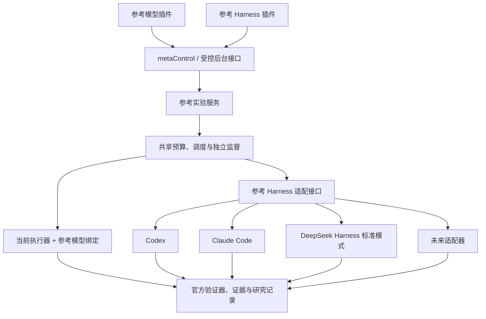

# 参考模型与参考 Harness 插件设计

日期：2026-10-23 · 状态：设计基线，尚未实施 · 需求：[v0.15](../requirements/meta-harness.md) · 实施与验收：[开发计划](../plans/meta-reference-experiments.md)

本文定义两个可独立启用和移除的 Meta 插件，分别开放参考模型和参考 Harness 两个选择维度。参考模型遵循 DeepSeek Harness 的原生模型配置；参考 Harness 首期包括 Codex、Claude Code 和 DeepSeek Harness 标准模式，并保留扩展接口。用户在 UI 中独立开关插件、选择允许的模型和 Harness，并可授权 Meta 在兼容组合中自主取样。两个插件同时开启时支持参考模型 × 参考 Harness，无需第三个组合插件。本文中的新工具、协议、目录和界面均是待实现约定，不表示当前已经可用。

## 1. 研究目的与边界

参考实验为 Meta 提供实际执行经验、解题行为和失败模式，帮助提出可验证的插件改进假设。研究链路为“参考运行 → 阅读轨迹 → 提出机制假设 → 开发执行插件 → 固定 Solver 验证”。Meta 自主决定何时使用、选择哪些任务与版本以及是否追加重复；不强制每轮运行参照，不要求参考模型一定更强，也不将成熟 Harness 预设为成绩上限。

| 类型 | 保持的条件 | 改变的条件 | 主要问题 |
|---|---|---|---|
| 主线候选实验 | 活动固定 Solver、任务与评分边界 | 执行插件组合及配置 | Harness 改进是否帮助固定 Solver？ |
| 模型参考实验 | 所选冻结执行 Harness 的插件、配置、任务工具与环境 | 用户允许的参考模型及其原生调用设置 | 换模型后，行为与结果有什么不同？ |
| Harness 参考实验 | 固定 Solver 及约定调用设置、任务与评分边界 | 已登记的参考 Harness | 同一 Solver 获得不同运行支持后如何表现？ |
| 联合参考实验 | 任务与评分边界 | 参考模型与参考 Harness | 其他 Agent 组合提供哪些可学习的行为和机制？ |

联合参考适合发现思路，不能把结果差异单独归因于模型或 Harness。需要区分两者时，Meta 可按问题选择“固定 Solver/参考模型 × 当前候选/参考 Harness”的四格对照；兼容性、任务样本和预算允许才运行，不自动补齐或穷举。缺少某一格时明确证据缺口，不换另一个模型补成表面完整的对照。

参考模型和参考 Harness 运行均为独立实验，不接管正在进行的主线 Trial，不向其实时提供答案。首期只启动干净执行会话：输入为同范围公开任务材料，不继承 Meta 对话、研究工作区、已知解法、其他运行的轨迹或产物。带研究历史的探查不是首期模式；以后引入须单独标记材料暴露与实验用途。

一次成功是一个观察，重复运行才支持稳定性分析。参考轨迹用于形成假设，不直接证明某个机制有因果收益；任务答案、隐藏数据和按任务身份选择答案的逻辑不得写入通用插件。参考实验遵守任务用途与反馈规则：首期供 Meta 学习的参考提交限于允许反馈的开发任务；不得读取最终保留测试后继续本轮搜索。对插件本身的收益比较仍以独立活动和最终执行成果为单位，本增量不实现自动 Meta 消融调度。

## 2. 两个独立插件

| 项目 | `meta-model-reference` | `meta-harness-reference` |
|---|---|---|
| 中文名称 | 参考模型实验 | 参考 Harness 实验 |
| 模型来源 | 活动批准并冻结的 DeepSeek Harness 原生模型配置引用 | 默认固定 Solver；仅当模型插件也有效时，允许使用批准的参考模型引用 |
| Harness 来源 | 本活动已通过检查的冻结执行候选，包括 H0 | 活动批准的参考 Harness 配置引用 |
| 可选择参数 | 候选、参考模型、任务、重复次数、资源安排、研究目的 | 参考 Harness、可选参考模型引用、任务、重复次数、资源安排、研究目的 |
| 直接依赖 | `metaControl`、原生 tools；自身按需资料和工具说明 | `metaControl`、原生 tools；自身按需资料和工具说明 |
| 业务写角色 | 主 Meta；平台用户经用户接口操作 | 主 Meta；平台用户经用户接口操作 |
| 可移除性 | 不依赖另一个参考插件或其入口文件 | 不依赖另一个参考插件或其入口文件 |

两个开关控制选择权，模型与 Harness 配对由后台统一解释：

| 模型插件 | Harness 插件 | 可提交的参考运行 |
|---|---|---|
| 关 | 关 | 不提交参考实验，主线照常 |
| 开 | 关 | 已选参考模型 × 本活动已检查的冻结执行候选 |
| 关 | 开 | 活动固定 Solver × 已选参考 Harness |
| 开 | 开 | 上述两类，以及已选参考模型 × 已选参考 Harness |

联合运行的 `requiredCapabilities` 同时包含两项能力；这是一笔运行的准入条件，不是两个插件之间的装配依赖。停用任一插件会关闭新的联合提交，另一插件的单维参考仍可使用。仅启用 Harness 插件且固定 Solver 与 Claude Code 不兼容时，UI 显示原因；不能自动换模型或替用户开启模型插件。

使用现有 Cordis 插件、Agent Preset、依赖和生命周期机制，不增加第二套 Meta 插件管理器。两个插件各自拥有入口、契约、说明、可选依赖和测试；建议分别形成 `packages/meta-model-reference/`、`packages/meta-harness-reference/`。已有六个领域插件继续承担原职责，完整 Meta 组合的必需能力不增加这两个插件。

插件通过受控 `metaControl` 提交有限业务操作，不启动宿主命令、不持有供应商密钥、不直接操作数据库。两者不调用对方工具，也不导入 `meta-experiments`、`meta-evidence` 或 `meta-reporting` 的私有实现。公共证据和报告读取后台事实；缺少某个参考插件时，历史结果仍可阅读。

共享参考实验服务是后台普通模块，负责身份、组合兼容性、准入、调度、计量、监督和持久化，不作为第三个必需 Meta 插件。Codex、Claude Code 与 DeepSeek 标准模式是运行适配器，不向主 Meta 再注册一组供应商专用工具。

## 3. 参考模型跟随 DeepSeek Harness 配置

### 3.1 配置权威与选择

参考模型的供应商、模型 ID、模型能力、推理设置及提供方默认值，以用户指定的 DeepSeek Harness 原生 profile 和已配置 provider 为权威。参考插件不建立第二份供应商/模型目录，不添加自己的 API Key 编辑器，也不将“复用 Meta 模型”作为唯一模式。本项目已有的主线 Solver/Meta 供应商设置在本增量中保持原接口；参考模型来源在界面中明确标注，不能把两个目录当成天然相同。

实现应复用锁定 dsh 的原生 provider 发现、模型目录和调用配置解析能力。当前已安装 `0.2.1-rc.2` 的 `dsh-llm` 提供 `listProviders`、`listModels`、`resolveCallConfig` / `prepareCall`；GUI 模型选择依赖 provider 暴露的模型目录。准确调用方式及配置快照可移植性由开发计划 P0 验证，不仅凭配置文件中出现模型名字就认定可执行。

用户在原生 DeepSeek Harness 配置处维护模型；工作台经可信宿主桥读取可选项、来源和可用性，让用户选择一个或多个参考模型及具体设置。该同步只读取和解析，不自动发起真实模型请求。主 Meta 只能使用批准集合中的引用，不能自行提交任意 provider 地址、密钥、配置文件或其他未授权模型。

“使用与 Meta 相同的模型”可作为快捷选择：只有相应原生路由存在且配置可准确匹配时才能解析成功，否则提示用户在 DeepSeek Harness 中配置，不私自回退到项目模型目录。

### 3.2 冻结与恢复

创建活动时保存版本化的 `referencePolicy` 和 `referenceModelBindings`。每个模型引用至少包含：源 profile 标识、dsh/provider 插件版本和内容身份、原生 provider/model 标识、解析后的有效调用设置、能力信息、非敏感配置摘要、配置来源修订和宿主凭据引用。原生缺省值必须由原生解析器物化并记录，不由插件重新猜测或维护默认值表。

“跟随配置”指新活动和创建草稿可从原生配置取得最新可用项；已创建活动使用冻结绑定。重试创建沿用原请求绑定；原生 HMR、模型目录刷新和后台重启不热改活动。首期修改参考模型集合或行为配置需创建新活动；已有凭据可按正常机制续期，不改变模型路由和行为身份。

原生 provider 配置可能包含敏感 header、明文 key、环境引用或可执行配置。解析只在可信宿主内对用户明确配置的 profile 进行；不能执行 Meta 提供的任意 patch。导出给 Runner、UI、证据和组合对象的内容必须脱敏，凭据单独受保护。冻结必要的 provider 插件与非敏感有效配置，凭据引用在启动时由宿主解析；无法安全冻结或恢复的配置应标为不可用，不挂载整个 `$DSH_HOME` 作为替代。

原生配置源关闭后，已受理实验由独立宿主按冻结绑定运行，不依赖工作台在线。冻结的 provider 内容缺失、模型已不可用或认证失败时明确失败，不改成另一个模型。单纯修改凭据不得清除既有用量和失败记录。

### 3.3 在执行 Harness 中使用参考模型

新建 `ReferenceExecutionSpec`，关联原 `sourceCandidateId` 与执行组合摘要，再绑定选定参考模型。保留原候选内容和身份，不修改其 `recipe.json`、Solver 记录、检查结果或旧 Bundle。新的参考执行配置具有独立摘要，不能仍冒充原候选的已测执行身份。

沿用该候选的插件、有效插件配置、任务工具和准确运行依赖；仅替换模型绑定及其必需的 provider 接入。原生 provider 在凭据所在的可信宿主服务中运行，Runner 继续通过受控模型通道访问。此桥接须保留原生配置语义、工具调用、流式错误与用量，不能把原生供应商配置翻译成未经验证的近似配置。

每个参考组合先做兼容与装配检查：上下文、工具调用、输入类型、推理选项、插件的模型假设、计量和中止均可用后才接受真实实验。不兼容则拒绝并说明，不能静默删插件、改提示或降低推理设置来凑成成功对照。模型相关有效设置有差异时在比较记录中呈现。

## 4. 参考 Harness 注册与适配

### 4.1 注册与模型绑定

首期注册 `codex`、`claude-code`、`deepseek-standard` 三种适配器。用户选择已安装并验证的 Harness 配置，可在同一活动允许多个；Meta 在冻结允许列表内按需选择。Codex 先接通，Claude Code 和 DeepSeek 标准模式也是首期必交付项，不能以“预留接口”代替实现。各适配器独立发现和加载，缺少一个不会使其他适配器或模型参考插件不可用。

不指定参考模型时，绑定活动固定 Solver 的准确供应商路由、模型及约定调用设置；指定参考模型时，须同时具有模型插件能力，并从第 3 节批准的原生绑定中解析。后者仍以 DeepSeek Harness 配置为权威，适配器不维护另一份模型目录。适配器须检查准确配置是否可以表达；同名模型、服务商别名或类似推理档位不自动视为相等。不支持时返回不可用，不静默替换供应商、模型或参数。

每次运行只有一个冻结模型绑定。压缩、子代理、重试和其他辅助模型调用同样经过受控通道并计量；首期不得在运行内换成另一模型。若 Harness 必须使用不可配置的辅助模型，或不能阻止模型自动回退，当前配对标为不兼容；“联合参考”允许改变起始模型，不代表允许运行中无记录切换模型。Harness 内部的调用组织、提示和上下文策略属于参照对象，实际设置和额外调用须如实记录。

### 4.2 组合兼容性与自主选择

允许的模型集合包含活动固定 Solver，以及模型插件启用时用户选择的参考绑定；允许的 Harness 集合包含本活动已检查的执行候选，以及 Harness 插件启用时用户选择的适配器配置。固定 Solver × 执行候选属于已有主线，不重复建立参考运行。其余配对须同时满足插件能力、用户组合策略、模型/协议和工具能力、环境、计量、中止及当前资源条件。

“自由组合”是从批准集合的兼容子集中选择，不承诺完整笛卡尔积都可执行。兼容状态至少为 `supported`、`unsupported`、`unverified`、`temporarily-unavailable`；附原因、适配器/配置摘要、核验时间与证据。目录发现不调用真实模型；`supported` 表示已通过规定的工程检查，不保证供应商实时可用。未核验项不能通过真实任务盲试后自动升级支持，需先走显式接入验证；启动前仍复核依赖、凭据与限制。

活动冻结 `selectionMode`：`meta-select` 表示 Meta 可在用户勾选集合的兼容子集中自主选配；`pinned-pairs` 表示用户指定允许配对，Meta 只在这些配对内选择。配对中的“当前执行 Harness”是本活动已检查候选范围，提交时必须解析为准确 `sourceCandidateId`，不能用可变的 latest 名称。两种模式均不要求运行所有组合；Meta 自主决定研究问题、任务、候选、时机、重复和停止，不能增加批准集合或更改模式。用户若要单次手动运行，通过同一后台准入接口提交明确配对。

`reference_harness_list` 及 UI 从同一兼容性服务读取配对信息。Meta 每次提交一个明确模型 × Harness 配对及简短研究目的，不提交“自动遍历整个列表”的隐式展开任务。选择理由记录在研究链中，帮助用户理解为什么参考该组合；不强制固定顺序、配额比例或四格对照。

### 4.3 统一适配接口

下面是目标接口职责，不是已发布 SDK；参数与返回需形成独立版本契约。

| 操作 | 输入与结果 |
|---|---|
| `describe` | 返回 Harness 身份、模型/协议/路由约束、原生绑定映射能力、任务工具能力、配置 schema、流式事件、计量、中止与恢复支持 |
| `prepare` | 接收冻结模型、任务环境、Harness 配置和限制；校验依赖、生成独立运行配置、返回有效能力及条件差异；默认不调用真实模型 |
| `start` | 接收后台颁发的单次运行身份、资源租约和冻结配置；启动一个受监督运行，返回可恢复核对的执行句柄 |
| `status` | 核对进程、容器及运行阶段，返回实际状态和事件游标；不猜测评分是否已经开始 |
| `cancel` | 幂等中止当前运行及其子进程/子会话，返回清理和残留状态 |
| `collect` | 保存原始事件、轨迹、文件产物和用量，返回公共结果描述与完整性标记；不自报官方成绩 |

适配器登记至少包括 ID、实现版本、内容摘要、准确 Harness 版本、依赖锁/镜像、配置 schema 及上述能力声明。任务接入、默认系统提示、工具列表、技能、额外 patch 和平台差异进入冻结身份。禁止 `latest` 或宿主当前安装版本成为隐式运行依赖。

以后增加 Harness 时，仅需新增受信适配器、注册项及通用契约测试；不用修改两个 Meta 插件的工具形状或 Studio 的公共组合选择流程。Harness 配置是经过 schema 校验的数据，Meta 不能借此提交任意宿主启动命令或动态加载模块。安装和授权属于用户/平台维护操作，首期不实现插件市场或自动下载未知 Harness。

### 4.4 Codex 适配

首期优先评估 Codex CLI 非交互 `codex exec --json`，采集其公开 JSONL 事件、命令/工具执行、文件变化、最终输出和用量。若必要的中止、工具挂载或持久状态无法由该入口可靠实现，可改用官方 SDK/app-server，但须保留同一适配契约和冻结身份，并记录选择依据。公开事件不等于完整内部推理；未暴露信息标未知。

Codex 使用专用配置与隔离工作区，不继承个人历史会话、全局技能、未声明 MCP、用户项目指令或默认联网权限。保留已声明的 Harness 内建行为；确需加入的任务说明和工具桥如实记录。通过任务桥提供同一 main/qsim 能力和产物提交路径；宿主仓库、官方 verifier 源码、隐藏材料和容器管理接口不能暴露给执行会话。

选定模型的准确路由、全部辅助调用的计量、自动重试、取消传播及 token 未知状态，是接入门槛。只有最终 CLI 用量且无法执行请求准入时，不能伪装成逐请求已计量：先实现受控网关或等效可核验通道。不能满足活动限制的配置必须在启动前拒绝；不通过放开预算或偷偷删减 Harness 核心行为获得“可用”结论。

### 4.5 Claude Code 适配

首期评估锁定版本的非交互 CLI `claude -p`，使用 `--output-format stream-json --verbose` 采集公开事件；需要增量内容时按该版本文档使用 `--include-partial-messages`。若工具桥、取消或恢复必须使用官方 Claude Agent SDK，可在相同适配契约下选择 SDK，并记录其依赖和实际加载的 Claude Code 版本。事件、工具结果、会话标识、产物、最终状态和用量均归档；公开输出不等于完整内部推理。[官方非交互接口](https://code.claude.com/docs/en/headless)

通过专用隔离环境和明确配置提供任务工作区、MCP 任务桥与权限。CLI 提供 `--mcp-config`、`--strict-mcp-config` 和 `--settings` 等配置入口；其中 `--settings` 不能单独证明未继承其他设置，必须核验最终生效来源。不得继承个人会话、CLAUDE.md、技能、hooks、插件、连接器或未声明 MCP；Harness 内建提示和工具保留，任务适配差异进入身份。无交互运行遇到权限或认证缺口须可诊断地结束，不能等待人工输入或用全面放权代替任务隔离。[CLI 参数](https://code.claude.com/docs/en/cli-reference)

显式绑定准确模型和 provider 路由，不使用浮动模型别名、默认账户模型、自动切换组合或备用模型链。DeepSeek Harness 中存在某模型，不代表 Claude Code 就支持其协议；模型名和服务地址可配置也不构成兼容证明。原生绑定到 Claude Code 有效设置的映射须有工程证据，无法等价表达即拒绝该配对；禁止悄悄改用 Claude Code 的默认模型。[模型配置](https://code.claude.com/docs/en/model-config)

与其他适配器相同，所有主/辅助请求通过受控准入和用量审计，测试压缩、子代理、重试及模型回退不会绕过绑定。取消验证覆盖 CLI/SDK、子进程、工具和仍在运行的子会话；不能只根据主进程退出推定已清理。版本无法满足这些条件时保留不可用项，先补齐接入能力。Claude Code 已安装或单次得到文本回复，均不能作为完整接入的验收结论。

### 4.6 DeepSeek Harness 标准模式适配

标准模式是锁定上游的完整通用 Agent 组合，不是本项目 H0 的 `sdk-minimal`，也不是加载 Meta 六插件的研究 Runner。以当前锁定 `0.2.1-rc.2` 的原生 `sdk` profile（`dsh-base` + `dsh-sdk-app`）作为首期无界面入口基线；通过上游配置树和实际加载回执核验。未来升级使用新的 Harness 配置身份，不重写旧参照。

保留标准组合的原生上下文、文件、终端、工具及适用委派机制；使用本次冻结模型绑定，并将一切模型调用纳入同一租约。执行 profile 使用专用 `$DSH_HOME`，不叠加开发宿主的任意 home patch、私人技能或 MCP。第 3 节原生配置只提供模型来源；标准 Harness 本体仍从固定上游基线解析，两者不能混同。

任务环境由共同适配层提供：原生文件/终端可访问范围映射到本次授权任务工作区，qsim 与官方提交接口走正式工具桥。不得仅在任意本地文件夹运行成功便宣称已接入 Harbor。文件可见性、shell 状态、工具返回、网络、子代理并发和提交产物必须有集成证据。

为任务隔离或不可用依赖进行的配置调整逐项记录目的、实际差异和影响；若禁用了标准组合的重要能力，展示为“DeepSeek 标准模式＋已声明适配/限制”，不得冒充未改动的上游默认模式。不能用现有 H0 更名替代该实现。

## 5. 共同实验条件与执行权威

模型、Harness 和联合参考实验均复用活动锁定的任务源码和镜像身份、公开输入、测量资源、任务原有时限、官方验证器及结果收集规则。每次运行使用新任务实例、容器/工作区、会话和产物目录；不同参照不共享上一轮测量结果或写入文件。若环境支持 seed/实例身份则保存；不支持时记录随机性，不能宣称完全相同样本。

各 Harness 可以有不同的内部提示、上下文、原生开发工具和重试策略，这些是被比较的内容；任务可访问能力、评分、数据暴露及用户限制是外部条件。版本/依赖、CPU/内存、工具与联网差异、初始材料、时长与用量差异进入 `comparisonConditions`，不能凭“同一模型名”忽略差异。

运行监督和官方评分由固定基础设施负责。Harness 退出零码、最终消息和插件声明均不代替官方结果。收集失败、官方缺分、取消和中断保留原件和原因；参考运行按活动绑定的任务完成规则投影结果，但仅进入对应参考分组。

## 6. 记录、身份与证据

采用独立的 `ReferenceBatch`、`ReferenceRun` 业务记录，与主线候选/Trial 分开关联，复用监督和账本实现，不复制一套运行状态逻辑。所有新契约须有版本；建议首版策略标识 `meta-reference-v1`，正式实现时发布对应 schema，不修改既有活动协议。

| 记录 | 必需内容 |
|---|---|
| 活动参考策略 | 两插件是否装配、插件准确内容/契约、批准模型与 Harness 绑定、selectionMode、指定配对（如有）、插件分项额度、用户运行期启停修订 |
| 参考批次 | 活动、发起者、requestMode、requiredCapabilities、研究目的与选择理由、单一模型/Harness/来源候选引用、任务与重复次数、兼容与准入快照、幂等请求身份 |
| 参考运行 | 批次、任务与用途、重复序号、独立执行配置摘要、启动身份、状态/阶段、时间、租约、原始和派生结果、失败原因 |
| 执行条件 | 解析后模型、Harness/适配器版本、任务镜像、输入摘要、工具/技能/网络能力、资源与截止、配置差异 |
| 证据清单 | 原始事件/轨迹、命令和工具结果、产物、官方评分、用量审计；路径、摘要、大小、来源、完整性和可见范围 |
| 研究关联 | 引用的参考运行和证据、观察事实、机制假设、验证问题、后续候选与主线 Trial；保留修订 |

`requestMode` 区分 `model-reference`、`harness-reference`、`joint-reference`，分别要求模型、Harness、两项能力。模型选择使用“活动固定 Solver / 原生参考模型引用”的明确判别形式，Harness 选择使用“冻结执行候选 / 参考 Harness 配置”的明确判别形式；不接收自由文本模型名或启动命令。联合运行只有一个 ReferenceRun，不为两个插件各复制一份。

请求模式与科学比较分开：比较记录保存对照运行/候选、实际模型和 Harness 身份是否相同、其他条件差异及可比较范围。即使选了一个与固定 Solver 相同的参考绑定，仍按显式模型选择检查能力，但不能在分析中声称实际换了模型。缺少准确同模型核验时标为待核验，不能标“仅 Harness 差异”。

同样的冻结配置可复用内容对象；重复运行仍产生不同记录，不因成绩相同合并。新执行身份不覆盖 `bundleId`、旧报告或旧选择。共享安装、工具缓存、私有配置和证据的生命周期分开；历史读取不依赖插件仍安装。

完整证据沿用只读材料索引、SHA-256、原件路径与字符片段定位。工具和通知只返回有界摘要及路径；大轨迹、部分输出和未知状态均可核对。新增来源类型须明确为参考运行，不能伪造主线 Trial ID。Meta、研究子代理和审查者按既有资料权限读取；参考 Runner 自身只见任务所需材料。

## 7. Meta 工具与后台接口

下列名称为拟定接口。两插件分别注册自己的工具和说明，公共查询由后台实现，不能因另一插件卸载而失效。

| 插件 | 工具 | 职责 |
|---|---|---|
| 模型参考 | `reference_model_list` | 返回活动批准的原生模型引用、来源修订、能力及与所选执行候选的兼容性 |
| 模型参考 | `reference_model_submit` | 指定来源候选、模型引用、任务、重复、研究目的与执行安排，提交参考批次 |
| 模型参考 | `reference_model_status` / `reference_model_cancel` | 查询本类批次/运行及证据路径；显式取消本类工作 |
| Harness 参考 | `reference_harness_list` | 返回活动批准的 Harness 配置及与固定 Solver/已授权参考模型的兼容配对、策略和原因 |
| Harness 参考 | `reference_harness_submit` | 指定 Harness 引用、任务、重复、研究目的与执行安排；省略 modelRef 使用固定 Solver，显式 modelRef 提交联合参考并校验两项能力 |
| Harness 参考 | `reference_harness_status` / `reference_harness_cancel` | 查询本类批次/运行及证据路径；显式取消本类工作 |

提交参数使用对象，包含稳定 `idempotencyKey`、预期策略修订、任务列表、正整数 repeats、researchQuestion、已有可选 researchRefs 和执行条件。后台校验活动、插件授权、模型/Harness 绑定、候选和任务范围、兼容性及资源后事务受理；返回批次/操作 ID、受理状态、执行条件及完整文件路径。

保留两组工具的唯一归属：当前执行候选的模型参考经 `reference_model_submit` 提交，外部 Harness 的单维/联合参考经 `reference_harness_submit` 提交。后者在模型插件未安装时仍可独立使用，显式传入 modelRef 则拒绝。它只调用共享后台，不导入或调用模型插件；联合能力检查由实际请求和活动授权推导，不信任发起者自报“仅 Harness”标签。Harness 工具查询/取消覆盖其联合批次，公共历史读取也能按所需能力查找记录；停用任一能力时由后台统一处理关联工作。

同键同参数重放原结果；同键不同参数冲突。受理成功但响应丢失时先按原请求身份核对，不创建第二批。插件关闭后可返回此前请求的已存回执，但不能由重放启动新的工作。错误区分未安装、已停用、模型或 Harness 不兼容、原生配置失效、缺依赖、权限、修订、预算和暂时不可用。

后台另提供用户身份的配置发现、活动启停、历史列表、比较和取消接口；Meta 无权改变批准模型/Harness 集合或启用自身未装配的插件。服务校验真实角色、活动冻结能力与运行期授权，不信任模型自报 pluginId。普通研究子代理、停止审查者和参考执行会话不获得参考提交权限。

## 8. 预算、排队与生命周期

### 8.1 一份总账与统一计数

参考实验不获得额外预算。主线与参考运行共享活动总墙钟、token 软阈值、实验次数、轮次、最高并发、截止和收尾策略。两插件可另有用户设置的次数/token 上限，均是总额度内的子额度；未设置子额度表示只遵守总额度，不表示零额度，也不隐式扣固定比例。

启用本策略的新活动中，每个受理的参考批次同样占一个 `maxRounds` 名额；一个批次只有一个模型 × Harness 配对，换配对需新批次。计划任务数乘重复次数预留 `maxTrials`，开始启动才消耗实际尝试次数，未启动取消可释放预留，已经受理的轮次不退回。主线与参考分别展示计数，但总额度在同一事务校验；旧活动维持原计数。现有单批大小约束继续适用。基线准备及最低覆盖要求不变，所选任务的 H0 最低名额先按原流程预留，不被参考提交挤占。预算与并发允许时参考实验可与已受理 H0 并行，不强制等待整个基线结束。

参考模型及三个参考 Harness 中的全部模型请求、压缩、子代理和重试归到相应 ReferenceRun；主 Meta 分析参考材料仍归 Meta。联合运行只占一份活动轮次、次数、token 和并发槽位；若设置了两插件子额度，该运行同时受两项上限约束，不能只按发起工具绕过模型额度。子额度是对同一账本按 requiredCapabilities 查询的重叠限制，不是两笔支出。成本总览用模型参考/Harness 参考/联合参考三个互斥分组；按插件查看时明确“包含联合运行，不可相加”。输入、缓存、输出和未知用量保持现有口径，不用合成零值抵消未知预留。

主线与参考共用并发槽位和请求预留。计划影响未来批次，已经受理的条件保持；需要缩短排队任务时通过有修订的明确条件接受操作处理，并记录参考类型，不借用虚构 Trial ID。临时预留不足进入有原因的等待；不可执行的软/硬限额组合在启动前拒绝，不能以等待无期限掩盖不兼容。适配器内部并发和资源上限也须公开并受租约约束。

### 8.2 持久监督与恢复

状态至少区分 reserved、launching、running、collecting 与终态 finished/failed/cancelled；结束事实不足另标待核实。具体状态映射复用既有监督语义，不能凭缺分立即判结束。独立监督器持有执行身份、截止、进程/容器和归档，Meta 或 UI 退出不使实验失去控制。

后台重启先核对已受理操作、运行句柄、外部进程和收集游标。查询和收集可以幂等重试；结果未知的 start、命令或整个任务不自动重放。Harness 支持的会话恢复须经过适配器声明和测试，并保持同一计量身份；否则归档中断，下一次重跑由 Meta 显式提交新实验，计新次数。平台的 Meta 技术恢复不等于参考任务免费重试。

完成事件进入现有持久通知/ACK 流程。活动空闲判断、待处理工作、暂停、截止、最终用量和停止审查快照必须包含参考工作；有参考实验或收集在途时不能因主线空闲而提前完成活动。稳定停止只看固定 Solver 的主线证据；耗尽审查可读取参考观察，但参考成功不满足主线稳定条件。

## 9. 独立启用、移除与运行中停用

新活动的两个开关分别决定冻结组合是否包含该插件。两者均是可选能力，不隐式启用、不替对方加载；四种组合都必须通过装配和正常主线流程。关闭时不注册该插件工具、提示、SDK 导航和主动回调；公共核心和 UI 不静态导入它的私有文件。未选择某参考 Harness 时，不要求安装其运行依赖，包括 Codex 和 Claude Code。

从安装清单和组合中移除一个插件后，构建、启动、创建活动、H0、研究、报告及导出仍可用；删除插件包目录的测试须证明没有残留导入。后台同时撤销其新请求能力，不能仅隐藏工具而留下可由终端调用的有权接口。固定基础设施仍保留通用账本、历史读取和在途监督，不因插件卸载丢失事实。

已创建活动的冻结组合不可就地改写。运行中关闭使用用户权限更新 `capabilityRevision` 并记录时间与原因：拒绝依赖该能力的新提交和新请求的重放；按 requiredCapabilities 取消所有相关排队运行（含联合运行）并释放预留，不能只按发起插件筛选。已开始运行默认按原租约完成，其已授权请求准入继续计量；也提供显式“同时停止运行中参考实验”。UI 列明受影响的单维与联合运行及仍在执行的数量，不能把“停止新运行”显示成“全部已停止”。取消计数按第 8 节处理。关闭与受理/领取并发必须在事务中裁决；原请求回执查询仍可用。

原生作用域可安全卸载时释放工具/监听；不能安全热卸载时，在受控会话续接时应用有效能力列表，后台立即拒绝新增工作。不得为关闭一个插件中断另一插件独立进行的单维参考或主线实验。重新启用仅限原活动已冻结的插件和绑定，使用用户操作记录，不重置预算或复活已取消任务；原组合没有该插件时创建新活动。

产品内对当前活动的卸载/移除操作先执行上述停用协议，再移除有效注册；安装清单移除决定未来活动的装配。手工删除工作仓库源码不等于通知已冻结的后台活动停用，界面须明确有效活动与影响范围。原包被移除后，历史只读视图不加载其代码；旧活动恢复只使用已归档的准确资产，缺失时明确不可恢复，不套用最新版。运行期停用状态跨恢复保留。若用于比较插件有无收益，应使用独立干净活动；中途关闭不会消除 Meta 已经阅读的参考知识，不能冒充未暴露参照的消融组。

## 10. 轨迹比较、研究记录与界面

### 10.1 创建活动与组合选择

创建页的“参考实验”区域提供两个独立开关，默认关闭。模型插件打开后，可从 DeepSeek Harness 原生目录多选模型，显示 profile、配置来源和有效设置；Harness 插件打开后，可多选 Codex、Claude Code、DeepSeek 标准模式及其准确配置。未安装或不可用项显示原因，插件关闭不触发安装，也不替用户启用另一插件。

选择控件遵循以下顺序，不要求填写适配器内部字段：

1. 开启需要的插件，勾选允许的模型和 Harness。
2. 选择“由 Meta 自主选择”或“我指定组合”。前者授权选定集合内的兼容配对；后者只授权在矩阵中勾选的配对，Meta 仍自主安排研究任务和时机。
3. 检视组合矩阵：行是固定 Solver/已选参考模型，列是当前执行 Harness/已选参考 Harness；主线格标为主线，其他格显示可用、不支持、待核验或暂不可用及原因。只开放一个维度时简化为列表，窄屏使用配对卡片。
4. 查看沿用的活动总预算、可选插件子额度，以及“按需选择，不自动遍历”的说明，再创建活动。保存草稿/刷新目录不提交实验、不调用模型。

策略有已选但暂不可用配对时允许保存草稿并明确提示；创建活动时，每项启用能力至少要能参与一个已核验兼容配对，联合配对可同时满足两项能力。不能把不兼容选择静默移除后提交。兼容列表大时分页/筛选，客户端不枚举并启动所有配对。用户指定配对、选择模式、Harness 集合与模型绑定一同冻结；首期修改这些研究条件需新活动，运行期仅按第 9 节停用/恢复原能力。

草稿中的“当前执行 Harness”以选定起始配方的准确内容进行兼容预检，不要求尚未创建的 candidateId；活动创建后仍按正式流程冻结和检查 H0。后续新候选须单独通过与参考模型的兼容检查，不能把起始配方的检查结论自动授予全部候选。提交时必须有准确且已检查的来源候选。

运行页展示当前有效开关、冻结允许集合、组合选择模式、Meta 每次选择的配对与理由、排队/运行状态、停止范围和实际消耗。用户可按相同策略单次手动提交明确配对；记录真实发起者。公共客户端负责策略修订、幂等与过期响应隔离，前端禁用态不能代替后台能力检查。

### 10.2 轨迹阅读与研究解释

新增参考实验阅读入口，按模型参考、Harness 参考和联合参考分类，支持按模型、Harness、任务和发起者筛选。每条记录先展示研究问题、模型/Harness 可读名称、选择理由、结果、耗时与用量、重要条件差异；再进入批次、逐任务结果、轨迹与产物。主线版本成功率矩阵继续只统计原 Solver 候选，参考数据在独立分组并排展示，分母和样本覆盖明确。

与主线或其他参照并排比较时，显示“同模型 / 异模型 / 待核验”及准确对照对象；同时改变模型与 Harness 的结果标注“联合变化，不能单独归因”。可并排读取同任务的四格轨迹，但未运行/不支持的格子保持为空，不自动补跑。用户能从选择理由看到参考目的，从研究修订看到哪些观察成为插件假设，从主线验证看到是否实际有效。

比较维度包括首次有效操作、工具使用和错误修正、测量与分析安排、上下文处理、产物提交、资源消耗。没有可靠事件的阶段标未知，不让模型补造时间线。优先按任务、工具事件、产物和阶段定位；跨 Harness 不承诺消息序号一一对应。

沿用 `research_save` 保存观察与假设，扩展准确的 referenceRun/参考证据来源；candidate_freeze 可通过研究修订关联其启发，report_get_facts 冻结本次引用的参考事实。参考输入、Meta 解释与主线验证分别呈现，保留失败和反例。candidate_retain 仍只接受合法主线候选；参考结果可解释研究取舍，不能替代该候选的验证或直接进入成绩。

无插件且无历史时不显示无效操作；卸载后仍有历史时保留通用只读记录。参考解释写入已有研究/报告体系，页面加载不调用模型生成。参考模型、参考 Harness、两个 Meta 插件及其历史轨迹不自动进入 Solver 独立执行项目；真正采纳的执行插件仍通过主线冻结与导出规则交付。

## 11. 实施落点与兼容

| 位置（拟定） | 责任 |
|---|---|
| `packages/meta-model-reference/` | 模型参考工具、契约、说明、原生配置选择所需宿主扩展声明 |
| `packages/meta-harness-reference/` | Harness 参考工具、契约、说明和适配器配置导航 |
| `src/control/reference/` | 策略/原生模型绑定、兼容配对、批次、两维能力授权、共同预算、监督关联、用户操作 |
| `src/execution/reference/` | 可独立监督的参考执行协议、当前执行器模型绑定及可选适配器；不导入 control/evidence/reporting |
| `schemas/` | 参考策略、配置、批次、运行、回执和适配器契约 |
| `src/evidence/`、`src/reporting/` | 参考来源、统一事实与分组比较、研究关联、历史读取 |
| 公共客户端、桥与 Studio | 原生配置发现桥、独立开关、多选/组合策略、兼容矩阵、运行启停、参考实验和证据阅读 |

当前 `meta_native_composition.py` 只允许主包内模块，`meta_contracts.py` 和 `domain-tools.mjs` 使用集中契约。扩展受信可选包的声明入口、内容依赖闭包和分插件契约装配：未安装且未选中时不导入；已选中缺包或依赖时明确失败；同名工具、缺服务和契约冲突拒绝。原生插件生命周期继续负责注册，不另建并行插件执行框架。

新增能力以新协议绑定/独立版本标记进入新活动，保留已有 v2/v3/v4 工具和报告资产。旧活动缺参考策略等价于未启用，旧候选、评分、报告、原件、预算和幂等回放不迁移。报告扩展引用类型需版本化，不能要求旧 schema 突然接受新字段。工程实现不得为本增量修改全部历史执行模型规则。

## 12. 完成边界与依据

完整交付须同时覆盖两插件、三个首期 Harness、原生模型配置绑定、用户选定范围内的 Meta 自主配对、联合参考、统一预算/恢复、证据/报告/界面、独立移除和旧版本回归。三个 Harness 各自至少有实际验收的兼容模型配对，不要求任意模型都能在三者运行；真实不支持的组合明确保留。代码存在、脚本 provider 通过、真实 Harness 装配、真实模型调用、官方评分和效果提升分别报告；测试通过不要求科学成绩提升。开发工作包和逐项验收见[开发计划](../plans/meta-reference-experiments.md)。

技术依据：

- [项目插件组合边界](meta-harness-composition.md)、[通用 Agent 与证据](meta-agent-and-evidence.md)、[版本与导出](plugin-versioning-and-export.md)、[资源计划](../plans/meta-resource-planning.md)。
- 锁定安装的 `@deepseek-ai/dsh@0.2.1-rc.2` README、`dsh-llm` README/类型、`dsh-base` 和 `dsh-sdk-app` 配置：原生 profile、模型目录、调用配置解析与标准 SDK 组合；实施时从对应锁定包核验，不将本机 `node_modules` 路径作为交付依赖。
- [Codex 非交互模式](https://learn.chatgpt.com/docs/non-interactive-mode)、[MCP 接入](https://learn.chatgpt.com/docs/extend/mcp?surface=cli)、[官方 Harness 集成入口](https://developers.openai.com/blog/codex-as-a-platform)：2026-10-23 查阅。文档说明入口能力，不证明本项目的固定 Solver、隔离和计量已经适配完成。
- [Claude Code 非交互模式](https://code.claude.com/docs/en/headless)、[CLI 参数](https://code.claude.com/docs/en/cli-reference)、[模型配置](https://code.claude.com/docs/en/model-config)：2026-10-23 查阅。用于确定待验证接入方案；实施时锁定版本重新核验，不能从支持模型参数推断任意原生 provider 已兼容。
